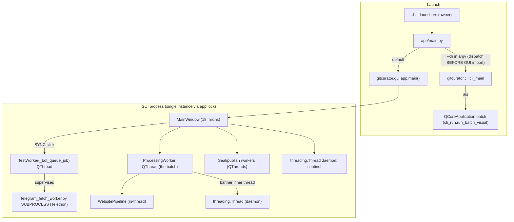

# 02 — Current Architecture

> All statements cite `app/…:line` at v0.91.0 (HEAD 8fd4179). Mermaid diagrams describe what
> exists; nothing here is proposed design (that is doc 04).

## 1. Process and entry-point model



- Entry shim: `app/main.py:43-50` — `--cli` dispatch happens **before** importing PyQt6 so
  `--cli --status` never pays the widget-stack import cost.
- GUI entry: `gui/app.py:387-470` — single-instance lock (`app.lock` with PID liveness healing,
  `app.py:393-440`), `QApplication`, Fusion style, `MainWindow`, `app.exec()`.
- CLI entry: `cli/cli.py:1709-1773` builds the same `ProcessingWorker` inside a
  `QCoreApplication` (`cli/cli_run.py:239-504`), including the post-batch seals and the Phase-5
  "mark bot messages read" step.
- Telethon is the **only subprocess** (`integrations/telegram_fetch_worker.py`) with a JSON-line
  stdio protocol and `__NEED_CODE__`/`__NEED_PASSWORD__` auth markers; supervised by
  `subprocess_runner.py` (idle 180 s / hard cap 1,800 s / auth grace 360 s).

## 2. Layer map

```mermaid
flowchart LR
    subgraph Pure["core/ — pure stdlib, Qt-free, injected deps"]
        LINKS[links] --- ST[storage/dryrun] --- NB[note_builder] --- NS[note_state]
        NS --- NR[note_reads] --- TAX[taxonomy] --- WP[website_pipeline + website_state + website_directory]
        WP --- VF[web_fetch / web_extract] --- CT[chrome_tabs / hand_delivery]
        VS[vault_scan / vault_hygiene / repo_banish] --- SR[sync_review]
        MIR[mirror + linking + embeddings + recall] --- CC[connection_check / net_guard / netctx]
        LLM[llm_client] --- UC[user_config] --- PR[prompts]
    end
    subgraph IO["integrations/ + cloud/ — the outside world"]
        TG[telegram subprocess + runner] --- VS2[vaultseal] --- GR[goodrepos + repo_radar]
        CS[cloudflare_sync (Worker client)] --- DS[directory_sync (publish)] --- CONF[banish/scan confirm]
    end
    subgraph UIL["gui/ + cli/ — shells"]
        WIN2[MainWindow + mixins] --- PW2[ProcessingWorker + worker mixins] --- WJ[worker_jobs]
        CACHE[cache_db + vault_index + link_tracker] --- CLI2[cli package]
    end
    UIL -->|"calls"| Pure
    UIL -->|"calls"| IO
```

Dependency direction is strictly one-way: gui/cli → integrations/cloud → core. The only cycle-break
devices: `mirror_keys.py` (shared leaf so mirror↔linking stays acyclic, `core/mirror_keys.py:1-12`)
and `note_reads`' lazy import of `website_pipeline` for the banish grammar
(`core/note_reads.py:127-140`).

## 3. Startup sequence (GUI)

1. `gitcurator.gui.app` import: version stamp to stderr (suppressed under `--cli`, `app.py:31-38`);
  Telethon deliberately **not** imported (cold-start saving, `app.py:155-163`).
2. `main()` → lock → `QApplication` → `MainWindow()` (`gui/main_window/window.py:115-451`):
   - `load_config()` (merge with `CONFIG_EXAMPLE`; user-config fill from `Documents/.gitcurator`;
     credential strip for display — `gui/main_window/vaults_config.py:209-258`).
   - `initUI()` (`gui/main_window/ui.py:179-2100`): Inter fonts → all 11 settings pages → top bar
     (Net/AI/Proxy sentinel labels) → CTA band (SYNC, Fast Sync, Scan, Test Connectivity) →
     progress row (`SegmentBar`) → Progress Logs card (`LogView`) → More menu (~24 actions) →
     `SettingsDialog` → mirror timer 200 ms → theme.
   - Retry-queue truth pass + LinkTracker manifest reconciliation (`window.py:194-331`).
   - Timers: sentinel 60 s (first pass at 1,200 ms), telegram watchdog 60 s; single-shots:
     llama.cpp autodetect 1,500 ms, review-backlog 2,500 ms, quiet vault heal 2,000 ms, repo radar
     3,500 ms.
3. **The quiet-open law**: nothing measures the network at startup — the sentinel's daemon thread
   is the only ambient probe (`ui.py:2092-2099`, `window.py:544-594`).

## 4. The SYNC golden path (primary workflow)

1. **Click SYNC** → hero state machine (`sync` → `fetching` → `process` → `running`,
   `gui/main_window/hero.py:423-489`); offline guard modal if sentinel says offline
   (`hero.py:140-155`).
2. **Fetch**: `check_bot_queue` acquires the Telegram lock, spawns
   `TestWorker(_bot_queue_job)` (`gui/worker_jobs.py:93-391`) which runs the Telethon subprocess,
   then **on the worker thread** classifies links against both vaults (VaultIndex rebuilds, dead
   sets, settled ledgers, platform/blocked/self domain law) → result lands via queued
   `finished_signal`.
3. **Flip to PROCESS**: pending repos/websites counts; caught-up path instead runs the drift seal
   (v0.89.0: caught-up sync seals dirty vaults + publishes directory, quiet when clean,
   `hero.py:345-373`).
4. **Batch**: `_start_worker` (`gui/main_window/processing_control.py:1686-1765`) connects 8 queued
   signals and starts `ProcessingWorker`.
   - GitHub loop (`gui/processing_worker.py:947-1719`): rate-limit guard → canonicalize → gates
     (dead/dismissed/settled/vault-index) → `g.get_repo` → banner thread → LLM analyze
     (`gui/worker/llm.py:439-720`, 3-attempt ladder) → note build/write → cache/note_state/manifest
     updates → 0.5 s inter-item delay.
   - Websites phase (`gui/worker/website_phase.py:95-515`): constructs `WebsitePipeline` with
     injected `llm_call`, `fetch_fn`, `banish_confirm`; gates; retries; per-link progress via
     `_wp_advance`; then directory rebuild + inbox prune.
5. **Completion chain** (`processing_control.py:1870-2230`): hero reset → optional folder backup →
   GitHub seal → GoodRepos publish → websites seal → manual seal → Phase-5 CLEAR (mark bot messages
   read only if the manifest verifies all-clear) → hand-delivery offer → Chrome tab-retry offer →
   scorecard modal + chime.

## 5. State and persistence map

| Store | File | Owner | Key tables/keys |
|---|---|---|---|
| `CacheDB` | `app/cache.db` | `gui/cache_db.py:116-288` | `processed_repos`, `failed_repos`, `decommissioned_repos`, `repos_settled`, `cache_meta` (+ dead `checkpoints`) |
| `NoteStateDB` | `app/cache.db` | `core/note_state.py:182-436` | `note_state`, `corrections_log`, `note_state_dismissed` |
| `WebsiteStateDB` | `app/cache.db` | `core/website_state.py:71-755` | `websites_processed`, `website_retry_queue`, `dismissed_urls`, `website_state_meta`, `websites_settled` |
| `NoteReadCache` | `app/cache.db` | `core/note_reads.py:297-592` | `note_reads` (parse cache, version marker `v=4`) |
| `EmbeddingStore` / `LinkStore` | `app/cache.db` | `core/embeddings.py:260-338`, `core/linking.py:205-316` | `embeddings`, `link_suggestions` |
| `DeferredLog` | `app/sync_review.db` | `core/sync_review.py:437-708` | `sync_deferrals` (never-delete ledger) |
| `ErrorReporter` | `app/error_outbox.db` | `integrations/error_reporter.py` | `error_outbox` |
| Config | `app/config.json` | merge-law writes | 109 keys (`constants.py:122-305`) |
| User memory | `Documents/.gitcurator` | fill+mirror, chmod 600 | credential + vault families |
| Link manifest | `<vault>/links_manifest.json` | `gui/link_tracker.py` | 5-phase no-link-lost ledger |
| Telegram session | `app/session.session` | Telethon SQLite | (accepted break in Go — ADR-0004) |
| Chrome state | `app/chrome-profile/`, `chrome-proxy-memory.json`, `chrome-real-link` | `core/chrome_tabs.py` | dedicated profile + route memory |

All SQLite stores follow the **locking law**: own connection, `timeout=30`, `busy_timeout=30000`,
`check_same_thread=False`, per-instance `threading.RLock`; `CacheDB`/`DeferredLog` set
`journal_mode=WAL`, `synchronous=NORMAL`.

## 6. Concurrency model (as built)

- **One batch at a time** (GUI Telegram lock + `_batch_running`); seals refuse to start while a
  batch runs; drift seal refuses while any seal worker runs (`backup_seal.py:820-831`).
- Worker→GUI communication is **queued signals only** (`progress_updated`, `status_updated`,
  `log_message`, `code_requested`, `disk_full_signal`, `llm_failed_signal`, `model_changed`,
  `finished_signal` — `gui/processing_worker.py:101-112`).
- Interactive round-trips are `threading.Event` + signal: login code (300 s), scan confirm
  (300 s), LLM failure decision (600 s).
- GUI→worker is cooperative: `worker.stop()` sets `is_running=False`; long waits are chunked
  (5 s rate-limit sleeps, 1 s disk-full spin) so Stop lands between items.
- The **coalesced log**: `log_message` appends to a pending queue (8.7 µs/line measured); a 120 ms
  single-shot timer flushes ≤250 rows in one cursor edit block; document mirrors the cache's
  rendered subset (`gui/main_window/ui.py:65-86, 2471-2701`).
- LLM calls are wrapped in a 1-worker `ThreadPoolExecutor` wall-clock timeout (threads can't be
  killed in Python; the leaked thread's late result is discarded — `core/llm_client.py:89-119`).

## 7. Error propagation and logging

- **Never-raise discipline** at every integration boundary: `process_link` never raises
  (`website_pipeline.py:4312-4345`); seal/publish failures return result objects; connection checks
  degrade to result lines; the sentinel never raises.
- One failing item never stops the batch; one failing vault never stops the others (SPEC §2.7).
- User-visible errors are honest sentences (e.g. "the challenge needs a live browser; the fetcher
  cannot solve it", `web_fetch.py:239-240`); the log desk carries levels with filter chips.
- Rotating file logs (`logs/processing_<ts>.md` + `.txt`, `gui/app.py:234-255`).

## 8. Known architectural weaknesses (observed, labeled)

1. **Duplicated import preambles** — ~45-line copy-pasted import headers in 19+ files
   (mixin-split residue; ~1,000 LOC of dead imports). Cosmetic, but hides real dependencies.
2. **`gui/app.py` is 90% tombstones** — kept as a compatibility facade (by design, AGENTS.md).
3. **Cross-module private-API coupling**: `repo_banish` uses `website_pipeline._banish_note_file`
   and `_parse_review_frontmatter` (report 1-b) — port as shared helpers in Go.
4. **Two queue-fetch paths** (Telethon bot-chat iteration vs Worker `/api/pending`) coexist
   (`worker_jobs._bot_queue_job` vs `cloudflare_sync.get_pending_result`).
5. **Character-vs-byte accounting** in `NoteReadCache`'s RAM budget and various `[:N]` slices
   (code points, not bytes — report 1-a).
6. **Naive-local vs UTC timestamp split** across stores (report 1-b/1-a).
7. **PyQt-specific hacks with no Go equivalent** (measured-height wordwrap, repolish, event
   filters) — replaced wholesale by the GUI framework choice, not ported.
