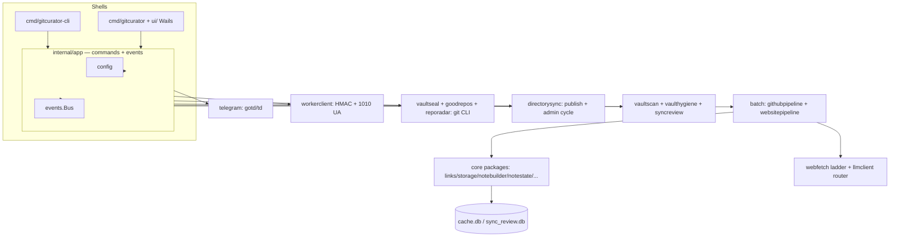

# 04 — Target Go Architecture

> Repository-specific design for the Go application. Decisions with alternatives live in
> `decisions/`; this document is the consolidated blueprint of *what to build*.

## 1. Module and directory layout

Go module `github.com/assadigit/second-brain-project` at the **repo root** of the private
implementation repo (ADR-0002 Am.1 — supersedes the earlier `go-desktop/`-inside-GitCurator plan;
the package tree below is otherwise unchanged; the Wails shell directory is named `webui/` per
that amendment). Proposed tree (package names mirror Python modules for traceability):

```
(second-brain-project repo root)
├── go.mod                      # module github.com/assadigit/second-brain-project; go 1.22+
├── cmd/
│   ├── gitcurator/main.go      # GUI entry (windowsgui subsystem via -ldflags)
│   └── gitcurator-cli/main.go  # CLI entry (console subsystem)
├── internal/
│   ├── app/                    # THE composition layer (no Qt equivalent — new)
│   │   ├── app.go              # App struct: config, stores, workers, event bus
│   │   ├── commands.go         # every user operation as a command (see §5)
│   │   ├── events.go           # typed event bus (progress, log, status, ask-gates)
│   │   └── lifecycle.go        # single-instance lock, startup passes, shutdown
│   ├── config/                 # config.json load/merge/save + user memory (.gitcurator)
│   ├── constants/              # APP_DIR resolution, stamps, CATEGORY_FOLDERS, defaults
│   ├── links/                  # URL grammar + THE LAW domain lists + import parser
│   ├── storage/                # atomic writes, safe_filename, dryrun recorder
│   ├── dryrun/
│   ├── prompts/                # template loader + embedded prompt files
│   ├── notebuilder/            # GitHub note rendering + YAML sanitizers
│   ├── notestate/              # moves-as-corrections + NoteStateDB
│   ├── notereads/              # one-open cache (RAM + SQLite parse layer)
│   ├── taxonomy/               # taxonomy file parser + validation
│   ├── llmclient/              # provider clients, detection, timeouts, extract_json
│   ├── webfetch/               # polite fetcher, ladder, rate limiter, DoH, wayback
│   ├── webextract/             # HTML extraction + heuristics
│   ├── chrometabs/             # CDP client, sessions, wave engine (fifth door)
│   ├── handdelivery/           # fourth door queue/consume
│   ├── websitepipeline/        # Websites pipeline + state DB + directory note
│   ├── vaultscan/              # scan engine (radar, weighing, plan, apply)
│   ├── vaulthygiene/
│   ├── repobanish/
│   ├── syncreview/             # four-state model + DeferredLog
│   ├── mirror/                 # Library/ mirror + linking + embeddings + recall
│   ├── connectioncheck/        # test battery + sentinel probes
│   ├── telegram/               # gotd/td client (queue fetch, login, mark-read)
│   ├── vaultseal/              # git seal ladder + local-only belt
│   ├── goodrepos/              # public directory publish
│   ├── reporadar/
│   ├── workerclient/           # CloudflareSync (HMAC, 1010 UA, pairing)
│   ├── directorysync/          # build_index + publish + admin command cycle
│   ├── store/                  # SQLite plumbing shared by all ledgers (cache.db)
│   ├── githubpipeline/         # the GitHub per-repo loop (from processing_worker)
│   ├── batch/                  # batch orchestration (both pipelines + reports)
│   └── cli/                    # the command-line surface (flags, terminal paint)
├── assets/                     # go:embed: prompts/, taxonomy defaults, sounds, fonts, icons
│   └── embed.go
├── webui/                      # Wails GUI (Phase 6 — see ADR-0001)
│   ├── frontend/               # HTML/CSS/TS replicating the documented design
│   └── bindings.go             # event bridge to internal/app
└── build/                      # packaging scripts, launcher .bat templates, zip builder
```

Rationale: 1:1 traceability with the Python core (`05-python-to-go-mapping.md`), the same
layering law (gui/cli → app → integrations → core, one direction), no `gui` imports anywhere under
`internal/` except `webui/` itself.

## 2. The `internal/app` composition layer (the Qt replacement seam)

The Python app's `MainWindow`/`ProcessingWorker` pair did three jobs: orchestration, threading,
and eventing. In Go these separate cleanly:

```go
type App struct {
    Cfg      *config.Store          // merge-law config + user memory
    Cache    *store.DB              // cache.db (WAL, locking law)
    Events   *events.Bus            // fan-out to GUI/CLI subscribers
    LLM      llmclient.Router       // provider routing + task overrides
    Telegram telegram.Client        // gotd-backed queue fetcher
    Worker   workerclient.Client    // HMAC client
    // ... seals, pipelines constructed per command with injected deps
}
```

- **Events bus** (`events.Bus`): typed channels for `LogLine{msg, level}`, `Progress{pos, total}`,
  `Status{text}`, `BatchFinished{ok, summary}`, `AskCode{kind, reply chan string}`,
  `AskScanConfirm{plan, reply chan Verdict}`, `LLMFailed{repo, reply chan Decision}`,
  `JobProgress{...}`. The GUI subscribes and marshals to its main thread; the CLI prints. This
  replaces the 8 queued Qt signals (`gui/processing_worker.py:101-112`) and the Event round-trips
  (`processing_worker.py:1959-2113`) with identical timeouts (300 s code, 300 s scan, 600 s LLM).
- **Ask-gates are channels**, preserving the interactive-auth pattern including the headless
  fail-fast behavior (`gui/headless.py:219-227`).
- **One batch at a time**: an app-level mutex + running flag mirrors the TelegramLockManager law
  (owner-scoped acquire/release, 35 min watchdog, `gui/telegram_lock.py`).

## 3. Package responsibilities and dependency rules

- `constants`, `links`, `storage`, `dryrun`, `prompts`, `taxonomy` — leaves; import nothing above
  them. Byte-exact parity packages (golden-tested).
- `notebuilder`, `notestate`, `notereads`, `websitepipeline`, `vaultscan`, … — engine packages;
  dependencies injected as small interfaces (the Python hermetic law):
  ```go
  type LLMCall func(messages []Message, task string) (string, error)   // classify|analyze|vaultscan
  type FetchFn func(req FetchRequest) (FetchResult, error)
  type ConfirmFn func(items []BanishItem, log Logger) (Verdict, Reporter)
  ```
- `store` — one `*sql.DB` per store instance + RWMutex, modernc driver, DSN pragmas
  (`busy_timeout=30000`, `journal_mode=WAL`, `synchronous=NORMAL`), naive-string timestamp helpers.
- `telegram`, `workerclient`, `vaultseal`, `goodrepos` — outside-world adapters; results, not
  panics; every method returns a result struct (never-raise law).
- `app` — the only package allowed to construct everything (dependency injection root); no
  business logic.
- `cli`, `ui` — thin shells over `app.Commands`.

## 4. Error handling, logging, cancellation, lifecycle

- **Errors as values with honest sentences.** Port the user-visible message strings verbatim (they
  are behavior). Domain packages return typed errors (`ErrDead`, `ErrPaywalled`, …) only where the
  Python code branched on category; otherwise plain `fmt.Errorf` with the same text.
- **Logging**: `log/slog` structured logger writing the same two rotating files
  (`logs/processing_<ts>.md` + `.txt`) and feeding the event bus for the desk log; the coalescing
  (120 ms / 250 rows) lives in the GUI subscriber, not the logger (same as Python).
- **Cancellation**: `context.Context` threaded through every long operation. The Python chunked
  sleeps (5 s rate-limit waits, 1 s disk-full spin) become `select { case <-ctx.Done(): … case
  <-time.After(chunk): }` — the cooperative Stop semantics preserved (`processing_worker.py`
  stop law).
- **Timeouts**: wall-clock contexts replace the ThreadPoolExecutor trick (`core/llm_client.py:89-119`);
  Go cancels for real, no leaked threads.
- **Lifecycle**: startup passes as sequential goroutines with the same delays (sentinel first pass
  1.2 s, llama autodetect 1.5 s, heal 2.0 s, backlog 2.5 s, radar 3.5 s); shutdown drains workers
  with the same grace windows (batch 5 s, test workers 2 s), kills Telethon/Chrome children,
  releases the lock, closes stores.
- **Single-instance lock**: same `app.lock` file + PID liveness healing (`gui/app.py:393-440`).

## 5. Command surface (what the GUI/CLI both call)

Every Python worker job becomes one command method (sources: `gui/worker_jobs.py`,
`gui/main_window/processing_control.py`, `cli/cli_run.py`):

| Command | Python origin |
|---|---|
| `Sync.FetchQueue` (classify + report) | `_bot_queue_job` |
| `Sync.RunBatch(urls, source)` | `ProcessingWorker` via `_start_worker_with_urls` |
| `Sync.FastSync` | `_run_drift_seal(manual=true)` |
| `Sync.DriftSeal` (auto) | `_run_drift_seal(manual=false)` |
| `Scan.Run(vaults)` | `_vault_scan_job` (+ ask-gate) |
| `Scan.ApplyPlan(plan, selection)` | `apply_scan_plan` |
| `Backup.SealVault(kind)` / `Backup.Resync` / `Backup.Now` / `Backup.Publish` | backup_seal starters |
| `Radar.Detect` | `_repo_radar_job` |
| `SyncView.Measure` | `_sync_display_job` + `_gather_sync_snapshot` |
| `Connection.Test` | `_connection_battery_job` + live telegram leg |
| `LLM.Detect(kind)` / `LLM.RefreshModels` | quick-detect jobs |
| `Retry.ReviewBacklog` / `Retry.MasterWaiting` / `Retry.Failed` | retry drivers |
| `HandDelivery.Deliver` (Chrome run) | `deliver_pages_via_chrome` |
| `Maintenance.HealVaults` / `Undo.LastBatch` / `Dead.Reset` | heal/undo/reset doors |

Each command: takes a context, emits events, returns a result struct — never panics across the
boundary (recover + honest error event, mirroring the BaseException-safe TestWorker wrapper,
`processing_worker.py:2093-2113`).

## 6. Concurrency architecture

- Batch worker = one goroutine per item? **No** — the Python batch is deliberately sequential
  (rate limits, politeness, vault-write ordering). Keep sequential; the parallelism wins come from
  the banner-download inner goroutine (as in Python) and from Go's fast single-thread execution.
- Sentinel, radar, heal, autodetect: independent goroutines with the same cadences.
- The coalesced log: producer-side ring buffer (channel, 1024 cap), consumer-side 120 ms ticker
  flush — same numbers as `ui.py:65-86`.
- All stores guarded per-instance (locking law) — no shared `*sql.DB` pool contention concerns at
  this scale.

## 7. What is intentionally NOT ported

- The 18-mixin `MainWindow` structure itself (replaced by `app` + `ui`).
- Qt-specific hacks (measured heights, repolish, event filters, `lay.activate()`).
- Dead code items listed in `01-repository-inventory.md` §6.
- The dormant cloud quartet (documented in `spec-cloud-dormant.md`; revive later if the owner
  asks).
- The Python release zip builder (replaced by the Go packaging in ADR-0010; the Python tool stays
  as reference).

## 8. Diagrams



## 9. Design rationales (summary)

- **Why a new `app` layer instead of porting mixins**: the mixins existed to split a 11.5k-line
  class; Go composes by package + struct fields. The behavior (signal flows, guards, honesty
  laws) is preserved by the event bus and command result contracts.
- **Why interfaces only at injection points**: the mission warns against fashionable abstraction;
  the Python codebase itself is the guide — it uses injection exactly where hermetic testing
  demanded it (`llm_call`, `fetch_fn`, `banish_confirm`).
- **Why sequential batches**: rate limits, domain politeness, and the "moves are corrections"
  run-start ordering are behavioral; parallelizing would change observable behavior.
