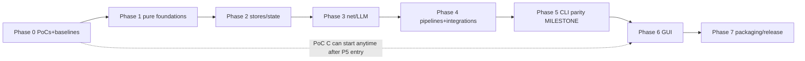

# 12 — Migration Roadmap

> Phased plan with entry/exit conditions and verification gates. Effort labels: XS/S/M/L/XL
> (relative, not time). Dependency graph is strict: a phase's entry condition is the previous
> phase's exit gate.

## Phase 0 — Foundations and proof points (before any engine work)

**Entry**: repo as-is; this blueprint accepted as the working plan.
**Work**:
- T-00 Reproduce the dev environment (Go toolchain; Python venv for differential runs).
- T-01 **PoC A: gotd/td** — login + bot-chat iteration + read-acknowledge over SOCKS on Windows
  (ADR-0004). Exit: working fetch of 100 messages, or the documented fallback decision.
- T-02 **PoC B: tls-client** — stdlib fetch gets 403 on a walled page; Chrome-profile fetch
  succeeds (ADR-0006). Exit: proof artifacts (statuses recorded), or utls fallback decision.
- T-03 **Differential harness skeleton** (`go-desktop/testdiff/`): case dirs, Python driver,
  comparator with normalization rules (doc 09 §3).
- T-04 **Performance baselines** captured (doc 07 §B.4 procedure; numbers recorded here — do not
  invent).
**Exit gate**: PoC verdicts recorded as ADR updates; harness runs one trivial case end-to-end
(e.g. `--version` output parity); baseline table filled.

## Phase 1 — Pure-foundation packages (byte-parity layer)

**Work**: port + golden-test `constants`, `links`, `storage`, `dryrun`, `prompts`,
`taxonomy`, `notebuilder` (sanitizers + note formats), config load/merge/save + user memory.
**Key risks**: semantics items 1–13 of `05-python-to-go-mapping.md` §3.
**Exit gate**: the corresponding characterization tests (ported from `test_core`,
`test_userconfig`, taxonomy tests) green; differential case "import-file grammar" matches; config
round-trip against a real `config.json` copy is byte-stable.

## Phase 2 — Stores and state engines

**Work**: `store` (SQLite plumbing) + `notestate`, `notereads`, `websitepipeline/state`,
`cache_db` (CacheDB), `link_tracker`, `vault_index`.
**Exit gate**: opening a real Python-created `cache.db` fixture passes read/write probes; the
moves-as-corrections suite (ported `test_phase1`-era cases) green; one-open law tests green
(`test_notereads` port).

## Phase 3 — Network and LLM layer

**Work**: `llmclient` (3 providers + detection + extract_json), `webfetch` ladder + rate limiter +
DoH + wayback, `webextract`, `netguard`/`connectioncheck`, `workerclient` (HMAC + UA law).
**Exit gate**: fake-server contract tests green (Ollama/OpenAI/Anthropic payload goldens; HMAC
loopback rig ported from `test_synclive`); redirect-chain parity tests; UA table asserted.

## Phase 4 — Pipelines and integrations (the engine room)

**Work**: `websitepipeline` (full state machine), `githubpipeline` + `batch`, `handdelivery`,
`chrometabs`, `vaultscan` + `vaulthygiene` + `repobanish`, `vaultseal` + `goodrepos` + `reporadar`
(real git tests), `directorysync`, `mirror/linking/embeddings/recall`, `telegram` (gotd
integration behind the PoC verdict).
**Exit gate**: differential cases: the 30-link golden set, banishment flows, scan-apply subset,
seal ladder on temp repos — all matching (normalized) Python outputs; the offline-golden-runner
equivalent passes in Go.
**GATE CLOSED (SESSION-026, 2026-10-18)**: the task list T-40..T-50 all landed (T-51 removed by
the Option-B stamp); SESSION-025's close-out evaluation — the stone-by-stone evidence table in
`docs/sessions/SESSION-025.md` — recorded 8 of the 10 named differential stones green with ONE
artifact outstanding (the table's last two rows are the SAME artifact: the 30-link golden set
and the offline-golden-runner equivalent). The closer landed as
`testdiff/goldens/dump_goldenwebsites.py` +
`internal/websitepipeline/goldenrunner_test.go`: the generator drives the UNMODIFIED reference's
own `tools/run_golden_websites.py --offline` (CI's mode) over its own
`tests/golden/websites.json` corpus — the fake LLM answering from the golden file, canned pages
feeding the fetch, a throwaway vault, clocks frozen at 2026-10-17 12:00:00, temp roots + the
reference app dir folded by REPLACE — into
`internal/websitepipeline/testdata/goldenwebsites.golden.json` (94,979 bytes, the generator
runs the payload twice and refuses to write unless byte-identical); the Go replay runs the
ported pipeline over the SAME corpus with the same seams and byte-compares the canned pages,
the 90-call LLM choreography (classify/classify/analyze per link — the analysis prompt carries
no `Website: ` line, so its answer is the default analysis: the quirk every golden note is
named "Golden test site" by), the first three prompts, the per-link results, the 30 produced
notes, the report, the console output, and the exit-code law — all green first run, the
mutation test (one byte in the golden) fails precisely, 1828/1828 tests race-clean over 30
packages. **Phase 4 CLOSED; Phase 5 (engine parity milestone per Amendment 1) OPENS.**

## Phase 5 — CLI parity milestone (first user-visible release)

**Work**: `internal/cli` full flag surface, terminal paint (ANSI/UTF-8 Windows hardening), the
`--sync` door, dry-run reports, `cmd/gitcurator-cli` packaging; `.bat` launcher equivalents.
**Progress (SESSION-027)**: T-60's first slice LANDED — THE CLI SHELL (the paint box, the
settings halves, the sync door's pure halves + beat 1a, the honest Option-B flag surface with
refusal cards for the Telethon accepted losses, the FULL --status card, --list-dead/
--reset-dead; the differential golden dump_cli.py → goldencli.golden.json → the Go replay
green, mutation bites; 1852 tests race-clean over 31 packages).
**Progress (SESSION-028)**: T-60's remainder LANDED — THE COMMAND WIRINGS (the --init
wizard with the repo radar over the RadarAll seam + the honest Option-B closing card,
--test-connection over the ported battery with the _section/_check_line renderers and
every Option-B divergence asserted, --detect-llm with the model menu + cli_settings's
model-menu half, --hand-delivery complete, --chrome-retry's listing + full dry-run
rehearsal with the reality-wins dry-run-switch fix; the golden grew to 9 more sections
incl. the wizards' saved-config bytes + the enqueue's writes — 48,698 bytes two-run
byte-identical, the mutation teeth grew; 1866 tests race-clean over 31 packages). Only
T-61's remaining paint legs ride with T-62's engines.
**Progress (SESSION-029)**: T-62 slice 1 LANDED — THE RUN ENGINE'S DOORS (the preflights
with the model-picker bridge, run_config_card, the dry-run report writer, and THE
PHASE-5 CLEAR RE-SPEC — ADR-0004 Am.3's bounded open item — resolved on the evidence
chain and implemented: the all-clear verdict + the batch-complete mirror push as the
ack; the golden grew to 10 more sections incl. two saved configs — 69,028 bytes
two-run byte-identical; 1877 tests race-clean over 31 packages).
**Progress (SESSION-030)**: T-62 slice 2 LANDED — THE ENGINE + THE
DRIVERS — **T-62 COMPLETE**: run_batch_visual's synchronous shell over
the ported engines (the setup family, the warmup family, the websites
phase per website_phase.py's wiring, the Finish chain + the seals in
the reference's exact order, the Phase-5 CLEAR, the dry-run path, the
SIGINT drain + the 100 ms heartbeat ticker, the exit-code law) + the
Worker-queue fetch + the _bot_queue_job classification half + the
batch drivers (cmd_auto's wrong-vault guard + the >10 confirm,
cmd_sync's live beats, cmd_retry_failed, the import mode, the
chrome-retry live leg) + internal/platformintake. The golden drove the
reference's own engine over a fake Qt event loop — 86,570 bytes,
two-run byte-identical, eight reality-wins finds fixed in-commit;
1911 tests race-clean over 32 packages. Only T-61's remaining paint
legs ride ahead of T-63 (launchers).
**Progress (SESSION-031)**: **T-61 COMPLETE** (the close-out audit:
the paint box + NO_COLOR/TTY law + the spinner under the heartbeat +
the 65001 hardening all landed with tests — the runtime Windows-console
legs recorded as Phase 7's clean-VM items; ADR-0007 Am.2 records the
re-instatement of the CLI-facing legs) + **T-63 COMPLETE** — THE
LAUNCHERS: cmd/gitcurator-cli (the --cli strip law ported from main.py,
the --version stamp door, the exit pass-through), VERSION (0.92.0-go.1),
the launcher set in cmd/gitcurator-cli/ (the four .bats + gitcurator-cli.sh
+ the 1-INSTALL equivalent: ASCII+CRLF at byte level, the walk-up with
landmark VERSION, the exe run DIRECT with the reference's own --cli
defaults, EXITCODE echo + pause, the git-only install check — no
registry writes, no PATH mutations), and THE DISPATCH FLIP — the
session's reality-wins find: the T-62 drivers had landed but Run's
dispatch still answered not-yet cards for --auto/--sync/--retry-failed/
--import-file; the flip routes them to the real drivers. The
differential stone grew the launchers section (the reference's own
bytes recorded raw; shared grammar byte-compared; divergences asserted
both ways; mutation teeth on three surfaces) — 101,777 bytes two-run
byte-identical; 1922 tests race-clean over 33 packages. Only T-64 (the
corpus full run) and T-65 (the tag + zip) remain on Phase 5's books.
**Progress (SESSION-032)**: **T-64 COMPLETE** — THE DIFFERENTIAL CORPUS
FULL RUN: all 31 golden generators driven twice end-to-end against the
unmodified reference by the new corpus driver (testdiff/run_corpus.py);
every generator exit-0 both passes with the pinned-rev line; the
two-run byte-identical proof held (empty full-tree diff beyond the four
atomic pairs' documented timestamp churn); committed == regenerated
(the tree clean after pass 2). The fix loop's five finds were ALL
generator-side determinism bugs (three generators recorded raw mkdtemp
roots — folded to <TMP> now; dump_mirror's duplicate fixture had two
stems — the os.walk-order quirk, one stem now; the pair-stability
digest learned the notereads mtime_ns/epoch/scratch masks + the
websitestate dismissed-ledger tie order, unspecified on both sides) —
ZERO Go-port divergences; 1922 tests race-clean over 33 packages; the
harness case PASS; the report archived at
docs/poc-artifacts/t-64-corpus-full-run-report.md. Only T-65 (the
v0.92.0-go.1 tag + zip) remains on Phase 5's books.
**Progress (SESSION-032, part 2)**: **T-65 COMPLETE — THE CLI PARITY
RELEASE**: the zip-composition question resolved per the specs (the
minimal deterministic mkzip slice landed now — build/mkzip with doc 10
§2's laws + 5 law tests incl. byte-identity; T-80/Phase 7 keeps the
full builder per F4); the GUI-side launcher pair at the repo root
(GitCurator.bat with the honest GUI-milestone card,
GitCurator-DRY-RUN.bat running the CLI exe's safe first run; the
golden's launchers section grown to the reference's own app-root pair,
105,092 payload bytes two-run byte-identical, a fourth mutation
surface); config.example.json (the reference's own bytes) + the Go
WINDOWS-QUICKSTART.md; the exe built twice byte-identical (760942e4…)
and the zip built twice byte-identical — GitCurator-v0.92.0-go.1-
windows.zip, 12 files, 15,988,399 bytes, sha256 d2679a1d…; the tag
v0.92.0-go.1 at a39cb3d pushed; GitHub release 416838956 published
with the zip asset (the round-trip download verified byte-identical);
1927 tests race-clean over 34 packages. **PHASE 5's BOOKS ARE EMPTY
— the exit gate is GREEN**: the CLI parity release 0.92.0-go.1 is
tagged with the zip artifact, the differential corpus is green, and
the owner can run the Go CLI alongside the Python app on real data
(dry-run first).
**Exit gate**: the owner can run the Go CLI alongside the Python app on real data (dry-run
first); differential harness green on the full case list; **CLI parity release `0.92.0-go.1`**
tagged with the zip artifact.

## Phase 6 — GUI (Wails shell)

**Entry**: Phase 5 exit + **PoC C: Wails** (ADR-0001 gate: themed window + log desk + one job;
startup ≤ 1.5 s; log flood smooth).

> **SESSION-033 (2026-10-19): the Phase-6 entry gate is GREEN — T-70
> COMPLETE.** The gate re-run with ONE REAL JOB wired through (the
> note-state baseline over a 800-note fixture vault, via the guibridge/
> seam): first frame 266/679 ms over two runs (gate ≤ 1.5 s), the 10k
> flood 458,695/454,133 lines/s with 0 drops and 23–25 ms max handler
> time per batch, the real job 800 notes in 94–101 ms, the Windows exe
> CGO-free at 14.95 MB. Verdict: ADR-0001 Am.3; evidence:
> docs/poc-artifacts/t-70-gate.md. The Wails toolchain record (the pinned
> CLI v2.16.0, the nested webui/ module, the vanilla frontend step, the
> CGO story) surfaced BEFORE the first wails invocation: ADR-0002 Am.3
> (+ Am.4's boundary correction). Phase 6's work (T-71…) may proceed.
>
> **SESSION-034 (2026-10-19): T-71 COMPLETE — `internal/app` is real.**
> The composition layer landed in four slices (events/commands+lifecycle
> seams/DI root, commits 5453214 → 00f4cdb → eb74171 → this row's
> slice): the typed bus + the three ask-gates (the reference's
> identical 300/300/600 s windows, the headless + no-reader
> fail-fasts), the command surface over injected seams with the
> crash-safety wrapper and the one-batch law, the single-instance
> app.lock with PID healing, the watchdog, the startup passes at the
> reference's delays, the shutdown graces, and the production engines
> (the queue classification, the scan job with both confirm doors, the
> backup zip, the batch composition). 67 internal/app tests
> race-clean; the acceptance (the command contract tests + the
> lock/watchdog tests) GREEN. T-72 (the frontend foundation) is the
> next session's primary task.
>
> **SESSION-035 (2026-10-19): T-72 COMPLETE — the frontend foundation.**
> The thirtieth full wipe absorbed before work (everything rebuilt from
> the committed recipes; the webkit tree rebuilt + proven at both
> levels). The suite re-verification caught a REAL production race
> (deskbus's post-Stop push coin flip) — fixed deterministically, plus
> hygiene (52 mode flips, the orphan wails binary). T-72 in two slices:
> (a) the theme-token CSS golden + the icon-pack golden — three twins
> (Go tables, the CSS var dump, the JS pack) locked against two
> reference-generated goldens (dump_theme.py + dump_icons.py, CORPUS
> 33); (b) the production shell binding internal/app DIRECTLY
> (guibridge/ retired with its tests; the T-70 gate legs retired), the
> typed Bus → the deskbus → the cache-mirror desk, the startup passes'
> real lines, the single-instance lock before the window
> (AppLock.Refused added), the sync_card CTA band. The dissolution
> probe (Am.4's law, run FIRST): wails into the MAIN module forces
> x/net v0.56.0 + the 1.25.0 directive — BLOCKED by the authorized-pins
> law; the boundary stays nested, the owner's call in ADR-0002 Am.5.
> The acceptance GREEN: the token golden (6 uitheme tests) + the log
> perf test (headless transport: ≥1.07M lines/s through the REAL Bus,
> 0 drops; the gate leg end-to-end: first frame 283 ms, the 10k flood
> 434,782 lines/s producer-side, 22 ms max handler, 0 drops). 1994
> main-battery tests over 35 packages race-clean + 21 webui tests over
> 4 packages. T-73 (Settings pages A) is the next session's task; the
> vanilla-vs-vite call + the dissolution question remain the owner's.
> **SESSION-036 (2026-10-19): T-73 COMPLETE — the Settings pages A.**
> The thirty-first full wipe absorbed before work (both repos re-cloned
> with the ephemeral GIT_CONFIG_COUNT PAT form, the toolchain + venv +
> wails CLI + webkit tree rebuilt — the 26 dev-symlink relinks again;
> the full battery re-verified green pre-work). T-73 in two slices:
> (a) internal/app/settings.go — THE LIVE-CONFIG LAW (config.json loads
> ONCE at construction through the GUI load path; the session-held
> *storage.OrderedMap, saves mutate IN PLACE — the reference's
> self.config semantics; the old missing-file→empty-map wiring
> assertion corrected to the reference's own deepcopy(CONFIG_EXAMPLE)
> behavior) + the six pages' engines over injectable SettingsDeps: the
> ONE merge save (all four v30 laws — MERGE never whitelist-rebuilds,
> absent groups keep config, in-place clear+update, atomic write +
> mirror BEFORE the mutation, the 250 ms sentinel re-arm), the
> five-rung vault ladder, the snapshot (populate_vaults' dedupe +
> no-pre-selection), TestGitHubToken as-typed, the About Me wizard,
> Ollama Refresh/Start Server, llama.cpp Detect/Refresh + THE SERVER
> CONFIG GRAB, the Detect & Set fast lane (guard/menu/cancel/SET + the
> live-fields overlay), the Sound preview gate (BatchSound's
> one-notice law) — 26 settings tests incl. the save-law battery; (b)
> the window on the shell: webui/settingsui.go (the thin-shell
> wrapper + the two native pickers), frontend/settings.js (the gear
> door, the 190px sidebar with the six rows + the TAB_INFO hints, the
> six pages rendered from the snapshot, every label/tooltip/help
> verbatim; THE SAVE-ON-CHANGE law — the commit-cadence dated note:
> the port commits all six pages per edit where the reference saves
> creds/proxy/LLM at closeEvent; the mini-dialog kit), the fill line at
> startup. The acceptance GREEN: the page workflow tests + the
> save-law tests (35 main packages + 4 webui packages race-clean; the
> gate leg GREEN — first frame 963 ms, the 10k flood 526,315 lines/s, 0
> drops; the screenshot VLM-verified: all six rows, the quiet-truth
> line VERBATIM). The CLI-parity shell wiring (warmup family, inputs
> fetchers, websites phase, Phase-5 CLEAR) carried honestly to the
> T-74+ binding — the one-slice-properly law; it gates T-77's hero
> batch, not the pages.
> **SESSION-037 (2026-10-20): T-74 COMPLETE — the Settings pages B +
> THE CLI-PARITY SHELL WIRING (the carried debt closed).** The
> thirty-second full wipe absorbed before work (both repos re-cloned
> with the ephemeral GIT_CONFIG_COUNT PAT form, go1.27.2
> sha-triple-verified, the venv, the wails CLI, and the rootless
> webkit tree rebuilt — the sandbox began blocking symlink(2)
> mid-session so the 26 dev .so links landed as hardlinks to the
> resolved system runtime targets, same bytes, the wails build
> verifying the tree). T-74 in three slices: (a) internal/app/
> batchwire.go — engine.go's runImpl composition re-hosted on the app
> surface (the warmup family, the inputs fetchers, the websites phase,
> the Phase-5 CLEAR, the finish seals, the dry-run law — the debt
> T-73 recorded, closed with 19 wiring tests); (b) internal/app/
> settingsb.go — the pages' engines (the specs matched BY NAME per the
> R-0 note: the queue report rendering from canned reports, the badge
> law, the dashboard stats + quarantine + undo engines, the sources
> fetch over its seam, the backup ladders + the save groups — 21
> tests); (c) webui/settingsuib.go + frontend/settings.js — the four
> pages live on the Settings window at the reference's own sidebar
> order with every label verbatim + the section-probe evidence door (5
> shell tests). 2060 main-battery tests race-clean over 35 packages +
> 28 webui tests over 4; the gate leg GREEN (first frame 283/942 ms;
> the 10k flood 476,190 lines/s, 0 drops); the screenshots
> VLM-verified (all ten sidebar rows; the Backup page's groups). T-75
> (the Sync view) is the next session's task; the dissolution +
> vanilla-vs-vite calls remain the owner's.

**Work**: `internal/app` commands/event bus completion; frontend pages in dependency order:
main window chrome + log desk → settings pages (Vault, Credentials, LLM, Proxy, Input) → Bot
queue + Dashboard → Sync view (flow cards + matrix + differences modal) → Scan flow (picker →
plan → scorecard) → Backup page → sounds/theme toggle/dialogs polish.
**Exit gate**: GUI workflow tests green for the golden paths (sync → batch → seals; scan →
confirm → apply; sync-view refresh); performance criteria met (doc 07 §B.4); side-by-side lock
verified against the Python app.

> **SESSION-038 (2026-10-20): T-75 COMPLETE — the Sync view (the flow
> cards + the matrix + the differences modal), the placeholder seat
> filled.** The thirty-third full wipe absorbed before work (both repos
> re-cloned with the ephemeral GIT_CONFIG_COUNT PAT form, go1.27.2
> sha-verified against the committed 64-char pin, the venv, the wails
> CLI, and the rootless webkit tree rebuilt — the 6th webkit rebuild,
> Am.4's hardlink fallback again, symlink(2) still blocked). T-75 in
> three slices: (a) internal/syncreview — core/sync_review.py PORTED
> (the four-state model, the named verdict + the setup/measure split,
> the micro-copy captions, the DeferredLog over the SQLITE LAW, the
> three read-only doors) — 101 tests; (b) internal/app's syncdisplay +
> syncview — the display model (the §5 arithmetic's every edge, the
> four cards verbatim) + the gather + the Settings doors (ONE Refresh
> payload for both desks — the shared single gather the reference
> defers to v2, taken now) — 50 tests; (c) the shell — the fourth
> bound struct + the Sync page at the reference's own sidebar order +
> the differences modal with the disabled-until law + the fix doors
> with the queue-state hook — 5 shell tests. The acceptance GREEN
> (the four-state rendering tests + the deferred-ledger UX tests):
> 2211 main-battery tests race-clean over 36 packages + 33 webui over
> 4; the gate leg GREEN (first frame 292/730 ms; the 10k flood
> 588,235 lines/s, 0 drops); the screenshots VLM-verified.

> **SESSION-039 (2026-10-20): T-76 COMPLETE — the Scan flow (the
> vault picker → the plan modal → the applied scorecard).** The
> thirty-fourth full wipe absorbed before work (both repos re-cloned
> with the ephemeral GIT_CONFIG_COUNT PAT form, go1.27.2 sha-verified
> against both the committed pin and go.dev's JSON, the venv, the
> wails CLI, and the rootless webkit tree rebuilt — the 7th webkit
> rebuild, Am.4's hardlink fallback again). T-76 in two slices:
> (a) internal/app's scandialogs.go + the scanjob story extension —
> the three dialogs' pure engines (the picker's display model + the
> live arithmetic, the plan's display model with the four sections +
> the landable move + the freeze guard, PlanPickState the selection
> semantics as a state machine (the masters, the low-confidence
> pre-uncheck, the arm-guard's enable law, the four-key selection),
> the scorecard's model (the landed counts, the K-of-N warnings, the
> named failures, the per-vault sections) — the reference's
> repos-only double-section quirk preserved by direct probe at
> 98f4fc7) — 19 tests; (b) the shell — the FIFTH bound struct
> (StartScan the whole CTA flow: the guards, the quiet cancel, the
> start line, the blocking job over the bus gate, the finished
> routing + the scorecard event; ScanAnswer the held gate's answer
> door) + shell.go's AskScanConfirm wiring + frontend/scanflow.js's
> three modals (the 350 ms fresh-click door, the pinned verdict row,
> the 12 s self-close) + the Scan CTA's own machine (the reference's
> own scan_btn, NOT the hero's) — 7 shell tests. The acceptance
> GREEN (workflow tests + selection semantics): 2230 main-battery
> tests race-clean over 36 packages + 40 webui over 4; the gate leg
> GREEN (first frame 339/283/280 ms; the 10k flood, 0 drops); the
> screenshots VLM-verified.

> **SESSION-040 (2026-10-20): T-77 COMPLETE — the main window chrome
> (the hero button machine, the progress row, the More menu, the
> sentinel labels, the battery modal, the sounds).** The
> thirty-fifth full wipe absorbed before work (the repos re-cloned
> with the ephemeral GIT_CONFIG_COUNT PAT form, go1.27.2 sha-verified
> against both the committed pin and go.dev's JSON, the venv, the
> wails CLI, and the rootless webkit tree rebuilt — the 8th webkit
> rebuild, Am.4's hardlink fallback again: symlink(2) still refused at
> boot; the 26 dev links as hardlinks to the resolved system targets;
> the wails build + the gate leg the proof; the FULL battery
> re-verified green pre-work — exactly 2230 + 40). T-77 in two
> slices: (a) the pure engines — internal/app/herostate.go (hero.py's
> GUI-only machine: the four states, the click routing with the
> guards as data, the fetch routing with the caught-up law, the
> mirror, the stopping render, the exact labels/tooltips, the >10
> confirm gate, the progress formats, the sentinel paint laws) — 21
> tests + THE RETROACTIVE FIELD-TAG FIX (the T-71 bus payloads
> crossed tagless: the progress bar never filled, every finish read
> ❌ — every crossed payload now tagged, pinned by its own test) +
> the cooperative StopBatch door (the runner's between-items law +
> the warmup lost-stop window closed) + BatchFinished.needs_retry +
> the sentinel pass's full snapshot/offline-law emission (with TWO
> reality fixes the re-read caught: the nil-latency deref on the
> offline path + the sentinelOnline data race — the seat now one
> unit under sentinelMu) + the WAVs SHIPPED (the deferred-debt note
> closes: success.wav/retry.wav embedded, disk-first) with the quiet
> batch gate split from the preview's lines; (b) the shell — the
> SIXTH bound struct webui/heroui.go (HeroClick the one click door
> with both stages, the 200 ms mirror, TestConnection the battery
> door with the live events, the More menu's live doors incl. the
> retry modes) + frontend/heroflow.js (the hero renders, the guard
> boxes, the sentinel paint, the battery modal with Start Syncing
> gated on all-ok, the More menu's verbatim list with the
> honest-disabled law, the chime) — 16 shell tests. The acceptance
> GREEN (hero state machine tests + the startup cadence battery):
> 2252 main-battery tests race-clean over 36 packages (2230 + 22) +
> 56 webui over 4 (40 + 16), stable across three consecutive full
> -race runs; the gate leg GREEN (first frame 908 ms ≤ 1.5 s; the
> 10k flood 555,555 lines/s, 0 drops, 26 ms max handler); the
> screenshot VLM-verified (the sentinels painting LIVE: Net: online
> green / AI: off — unreachable red / Proxy: off gray; the SYNC hero
> enabled; no honest-disabled placeholders left in the CTA band).

> **SESSION-041 (2026-10-20): T-78 COMPLETE — the side-by-side
> verification vs the Python app (the LAST Phase 6 task).** The
> thirty-sixth full wipe absorbed before work (both repos, the
> toolchain, the venv, the module cache all gone at boot; everything
> re-cloned/rebuilt from the committed recipes — both repos with the
> ephemeral GIT_CONFIG_COUNT PAT form, go1.27.2 sha-verified against
> the committed 64-char pin, the venv, the wails CLI; the webkit tree
> deliberately NOT rebuilt — no wails build was needed for T-78's
> data-side legs, the next GUI-touching session rebuilds it per the
> recipe; the FULL battery re-verified green pre-work — exactly 2252
> + 56). The verification machine (committed): testdiff/side_by_side.py
> + testdiff/goside (the Go driver over the production doors) — 21/21
> GREEN, the evidence archived at docs/poc-artifacts/t-78-side-by-side.md.
> LEG A (the acceptance — the lock mutual exclusion ACROSS BOTH
> BINARIES): the Python half drives THE REFERENCE'S OWN LOCK CODE,
> extracted verbatim by pinned line range (gui/app.py:393-440 +
> gui/headless.py:246-282; the PyQt6 import wall probed and pinned:
> headless.py:34 → icons.py:45 → ModuleNotFoundError under the
> stdlib-only venv, and --cli/--headless both exit BEFORE the lock —
> the GUI entry is the reference's only lock-taking binary; the
> extraction's structural pins + rev guard fail loudly on drift).
> Scenarios GREEN: the fresh-take BYTES law on both sides (bare
> decimal PID, no newline); A1 Go holds → the reference's own dance
> REFUSES (exit 1, the exact sentence, the file untouched); A2 Python
> holds → Go REFUSES (exit 1, the same sentence); A3 Go crashed →
> Python heals the stale (the exact stale sentence + takeover); A4
> Python crashed → Go heals the stale; A6 the EPERM probe — A REAL
> DIVERGENCE the audit caught and FIXED: the Go twin read EPERM (a
> live not-ours process) as ALIVE while the reference's blanket
> except reads it DEAD — a recycled-PID lock was take-over-able in
> Python but refused by Go; process_posix.go fixed (killVerdict,
> pinned hermetically) and BOTH binaries now take such a lock over
> identically, live, against PID 1. LEG B (the same-data config laws,
> the reference's own pure modules as the oracle): B1 both apps write
> BYTE-IDENTICAL config.json from the same input + the same updates
> (sha256 equal — the merge-never-rebuild + byte-comparable laws
> end-to-end) + unknown keys survive + tuning keys unstomped +
> nested key-by-key merge + non-ASCII raw with no HTML escaping; B1e/f
> the cross re-save stability (each side's re-save of the other's file
> never disturbs the bytes — all four sha256 equal); B2 the fill
> (same bytes, same counts, both modes; the local-wins law); B3 the
> mirror (identical memory bytes, the never-loses law, the 0600
> permission law on both sides). The battery at the close: 2253
> main-module tests race-clean over 36 packages (2252 + 1) + 56 webui
> over 4. Phase 6's task list is now EMPTY — the phase-exit question
> (opening Phase 7 per the protocol's gate laws) surfaced to the
> owner in the session report.

> **SESSION-042 (2026-10-20): the owner's Path-B stamp — T-79 (the
> GUI doors addendum) + T-79a COMPLETE (the five per-test doors).**
> The phase-exit call answered in the owner's own words: "the slow,
> more reliable and more rigorous method" — Phase 6 stays OPEN past
> T-78; the More menu's honestly-disabled tail (SESSION-040's record:
> the 19 doors) became the NAMED rows T-79a…T-79e on doc 13 (the
> export zip rides T-80's packaging composition per the standing
> assignment); Phase 7 opens only when the tail is empty. The
> thirty-seventh full wipe absorbed before work (both repos, the
> toolchain, the venv, the module cache, the wails CLI gone; the
> repair: both repos re-cloned with the ephemeral GIT_CONFIG_COUNT
> form, go1.27.2 sha-verified three ways, the venv rebuilt as
> --without-pip --copies — the boot's ensurepip absence + the symlink
> block recorded, the wails CLI, and the rootless webkit tree — the
> NINTH rebuild, Am.4's hardlink fallback again (the 26 dev links to
> the resolved system targets, zero missing); the FULL battery
> re-verified green pre-work: exactly 2253 + 56). T-79a: the five
> per-test doors LIVE (internal/app/pertests.go's engines over five
> new hermetic SettingsDeps seams + the HeroUI wrappers + the
> heroflow.js wiring + the SB_POC_OPEN_MORE probe): Test Telegram &
> GitHub (the Option-B re-scope — the GitHub half verbatim + the
> Worker queue leg), Test Proxy (the sentinel's TCP verdict — the
> re-scope), Test Ollama (models + the real "What is 2 + 3?" ping +
> the options retry), Test Cloud API (the /models pre-flight + the
> "Say hello" ping + the three verdict boxes), Test llama.cpp (the
> probe + the pick + the ping + the three boxes). The battery at the
> close: 2280 main-battery tests race-clean over 36 packages (2253 +
> 27) + 59 webui over 4 (56 + 3); the app package 3× race-clean; the
> wails build links clean over the 9th-rebuilt tree; the gate leg
> GREEN (first frame 779/284 ms; the 10k flood 0 drops); the
> screenshots VLM-verified (the five doors LIVE-dark beside the
> remaining tail's honest-disabled wash + the end-to-end click leg's
> desk lines). The full record: docs/poc-artifacts/t-79a-per-test-doors.md.
> The remaining tail: T-79b (the linking tools), T-79c (the bot-queue
> tool dialogs), T-79d (the Chrome doors), T-79e (the decommission
> picker).

> **SESSION-043 (2026-10-20): T-79b COMPLETE (the five linking-tools
> doors).** The thirty-eighth full wipe absorbed before work (both
> repos, the toolchain, the venv, the module cache, the wails CLI,
> AND the webkit tree gone; the repair all from the committed
> recipes: both repos re-cloned with the ephemeral GIT_CONFIG_COUNT
> form, go1.27.2 sha-verified against TOOLCHAIN.md Am.2's pin, the
> venv rebuilt — this boot HAS ensurepip, the plain form, the wails
> CLI v2.16.0, the module caches, and the TENTH webkit-tree rebuild —
> 144 debs, the 42 .pc rewrites, the 26 dev links as Am.4 hardlinks,
> zero missing; the FULL battery re-verified green pre-work: exactly
> 2280 + 59). T-79b: the linking tools as More-menu doors — the
> reference's SAFE defaults over the ported engines
> (internal/app/linkdoors.go's five Settings methods + three new
> hermetic SettingsDeps seams + the HeroUI wrappers + the heroflow.js
> wiring + the recategorize table modal + the generalized probe click
> leg): 🪝 Recall hooks (dry-run — the TestWorker law: the guard, the
> opening, the captured run, the last-40 tail, the finish verdict;
> DRY-RUN pinned — the report is the only write) + 🔗 Build link
> suggestions (the suggest grammar + THE ONE-WRITE law — the
> Suggestions note under Library/) + ✅ Validate Vault
> (connection_tests.py:219 verbatim) + 🔍 Verify Vault (the report box
> + the enqueue legs with the settled-repo filter) + 📁 Recategorize
> Notes (the two-door flow). THE GUARD LAW widened per the row's own
> naming: all five doors carry the batch-busy guard (the recorded
> divergence — the reference guards only the two tool runners). The
> battery at the close: 2312 main-battery tests race-clean over 36
> packages (2280 + 32) + 63 webui over 4 (59 + 4); the app package
> 3× race-clean; the wails build links clean over the 10th-rebuilt
> tree (24.6 s; no mode flips — content-only diffs = the regenerated
> bindings); the gate legs GREEN (first frame 726/269 ms; the 10k
> flood 0 drops); the screenshots VLM-verified (the five doors LIVE;
> the lower-region misreads settled per the 042 law — the byte-level
> source check + cropped passes; the recall-door click leg's whole
> runner grammar on the desk). The full record:
> docs/poc-artifacts/t-79b-linking-doors.md. The remaining tail:
> T-79c (the bot-queue tool dialogs), T-79d (the Chrome doors),
> T-79e (the decommission picker).

> **SESSION-044 (2026-10-20): T-79c COMPLETE (the bot-queue tool
> doors).** The fortieth full wipe absorbed before work (the whole
> environment gone — both repos, the toolchain, the venv, the module
> cache, the wails CLI, AND the webkit tree; the repair all from the
> committed recipes: both repos re-cloned with the ephemeral
> GIT_CONFIG_COUNT form — nothing persisted, both verified clean;
> go1.27.2 sha-verified against TOOLCHAIN.md Am.2's committed pin —
> go.dev's ?mode=json has rotated to 1.27.3, the pin is the
> authority; the venv — the plain form, this boot HAS ensurepip; the
> wails CLI v2.16.0; the module caches; the TWELFTH webkit-tree
> rebuild — 144 debs / 77.7 MB, the 42 .pc rewrites, the 26 dev
> links as Am.4 hardlinks [symlink(2) BLOCKED this boot]; the FULL
> battery re-verified green pre-work: exactly 2312 + 63, plain +
> race). T-79c: the bot-queue tool dialogs as More-menu doors — the
> reference's own flows (bot_queue.py:929/1026/1368 +
> dashboard.py:770) over the ported queue engines
> (internal/app/botdoors.go's Settings methods over ONE new
> hermetic BotQueueFetch seam — the SAME a.queueFetch Worker
> /api/pending composition; the HeroUI wrappers + the heroflow.js
> dispatch + the manual-resolve dialog + the probe's 'export' click
> pick): ✅ Verify All Processed (the per-URL ladder — in-vault →
> decommissioned → cache-processed → fuzzy → settled → missing — the
> byte-parity report + the permanent _verification_report file + the
> resolve payload) + 📋 Export All Links (the routed lists + Σ
> forward_count as the message count — the recorded divergence — +
> the byte-parity export file + the 📋 Links Exported box) + 🔄 Retry
> Failed (the scan: the vault-error box, the honest read-failure
> line, the empty verdict, the settled-skip layer, the >10 confirm;
> the shell's two-phase door holds the scanned urls on its own seat
> and the post-confirm leg speaks the 🔄 line, CLEARS the pending
> lists — the reference's _bot_queue_urls law — and runs the DIRECT
> batch). THE GUARD LAW carried exactly: NO busy guard on
> export/verify (the reference's TELEGRAM lock was their only guard
> — Option B's accepted loss; pinned by test), the retry batch rides
> SyncRunBatch's own refusal. The proof: 10 engine tests + 4 shell
> tests + the field-tags pin; the battery at the close 2322
> main-battery tests race-clean over 36 packages (2312 + 10) + 67
> webui over 4 (63 + 4); the touched packages 3× race-clean; the
> wails build links clean over the 12th-rebuilt tree (29.5 s; no
> mode flips); the gate legs GREEN (first frame 892/307/269 ms; the
> 10k flood 0 drops); the screenshots VLM-verified (the three doors
> LIVE; the first pass's Retry Failed misread settled per the
> 042/043 law — the byte-level source check + the cropped re-pass;
> the click leg: the export door's username-refusal grammar on the
> desk end-to-end — the first run caught the binding-import gap, now
> pinned by test). The ten recorded divergences + the full record:
> docs/poc-artifacts/t-79c-bot-queue-doors.md. The remaining tail:
> T-79d (the Chrome doors), T-79e (the decommission picker).

## Phase 7 — Packaging, release, cutover

**Work**: deterministic zip builder, `1-INSTALL` equivalent, clean-machine checklist (doc 10 §7),
release workflow, docs (README-go, QUICKSTART update).
**Exit gate**: acceptance criteria (doc 15) demonstrated on a clean Windows VM; release
`GitCurator-v0.9x.0-windows.zip` (Go) attached to a GitHub release; owner sign-off.

## Phase 8 (post-parity, out of blueprint scope) — future work register

- Visual redesign (separate spec; doc 07 §D boundary).
- Linux/macOS builds; localization beyond what exists; the dormant cloud quartet revival;
  Worker-side improvements; UI polish backlog collected during porting.

## Amendment 1 — Owner Q&A re-scope (2026-10)

- **Phase 5 re-scoped** from "CLI parity milestone (first user-visible release)" to **"engine
  parity milestone (internal)"**: the CLI surface is still built and gated by the differential
  harness (it is the engine's proving ground, test driver, and emergency fallback), but
  owner-facing CLI polish (terminal-paint hardening, `.bat` launcher parity) is CUT and **no
  tagged CLI release** is produced (ADR-0007 Am.1).
- **Phase 6 (GUI) becomes the first owner-visible release milestone**; the tag + artifact ritual
  moves here — now dual artifact (setup.exe + portable zip) per ADR-0010 Am.1.
- **Phase 0 PoC C gains a bootstrapper dimension** (T-70): WebView2 is now *assumed absent* on
  the owner machine (updates stopped + Edge deleted — ADR-0001 Am.1), so the PoC must verify
  the silent Evergreen-bootstrapper path end-to-end on a WebView2-less Windows VM.
- Phase 1–4, 7, 8 and M1–M4 are unchanged. M5 becomes an internal gate (no owner-facing
  release); M6 absorbs the release-ritual duties.

## Amendment 2 — Owner Option-B stamp (2026-10-15, ADR-0004 Am.3)

- **Phase 4 loses the `telegram` (gotd integration) work item** — T-51 moves to the
  **Phase-8 future-work register** below. The desktop's bot queue rides the Worker HTTP API
  only (`/api/pending` — already in Phase 3's T-34 `workerclient` scope; zero Worker changes
  for the core flow). Read-acknowledge is dropped; a Worker read-ack endpoint joins the
  Phase-8 register as an optional revival. The Telegram single-slot lock and the Telegram
  leg of Test Connection fall away (ADR-0004 Am.3 lists the full consequences).
- **Phase-8 register gains**: *gotd/td Telegram leg revival* (capability proven by the T-01
  PoC on the owner's account — ADR-0004 Am.2; `poc/telegram` + the gotd v0.110.0 pin stay
  in the repo as the dormant proof; would restore read-ack badge-clearing,
  Saved-Messages/keyword/single-id modes, and chat re-read recovery).
- **Rider task R-0** (XS) is attached to Phase 1's session (SESSION-003): reconcile the
  remaining behavioral spec ripple (spec-core-connection, spec-cli `--sync` door,
  spec-gui-pages-b queue data source, spec-worker-contract note) per ADR-0004 Am.3 —
  docs-only, before T-10.
- Supersession note: the one-time re-login accepted in the owner Q&A (doc 14 §6 Round 1
  Q2) is void — no MTProto user login ever happens.

## Dependencies between phases (mermaid)

## Milestone summary

| Milestone | Definition of done | Evidence |
|---|---|---|
| M0 | PoC verdicts + baselines + harness skeleton | Phase-0 report |
| M1 | Foundations byte-parity | golden tests + differential case |
| M2 | Stores open real data | fixture DB tests |
| M3 | Contracts proven | fake-server + loopback rig |
| M4 | Engine parity | full differential corpus |
| **M5** | **CLI parity release (tag + zip)** | owner runs Go CLI on real data |
| M6 | GUI parity | workflow + perf gates |
| M7 | Go release | clean-machine checklist + acceptance doc |

> **SESSION-045 (2026-10-20): T-79d COMPLETE (the Chrome doors).**
> The forty-first full wipe absorbed before work (the whole
> environment gone — both repos, the toolchain, the venv, the module
> cache, the wails CLI, AND the webkit tree; the repair all from the
> committed recipes: both repos re-cloned with the ephemeral
> GIT_CONFIG_COUNT form — nothing persisted; go1.27.2 sha-verified
> against TOOLCHAIN.md Am.2's committed pin; the venv — the plain
> form, this boot HAS ensurepip; the wails CLI v2.16.0; the module
> caches; the THIRTEENTH webkit-tree rebuild — 144 debs, the 42 .pc
> rewrites, the 26 dev links as Am.4 hardlinks [symlink(2) BLOCKED
> this boot]; the FULL battery re-verified green pre-work — and the
> re-verification caught ONE REAL FLAKE in the committed battery:
> TestBotDoorExportOrderedMapItems, root-caused at the byte level
> against the reference's own `_item_url` law [the FIXED priority
> tuple, never the dict's insertion order] and repaired in BOTH Go
> copies before the task work — commit 4c0234c, the
> cross-binary-disagreement class, pinned by two new deterministic
> tests). T-79d: the four anytime triggers over the ALREADY-LIVE
> engines — 🖐 Hand-deliver walled links + 🖐 Scrape hand rows via
> Chrome + 🤖 Chrome tab-retry failed links + 🪄 Attach to my Chrome
> (processing_control.py:615/669/1000/1601 + the shared
> _start_chrome_tab_retry at 1351): internal/app/chromedoors.go (the
> Settings-method engines over six new hermetic seams — incl. THE
> ChromeDeliver CDP/DevTools seam + the HandEnqueue open leg; the
> busy ladders carried in the reference's own order, guards → busy →
> scan) + the shell's seven More doors + startChromeTabRetry (ONE
> delivery at a time with the backlog merge; the failure story FIRST
> over the chrome:failed event; the delivered pages re-run as the
> DIRECT NonGithub batch — the v0.57 routing law) + the frontend's
> two picker dialogs + the attach default-No + THE BINDING-IMPORT
> pin. THE COLLABORATOR LAW held: the no-Chrome remedy box is the
> click-leg evidence itself. Six recorded divergences (the dead
> dry-run shadow branch; the stash counter; the frontend pickers;
> the end-of-run offer + the caught-up hand pass + the redo pass as
> the honest boundary — they ride the same runner; the reveal door;
> the per-platform attach legs): docs/poc-artifacts/t-79d-chrome-
> doors.md. Battery: 2337 main + 73 webui race-clean [corrected at SESSION-046 — the close docs said 71, an arithmetic slip]; the touched
> packages 3×; no mode flips; the MAIN go.mod byte-unchanged. The
> VLM misread pattern struck a FOURTH time on a focused crop (five
> live doors read as washed) — settled by the byte-level source
> check, no code touched on the VLM's word. The remaining tail:
> T-79e (the decommission picker), then Phase 7.

> **SESSION-046 — T-79e COMPLETE: THE DECOMMISSION PICKER (the LAST
> tail row flipped LIVE) + the 42nd-wipe repair + the scoping note
> settled (T-79f named).** The forty-second full wipe absorbed
> before work (the WHOLE environment again — both repos, the
> toolchain, the venv, the module cache, the wails CLI, AND the
> webkit tree; all rebuilt from the committed recipes: both repos
> re-cloned with the ephemeral GIT_CONFIG_COUNT PAT form, go1.27.2
> sha-verified vs TOOLCHAIN.md Am.2's committed 64-char pin, the
> venv [this boot HAS ensurepip — the plain form], the wails CLI
> v2.16.0, the FOURTEENTH webkit rebuild — 144 debs / 77.7 MB →
> dpkg -x → the 42 .pc prefix rewrites → the 26 dev links as Am.4
> hardlinks [symlink(2) still blocked; the clean CGO link the
> proof]; the FULL battery re-verified green pre-work: 2337 main +
> 73 webui race-clean — and the re-verification caught ONE
> ARITHMETIC SLIP in SESSION-045's close docs: the recorded "71
> webui (67 + 4)" is really **73 (67 + 6** — six shell tests landed
> in fd053ba, the report body's own count; the five records
> [README / NEXT-SESSION / the t-79d evidence doc / this roadmap /
> the SESSION-045 report] corrected in this session's close
> commits). **T-79e: the one-ledger law LIVE** — `internal/app/
> decomdoors.go` (DecommissionScan [the guards + _scan_backlog_
> alive + the sorted-dedup law + the empty box + the candidates
> pre-fill] + DecommissionBury [the picked URLs marked dead through
> MarkURLsDeadInTable — the SAME Status cells a hand-edit writes —
> then the burials enforced immediately through ConsumeDecommission
> Table over the same state DB a batch uses: dismiss + retry-row
> drop + placeholder sweep + the confirmed stamp; the exact success
> line + box; the cancel line; the deferral law] +
> OpenDecommissionTable [the reveal over the OpenFileLocation
> seam]) + the shell's THREE More doors + the frontend's picker
> dialog (the reference's own words verbatim; every row UNCHECKED —
> a burial is never a default; the danger bury button pinned
> outside the scrolling body; THE BINDING-IMPORT LAW honored +
> pinned) + the probe's 'grave' click pick. NO busy guard (the
> reference's own shape — the enforcement rides the same SQLite
> state DB a batch uses; pinned by test). THE FIELD-TAG LAW:
> DecommissionScan tagged + pinned. **The scoping note settled**:
> the end-of-run Chrome offer + hero.py's caught-up hand scrape +
> _maybe_redo_hand_notes named **T-79f — the Phase-6 closure row**
> (the batch-finish/hero-machine surfaces riding the landed
> startChromeTabRetry runner — a follow-up wiring with its own
> pinned tests, not a fold-in; "one slice done properly with proof
> beats two half-done"). Six recorded divergences (incl. the
> deferral case's "backlog is clear" arithmetic — the reference's
> own computation, my first test expectation was wrong and the
> engine was right): docs/poc-artifacts/t-79e-decommission-doors.md.
> Battery at the close: **2348 main-battery tests race-clean over 36
> packages (2337 + 11) + 77 webui over 4 (73 + 4)**; the touched
> packages 3× race-clean; no mode flips; the MAIN go.mod
> byte-unchanged; the gate legs GREEN (first frame 869 ms; the 10k
> flood 526,315 lines/s, 0 drops); the screenshots VLM-verified
> with BOTH passes agreeing (no misread incident this session). The
> tail is EMPTY; Phase 6 closes when T-79f lands.

> **SESSION-047 — T-79f COMPLETE: THE PHASE-6 CLOSURE ROW — the
> runner's automatic triggers landed + the 43rd-wipe repair.** The
> forty-third full wipe absorbed before work (the ENTIRE environment
> again — both repos, the toolchain, the venv, the wails CLI, AND the
> webkit tree; all rebuilt from the committed recipes: both repos
> re-cloned with the ephemeral GIT_CONFIG_COUNT PAT form, the
> reference at the pinned 98f4fc7, go1.27.2 sha-verified vs
> TOOLCHAIN.md Am.2's committed 64-char pin, the venv [ensurepip
> present — the plain form], the wails CLI v2.16.0, the FIFTEENTH
> webkit rebuild — 144 debs → dpkg -x → the 42 .pc prefix rewrites →
> the 26 dev links as Am.4 hardlinks [symlink(2) still blocked]; the
> FULL battery re-verified green pre-work: 2348 main + 77 webui
> race-clean, exactly the committed numbers). T-79f: the three
> automatic triggers over the landed startChromeTabRetry runner —
> internal/app/fanfaredoors.go (the engines: HandQueuePass with the
> once-per-session tried belt + the web_browser_retry knob;
> CaughtUpHandRows — NO tried-set at the caught-up call site, the
> reference's own law; RedoHandNotesScan — the 🔁 line spoken in the
> engine; ChromeOfferFromResults — the offered set marks only the
> PICKED) + THE FLAG-CLEAR LAW in SyncRunBatch (the running flag +
> the lock go home BEFORE the finished signal crosses, exactly as
> the reference's processing_finished opens with _batch_running =
> False) + BatchResult's batch_summary facts (Natural/Stopped/
> WebsiteResults) + the caught-up block's hand scrape + redo check
> + the work-started holds + the chrome:offer crossing +
> ChromeOfferAnswer (the DECLINED line's door) + heroflow.js's ONE
> listener over the SAME dialog (the parameterized answers) +
> ChromeOfferAnswer joined the binding import (the 044 lesson,
> pinned). The gate legs GREEN (first frame 802 ms ≤ 1.5 s; the 10k
> flood 0 drops, handler max 24 ms/batch); both screenshots
> VLM-verified with BOTH passes agreeing. The SIX recorded
> divergences: docs/poc-artifacts/t-79f-fanfare-triggers.md (the
> scorecard-stash interplay stays unlanded — its consumer, the Batch
> Complete modal, is no T-79 row's). The battery at the close: 2356
> main-battery tests race-clean over 36 packages (2348 + 8) + 84
> webui over 4 (77 + 7); the touched packages 3× race-clean; the
> MAIN go.mod byte-unchanged. **PHASE 6 CLOSED** — the honest exit
> gate evaluation in SESSION-047's report (the chosen path's own
> acceptance GREEN; the GUI-parity RELEASE criteria — the Windows
> runtime legs + the clean-VM checklist — remain Phase 7's owner
> items exactly as ADR-0001 Am.2 registered); >
> **SESSION-048 (2026-10-20) — T-80 COMPLETE: the reproducible packaging
> + the standing assignment landed; Phase 7's opening row.** The 44th
> full wipe absorbed before work (everything rebuilt from the committed
> recipes; the full battery re-verified green pre-work: 2356 + 84,
> plain + race). The full builder: mkzip's two-exe composition + the
> version-stamp + brand-icon guards; build/release.sh's DOUBLE-BUILD
> RITUAL — AC-22 GREEN (every sha256 pair identical, warm ×2 + a cold
> leg per exe; the zip: 13 files, 56,908,881 bytes in, sha256
> 61b4cf2a…); the manifest laws (supportedOS Win10 + longPathAware);
> the version stamping pinned (the -X-under-trimpath drop found +
> fixed via the reference's own boot print; the one-version-truth
> test). The standing assignment: the 📤 Export Backup ZIP row + the
> Backup page's Restore button LIVE + the v0.86.0 ledger rider on BOTH
> zips (T-71's placeholder note retired). 2371 + 89 tests race-clean;
> the evidence at docs/poc-artifacts/t-80-reproducible-packaging.md.
> T-81 (the release workflow) follows.
