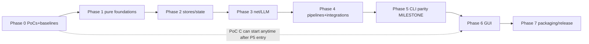

# 12 — Migration Roadmap

> Phased plan with entry/exit conditions and verification gates. Effort labels: XS/S/M/L/XL
> (relative, not time). Dependency graph is strict: a phase's entry condition is the previous
> phase's exit gate.

## Phase 0 — Foundations and proof points (before any engine work)

**Entry**: repo as-is; this blueprint accepted as the working plan.
**Work**:
- T-00 Reproduce the dev environment (Go toolchain; Python venv for differential runs).
- T-01 **PoC A: gotd/td** — login + bot-chat iteration + read-acknowledge over SOCKS on Windows
  (ADR-0004). Exit: working fetch of 100 messages, or the documented fallback decision.
- T-02 **PoC B: tls-client** — stdlib fetch gets 403 on a walled page; Chrome-profile fetch
  succeeds (ADR-0006). Exit: proof artifacts (statuses recorded), or utls fallback decision.
- T-03 **Differential harness skeleton** (`go-desktop/testdiff/`): case dirs, Python driver,
  comparator with normalization rules (doc 09 §3).
- T-04 **Performance baselines** captured (doc 07 §B.4 procedure; numbers recorded here — do not
  invent).
**Exit gate**: PoC verdicts recorded as ADR updates; harness runs one trivial case end-to-end
(e.g. `--version` output parity); baseline table filled.

## Phase 1 — Pure-foundation packages (byte-parity layer)

**Work**: port + golden-test `constants`, `links`, `storage`, `dryrun`, `prompts`,
`taxonomy`, `notebuilder` (sanitizers + note formats), config load/merge/save + user memory.
**Key risks**: semantics items 1–13 of `05-python-to-go-mapping.md` §3.
**Exit gate**: the corresponding characterization tests (ported from `test_core`,
`test_userconfig`, taxonomy tests) green; differential case "import-file grammar" matches; config
round-trip against a real `config.json` copy is byte-stable.

## Phase 2 — Stores and state engines

**Work**: `store` (SQLite plumbing) + `notestate`, `notereads`, `websitepipeline/state`,
`cache_db` (CacheDB), `link_tracker`, `vault_index`.
**Exit gate**: opening a real Python-created `cache.db` fixture passes read/write probes; the
moves-as-corrections suite (ported `test_phase1`-era cases) green; one-open law tests green
(`test_notereads` port).

## Phase 3 — Network and LLM layer

**Work**: `llmclient` (3 providers + detection + extract_json), `webfetch` ladder + rate limiter +
DoH + wayback, `webextract`, `netguard`/`connectioncheck`, `workerclient` (HMAC + UA law).
**Exit gate**: fake-server contract tests green (Ollama/OpenAI/Anthropic payload goldens; HMAC
loopback rig ported from `test_synclive`); redirect-chain parity tests; UA table asserted.

## Phase 4 — Pipelines and integrations (the engine room)

**Work**: `websitepipeline` (full state machine), `githubpipeline` + `batch`, `handdelivery`,
`chrometabs`, `vaultscan` + `vaulthygiene` + `repobanish`, `vaultseal` + `goodrepos` + `reporadar`
(real git tests), `directorysync`, `mirror/linking/embeddings/recall`, `telegram` (gotd
integration behind the PoC verdict).
**Exit gate**: differential cases: the 30-link golden set, banishment flows, scan-apply subset,
seal ladder on temp repos — all matching (normalized) Python outputs; the offline-golden-runner
equivalent passes in Go.
**GATE CLOSED (SESSION-026, 2026-10-18)**: the task list T-40..T-50 all landed (T-51 removed by
the Option-B stamp); SESSION-025's close-out evaluation — the stone-by-stone evidence table in
`docs/sessions/SESSION-025.md` — recorded 8 of the 10 named differential stones green with ONE
artifact outstanding (the table's last two rows are the SAME artifact: the 30-link golden set
and the offline-golden-runner equivalent). The closer landed as
`testdiff/goldens/dump_goldenwebsites.py` +
`internal/websitepipeline/goldenrunner_test.go`: the generator drives the UNMODIFIED reference's
own `tools/run_golden_websites.py --offline` (CI's mode) over its own
`tests/golden/websites.json` corpus — the fake LLM answering from the golden file, canned pages
feeding the fetch, a throwaway vault, clocks frozen at 2026-10-17 12:00:00, temp roots + the
reference app dir folded by REPLACE — into
`internal/websitepipeline/testdata/goldenwebsites.golden.json` (94,979 bytes, the generator
runs the payload twice and refuses to write unless byte-identical); the Go replay runs the
ported pipeline over the SAME corpus with the same seams and byte-compares the canned pages,
the 90-call LLM choreography (classify/classify/analyze per link — the analysis prompt carries
no `Website: ` line, so its answer is the default analysis: the quirk every golden note is
named "Golden test site" by), the first three prompts, the per-link results, the 30 produced
notes, the report, the console output, and the exit-code law — all green first run, the
mutation test (one byte in the golden) fails precisely, 1828/1828 tests race-clean over 30
packages. **Phase 4 CLOSED; Phase 5 (engine parity milestone per Amendment 1) OPENS.**

## Phase 5 — CLI parity milestone (first user-visible release)

**Work**: `internal/cli` full flag surface, terminal paint (ANSI/UTF-8 Windows hardening), the
`--sync` door, dry-run reports, `cmd/gitcurator-cli` packaging; `.bat` launcher equivalents.
**Progress (SESSION-027)**: T-60's first slice LANDED — THE CLI SHELL (the paint box, the
settings halves, the sync door's pure halves + beat 1a, the honest Option-B flag surface with
refusal cards for the Telethon accepted losses, the FULL --status card, --list-dead/
--reset-dead; the differential golden dump_cli.py → goldencli.golden.json → the Go replay
green, mutation bites; 1852 tests race-clean over 31 packages).
**Progress (SESSION-028)**: T-60's remainder LANDED — THE COMMAND WIRINGS (the --init
wizard with the repo radar over the RadarAll seam + the honest Option-B closing card,
--test-connection over the ported battery with the _section/_check_line renderers and
every Option-B divergence asserted, --detect-llm with the model menu + cli_settings's
model-menu half, --hand-delivery complete, --chrome-retry's listing + full dry-run
rehearsal with the reality-wins dry-run-switch fix; the golden grew to 9 more sections
incl. the wizards' saved-config bytes + the enqueue's writes — 48,698 bytes two-run
byte-identical, the mutation teeth grew; 1866 tests race-clean over 31 packages). Only
T-61's remaining paint legs ride with T-62's engines.
**Progress (SESSION-029)**: T-62 slice 1 LANDED — THE RUN ENGINE'S DOORS (the preflights
with the model-picker bridge, run_config_card, the dry-run report writer, and THE
PHASE-5 CLEAR RE-SPEC — ADR-0004 Am.3's bounded open item — resolved on the evidence
chain and implemented: the all-clear verdict + the batch-complete mirror push as the
ack; the golden grew to 10 more sections incl. two saved configs — 69,028 bytes
two-run byte-identical; 1877 tests race-clean over 31 packages).
**Progress (SESSION-030)**: T-62 slice 2 LANDED — THE ENGINE + THE
DRIVERS — **T-62 COMPLETE**: run_batch_visual's synchronous shell over
the ported engines (the setup family, the warmup family, the websites
phase per website_phase.py's wiring, the Finish chain + the seals in
the reference's exact order, the Phase-5 CLEAR, the dry-run path, the
SIGINT drain + the 100 ms heartbeat ticker, the exit-code law) + the
Worker-queue fetch + the _bot_queue_job classification half + the
batch drivers (cmd_auto's wrong-vault guard + the >10 confirm,
cmd_sync's live beats, cmd_retry_failed, the import mode, the
chrome-retry live leg) + internal/platformintake. The golden drove the
reference's own engine over a fake Qt event loop — 86,570 bytes,
two-run byte-identical, eight reality-wins finds fixed in-commit;
1911 tests race-clean over 32 packages. Only T-61's remaining paint
legs ride ahead of T-63 (launchers).
**Progress (SESSION-031)**: **T-61 COMPLETE** (the close-out audit:
the paint box + NO_COLOR/TTY law + the spinner under the heartbeat +
the 65001 hardening all landed with tests — the runtime Windows-console
legs recorded as Phase 7's clean-VM items; ADR-0007 Am.2 records the
re-instatement of the CLI-facing legs) + **T-63 COMPLETE** — THE
LAUNCHERS: cmd/gitcurator-cli (the --cli strip law ported from main.py,
the --version stamp door, the exit pass-through), VERSION (0.92.0-go.1),
the launcher set in cmd/gitcurator-cli/ (the four .bats + gitcurator-cli.sh
+ the 1-INSTALL equivalent: ASCII+CRLF at byte level, the walk-up with
landmark VERSION, the exe run DIRECT with the reference's own --cli
defaults, EXITCODE echo + pause, the git-only install check — no
registry writes, no PATH mutations), and THE DISPATCH FLIP — the
session's reality-wins find: the T-62 drivers had landed but Run's
dispatch still answered not-yet cards for --auto/--sync/--retry-failed/
--import-file; the flip routes them to the real drivers. The
differential stone grew the launchers section (the reference's own
bytes recorded raw; shared grammar byte-compared; divergences asserted
both ways; mutation teeth on three surfaces) — 101,777 bytes two-run
byte-identical; 1922 tests race-clean over 33 packages. Only T-64 (the
corpus full run) and T-65 (the tag + zip) remain on Phase 5's books.
**Progress (SESSION-032)**: **T-64 COMPLETE** — THE DIFFERENTIAL CORPUS
FULL RUN: all 31 golden generators driven twice end-to-end against the
unmodified reference by the new corpus driver (testdiff/run_corpus.py);
every generator exit-0 both passes with the pinned-rev line; the
two-run byte-identical proof held (empty full-tree diff beyond the four
atomic pairs' documented timestamp churn); committed == regenerated
(the tree clean after pass 2). The fix loop's five finds were ALL
generator-side determinism bugs (three generators recorded raw mkdtemp
roots — folded to <TMP> now; dump_mirror's duplicate fixture had two
stems — the os.walk-order quirk, one stem now; the pair-stability
digest learned the notereads mtime_ns/epoch/scratch masks + the
websitestate dismissed-ledger tie order, unspecified on both sides) —
ZERO Go-port divergences; 1922 tests race-clean over 33 packages; the
harness case PASS; the report archived at
docs/poc-artifacts/t-64-corpus-full-run-report.md. Only T-65 (the
v0.92.0-go.1 tag + zip) remains on Phase 5's books.
**Progress (SESSION-032, part 2)**: **T-65 COMPLETE — THE CLI PARITY
RELEASE**: the zip-composition question resolved per the specs (the
minimal deterministic mkzip slice landed now — build/mkzip with doc 10
§2's laws + 5 law tests incl. byte-identity; T-80/Phase 7 keeps the
full builder per F4); the GUI-side launcher pair at the repo root
(GitCurator.bat with the honest GUI-milestone card,
GitCurator-DRY-RUN.bat running the CLI exe's safe first run; the
golden's launchers section grown to the reference's own app-root pair,
105,092 payload bytes two-run byte-identical, a fourth mutation
surface); config.example.json (the reference's own bytes) + the Go
WINDOWS-QUICKSTART.md; the exe built twice byte-identical (760942e4…)
and the zip built twice byte-identical — GitCurator-v0.92.0-go.1-
windows.zip, 12 files, 15,988,399 bytes, sha256 d2679a1d…; the tag
v0.92.0-go.1 at a39cb3d pushed; GitHub release 416838956 published
with the zip asset (the round-trip download verified byte-identical);
1927 tests race-clean over 34 packages. **PHASE 5's BOOKS ARE EMPTY
— the exit gate is GREEN**: the CLI parity release 0.92.0-go.1 is
tagged with the zip artifact, the differential corpus is green, and
the owner can run the Go CLI alongside the Python app on real data
(dry-run first).
**Exit gate**: the owner can run the Go CLI alongside the Python app on real data (dry-run
first); differential harness green on the full case list; **CLI parity release `0.92.0-go.1`**
tagged with the zip artifact.

## Phase 6 — GUI (Wails shell)

**Entry**: Phase 5 exit + **PoC C: Wails** (ADR-0001 gate: themed window + log desk + one job;
startup ≤ 1.5 s; log flood smooth).

> **SESSION-033 (2026-10-19): the Phase-6 entry gate is GREEN — T-70
> COMPLETE.** The gate re-run with ONE REAL JOB wired through (the
> note-state baseline over a 800-note fixture vault, via the guibridge/
> seam): first frame 266/679 ms over two runs (gate ≤ 1.5 s), the 10k
> flood 458,695/454,133 lines/s with 0 drops and 23–25 ms max handler
> time per batch, the real job 800 notes in 94–101 ms, the Windows exe
> CGO-free at 14.95 MB. Verdict: ADR-0001 Am.3; evidence:
> docs/poc-artifacts/t-70-gate.md. The Wails toolchain record (the pinned
> CLI v2.16.0, the nested webui/ module, the vanilla frontend step, the
> CGO story) surfaced BEFORE the first wails invocation: ADR-0002 Am.3
> (+ Am.4's boundary correction). Phase 6's work (T-71…) may proceed.
>
> **SESSION-034 (2026-10-19): T-71 COMPLETE — `internal/app` is real.**
> The composition layer landed in four slices (events/commands+lifecycle
> seams/DI root, commits 5453214 → 00f4cdb → eb74171 → this row's
> slice): the typed bus + the three ask-gates (the reference's
> identical 300/300/600 s windows, the headless + no-reader
> fail-fasts), the command surface over injected seams with the
> crash-safety wrapper and the one-batch law, the single-instance
> app.lock with PID healing, the watchdog, the startup passes at the
> reference's delays, the shutdown graces, and the production engines
> (the queue classification, the scan job with both confirm doors, the
> backup zip, the batch composition). 67 internal/app tests
> race-clean; the acceptance (the command contract tests + the
> lock/watchdog tests) GREEN. T-72 (the frontend foundation) is the
> next session's primary task.
>
> **SESSION-035 (2026-10-19): T-72 COMPLETE — the frontend foundation.**
> The thirtieth full wipe absorbed before work (everything rebuilt from
> the committed recipes; the webkit tree rebuilt + proven at both
> levels). The suite re-verification caught a REAL production race
> (deskbus's post-Stop push coin flip) — fixed deterministically, plus
> hygiene (52 mode flips, the orphan wails binary). T-72 in two slices:
> (a) the theme-token CSS golden + the icon-pack golden — three twins
> (Go tables, the CSS var dump, the JS pack) locked against two
> reference-generated goldens (dump_theme.py + dump_icons.py, CORPUS
> 33); (b) the production shell binding internal/app DIRECTLY
> (guibridge/ retired with its tests; the T-70 gate legs retired), the
> typed Bus → the deskbus → the cache-mirror desk, the startup passes'
> real lines, the single-instance lock before the window
> (AppLock.Refused added), the sync_card CTA band. The dissolution
> probe (Am.4's law, run FIRST): wails into the MAIN module forces
> x/net v0.56.0 + the 1.25.0 directive — BLOCKED by the authorized-pins
> law; the boundary stays nested, the owner's call in ADR-0002 Am.5.
> The acceptance GREEN: the token golden (6 uitheme tests) + the log
> perf test (headless transport: ≥1.07M lines/s through the REAL Bus,
> 0 drops; the gate leg end-to-end: first frame 283 ms, the 10k flood
> 434,782 lines/s producer-side, 22 ms max handler, 0 drops). 1994
> main-battery tests over 35 packages race-clean + 21 webui tests over
> 4 packages. T-73 (Settings pages A) is the next session's task; the
> vanilla-vs-vite call + the dissolution question remain the owner's.
> **SESSION-036 (2026-10-19): T-73 COMPLETE — the Settings pages A.**
> The thirty-first full wipe absorbed before work (both repos re-cloned
> with the ephemeral GIT_CONFIG_COUNT PAT form, the toolchain + venv +
> wails CLI + webkit tree rebuilt — the 26 dev-symlink relinks again;
> the full battery re-verified green pre-work). T-73 in two slices:
> (a) internal/app/settings.go — THE LIVE-CONFIG LAW (config.json loads
> ONCE at construction through the GUI load path; the session-held
> *storage.OrderedMap, saves mutate IN PLACE — the reference's
> self.config semantics; the old missing-file→empty-map wiring
> assertion corrected to the reference's own deepcopy(CONFIG_EXAMPLE)
> behavior) + the six pages' engines over injectable SettingsDeps: the
> ONE merge save (all four v30 laws — MERGE never whitelist-rebuilds,
> absent groups keep config, in-place clear+update, atomic write +
> mirror BEFORE the mutation, the 250 ms sentinel re-arm), the
> five-rung vault ladder, the snapshot (populate_vaults' dedupe +
> no-pre-selection), TestGitHubToken as-typed, the About Me wizard,
> Ollama Refresh/Start Server, llama.cpp Detect/Refresh + THE SERVER
> CONFIG GRAB, the Detect & Set fast lane (guard/menu/cancel/SET + the
> live-fields overlay), the Sound preview gate (BatchSound's
> one-notice law) — 26 settings tests incl. the save-law battery; (b)
> the window on the shell: webui/settingsui.go (the thin-shell
> wrapper + the two native pickers), frontend/settings.js (the gear
> door, the 190px sidebar with the six rows + the TAB_INFO hints, the
> six pages rendered from the snapshot, every label/tooltip/help
> verbatim; THE SAVE-ON-CHANGE law — the commit-cadence dated note:
> the port commits all six pages per edit where the reference saves
> creds/proxy/LLM at closeEvent; the mini-dialog kit), the fill line at
> startup. The acceptance GREEN: the page workflow tests + the
> save-law tests (35 main packages + 4 webui packages race-clean; the
> gate leg GREEN — first frame 963 ms, the 10k flood 526,315 lines/s, 0
> drops; the screenshot VLM-verified: all six rows, the quiet-truth
> line VERBATIM). The CLI-parity shell wiring (warmup family, inputs
> fetchers, websites phase, Phase-5 CLEAR) carried honestly to the
> T-74+ binding — the one-slice-properly law; it gates T-77's hero
> batch, not the pages.
> **SESSION-037 (2026-10-20): T-74 COMPLETE — the Settings pages B +
> THE CLI-PARITY SHELL WIRING (the carried debt closed).** The
> thirty-second full wipe absorbed before work (both repos re-cloned
> with the ephemeral GIT_CONFIG_COUNT PAT form, go1.27.2
> sha-triple-verified, the venv, the wails CLI, and the rootless
> webkit tree rebuilt — the sandbox began blocking symlink(2)
> mid-session so the 26 dev .so links landed as hardlinks to the
> resolved system runtime targets, same bytes, the wails build
> verifying the tree). T-74 in three slices: (a) internal/app/
> batchwire.go — engine.go's runImpl composition re-hosted on the app
> surface (the warmup family, the inputs fetchers, the websites phase,
> the Phase-5 CLEAR, the finish seals, the dry-run law — the debt
> T-73 recorded, closed with 19 wiring tests); (b) internal/app/
> settingsb.go — the pages' engines (the specs matched BY NAME per the
> R-0 note: the queue report rendering from canned reports, the badge
> law, the dashboard stats + quarantine + undo engines, the sources
> fetch over its seam, the backup ladders + the save groups — 21
> tests); (c) webui/settingsuib.go + frontend/settings.js — the four
> pages live on the Settings window at the reference's own sidebar
> order with every label verbatim + the section-probe evidence door (5
> shell tests). 2060 main-battery tests race-clean over 35 packages +
> 28 webui tests over 4; the gate leg GREEN (first frame 283/942 ms;
> the 10k flood 476,190 lines/s, 0 drops); the screenshots
> VLM-verified (all ten sidebar rows; the Backup page's groups). T-75
> (the Sync view) is the next session's task; the dissolution +
> vanilla-vs-vite calls remain the owner's.

**Work**: `internal/app` commands/event bus completion; frontend pages in dependency order:
main window chrome + log desk → settings pages (Vault, Credentials, LLM, Proxy, Input) → Bot
queue + Dashboard → Sync view (flow cards + matrix + differences modal) → Scan flow (picker →
plan → scorecard) → Backup page → sounds/theme toggle/dialogs polish.
**Exit gate**: GUI workflow tests green for the golden paths (sync → batch → seals; scan →
confirm → apply; sync-view refresh); performance criteria met (doc 07 §B.4); side-by-side lock
verified against the Python app.

> **SESSION-038 (2026-10-20): T-75 COMPLETE — the Sync view (the flow
> cards + the matrix + the differences modal), the placeholder seat
> filled.** The thirty-third full wipe absorbed before work (both repos
> re-cloned with the ephemeral GIT_CONFIG_COUNT PAT form, go1.27.2
> sha-verified against the committed 64-char pin, the venv, the wails
> CLI, and the rootless webkit tree rebuilt — the 6th webkit rebuild,
> Am.4's hardlink fallback again, symlink(2) still blocked). T-75 in
> three slices: (a) internal/syncreview — core/sync_review.py PORTED
> (the four-state model, the named verdict + the setup/measure split,
> the micro-copy captions, the DeferredLog over the SQLITE LAW, the
> three read-only doors) — 101 tests; (b) internal/app's syncdisplay +
> syncview — the display model (the §5 arithmetic's every edge, the
> four cards verbatim) + the gather + the Settings doors (ONE Refresh
> payload for both desks — the shared single gather the reference
> defers to v2, taken now) — 50 tests; (c) the shell — the fourth
> bound struct + the Sync page at the reference's own sidebar order +
> the differences modal with the disabled-until law + the fix doors
> with the queue-state hook — 5 shell tests. The acceptance GREEN
> (the four-state rendering tests + the deferred-ledger UX tests):
> 2211 main-battery tests race-clean over 36 packages + 33 webui over
> 4; the gate leg GREEN (first frame 292/730 ms; the 10k flood
> 588,235 lines/s, 0 drops); the screenshots VLM-verified.

> **SESSION-039 (2026-10-20): T-76 COMPLETE — the Scan flow (the
> vault picker → the plan modal → the applied scorecard).** The
> thirty-fourth full wipe absorbed before work (both repos re-cloned
> with the ephemeral GIT_CONFIG_COUNT PAT form, go1.27.2 sha-verified
> against both the committed pin and go.dev's JSON, the venv, the
> wails CLI, and the rootless webkit tree rebuilt — the 7th webkit
> rebuild, Am.4's hardlink fallback again). T-76 in two slices:
> (a) internal/app's scandialogs.go + the scanjob story extension —
> the three dialogs' pure engines (the picker's display model + the
> live arithmetic, the plan's display model with the four sections +
> the landable move + the freeze guard, PlanPickState the selection
> semantics as a state machine (the masters, the low-confidence
> pre-uncheck, the arm-guard's enable law, the four-key selection),
> the scorecard's model (the landed counts, the K-of-N warnings, the
> named failures, the per-vault sections) — the reference's
> repos-only double-section quirk preserved by direct probe at
> 98f4fc7) — 19 tests; (b) the shell — the FIFTH bound struct
> (StartScan the whole CTA flow: the guards, the quiet cancel, the
> start line, the blocking job over the bus gate, the finished
> routing + the scorecard event; ScanAnswer the held gate's answer
> door) + shell.go's AskScanConfirm wiring + frontend/scanflow.js's
> three modals (the 350 ms fresh-click door, the pinned verdict row,
> the 12 s self-close) + the Scan CTA's own machine (the reference's
> own scan_btn, NOT the hero's) — 7 shell tests. The acceptance
> GREEN (workflow tests + selection semantics): 2230 main-battery
> tests race-clean over 36 packages + 40 webui over 4; the gate leg
> GREEN (first frame 339/283/280 ms; the 10k flood, 0 drops); the
> screenshots VLM-verified.

> **SESSION-040 (2026-10-20): T-77 COMPLETE — the main window chrome
> (the hero button machine, the progress row, the More menu, the
> sentinel labels, the battery modal, the sounds).** The
> thirty-fifth full wipe absorbed before work (the repos re-cloned
> with the ephemeral GIT_CONFIG_COUNT PAT form, go1.27.2 sha-verified
> against both the committed pin and go.dev's JSON, the venv, the
> wails CLI, and the rootless webkit tree rebuilt — the 8th webkit
> rebuild, Am.4's hardlink fallback again: symlink(2) still refused at
> boot; the 26 dev links as hardlinks to the resolved system targets;
> the wails build + the gate leg the proof; the FULL battery
> re-verified green pre-work — exactly 2230 + 40). T-77 in two
> slices: (a) the pure engines — internal/app/herostate.go (hero.py's
> GUI-only machine: the four states, the click routing with the
> guards as data, the fetch routing with the caught-up law, the
> mirror, the stopping render, the exact labels/tooltips, the >10
> confirm gate, the progress formats, the sentinel paint laws) — 21
> tests + THE RETROACTIVE FIELD-TAG FIX (the T-71 bus payloads
> crossed tagless: the progress bar never filled, every finish read
> ❌ — every crossed payload now tagged, pinned by its own test) +
> the cooperative StopBatch door (the runner's between-items law +
> the warmup lost-stop window closed) + BatchFinished.needs_retry +
> the sentinel pass's full snapshot/offline-law emission (with TWO
> reality fixes the re-read caught: the nil-latency deref on the
> offline path + the sentinelOnline data race — the seat now one
> unit under sentinelMu) + the WAVs SHIPPED (the deferred-debt note
> closes: success.wav/retry.wav embedded, disk-first) with the quiet
> batch gate split from the preview's lines; (b) the shell — the
> SIXTH bound struct webui/heroui.go (HeroClick the one click door
> with both stages, the 200 ms mirror, TestConnection the battery
> door with the live events, the More menu's live doors incl. the
> retry modes) + frontend/heroflow.js (the hero renders, the guard
> boxes, the sentinel paint, the battery modal with Start Syncing
> gated on all-ok, the More menu's verbatim list with the
> honest-disabled law, the chime) — 16 shell tests. The acceptance
> GREEN (hero state machine tests + the startup cadence battery):
> 2252 main-battery tests race-clean over 36 packages (2230 + 22) +
> 56 webui over 4 (40 + 16), stable across three consecutive full
> -race runs; the gate leg GREEN (first frame 908 ms ≤ 1.5 s; the
> 10k flood 555,555 lines/s, 0 drops, 26 ms max handler); the
> screenshot VLM-verified (the sentinels painting LIVE: Net: online
> green / AI: off — unreachable red / Proxy: off gray; the SYNC hero
> enabled; no honest-disabled placeholders left in the CTA band).

> **SESSION-041 (2026-10-20): T-78 COMPLETE — the side-by-side
> verification vs the Python app (the LAST Phase 6 task).** The
> thirty-sixth full wipe absorbed before work (both repos, the
> toolchain, the venv, the module cache all gone at boot; everything
> re-cloned/rebuilt from the committed recipes — both repos with the
> ephemeral GIT_CONFIG_COUNT PAT form, go1.27.2 sha-verified against
> the committed 64-char pin, the venv, the wails CLI; the webkit tree
> deliberately NOT rebuilt — no wails build was needed for T-78's
> data-side legs, the next GUI-touching session rebuilds it per the
> recipe; the FULL battery re-verified green pre-work — exactly 2252
> + 56). The verification machine (committed): testdiff/side_by_side.py
> + testdiff/goside (the Go driver over the production doors) — 21/21
> GREEN, the evidence archived at docs/poc-artifacts/t-78-side-by-side.md.
> LEG A (the acceptance — the lock mutual exclusion ACROSS BOTH
> BINARIES): the Python half drives THE REFERENCE'S OWN LOCK CODE,
> extracted verbatim by pinned line range (gui/app.py:393-440 +
> gui/headless.py:246-282; the PyQt6 import wall probed and pinned:
> headless.py:34 → icons.py:45 → ModuleNotFoundError under the
> stdlib-only venv, and --cli/--headless both exit BEFORE the lock —
> the GUI entry is the reference's only lock-taking binary; the
> extraction's structural pins + rev guard fail loudly on drift).
> Scenarios GREEN: the fresh-take BYTES law on both sides (bare
> decimal PID, no newline); A1 Go holds → the reference's own dance
> REFUSES (exit 1, the exact sentence, the file untouched); A2 Python
> holds → Go REFUSES (exit 1, the same sentence); A3 Go crashed →
> Python heals the stale (the exact stale sentence + takeover); A4
> Python crashed → Go heals the stale; A6 the EPERM probe — A REAL
> DIVERGENCE the audit caught and FIXED: the Go twin read EPERM (a
> live not-ours process) as ALIVE while the reference's blanket
> except reads it DEAD — a recycled-PID lock was take-over-able in
> Python but refused by Go; process_posix.go fixed (killVerdict,
> pinned hermetically) and BOTH binaries now take such a lock over
> identically, live, against PID 1. LEG B (the same-data config laws,
> the reference's own pure modules as the oracle): B1 both apps write
> BYTE-IDENTICAL config.json from the same input + the same updates
> (sha256 equal — the merge-never-rebuild + byte-comparable laws
> end-to-end) + unknown keys survive + tuning keys unstomped +
> nested key-by-key merge + non-ASCII raw with no HTML escaping; B1e/f
> the cross re-save stability (each side's re-save of the other's file
> never disturbs the bytes — all four sha256 equal); B2 the fill
> (same bytes, same counts, both modes; the local-wins law); B3 the
> mirror (identical memory bytes, the never-loses law, the 0600
> permission law on both sides). The battery at the close: 2253
> main-module tests race-clean over 36 packages (2252 + 1) + 56 webui
> over 4. Phase 6's task list is now EMPTY — the phase-exit question
> (opening Phase 7 per the protocol's gate laws) surfaced to the
> owner in the session report.

> **SESSION-042 (2026-10-20): the owner's Path-B stamp — T-79 (the
> GUI doors addendum) + T-79a COMPLETE (the five per-test doors).**
> The phase-exit call answered in the owner's own words: "the slow,
> more reliable and more rigorous method" — Phase 6 stays OPEN past
> T-78; the More menu's honestly-disabled tail (SESSION-040's record:
> the 19 doors) became the NAMED rows T-79a…T-79e on doc 13 (the
> export zip rides T-80's packaging composition per the standing
> assignment); Phase 7 opens only when the tail is empty. The
> thirty-seventh full wipe absorbed before work (both repos, the
> toolchain, the venv, the module cache, the wails CLI gone; the
> repair: both repos re-cloned with the ephemeral GIT_CONFIG_COUNT
> form, go1.27.2 sha-verified three ways, the venv rebuilt as
> --without-pip --copies — the boot's ensurepip absence + the symlink
> block recorded, the wails CLI, and the rootless webkit tree — the
> NINTH rebuild, Am.4's hardlink fallback again (the 26 dev links to
> the resolved system targets, zero missing); the FULL battery
> re-verified green pre-work: exactly 2253 + 56). T-79a: the five
> per-test doors LIVE (internal/app/pertests.go's engines over five
> new hermetic SettingsDeps seams + the HeroUI wrappers + the
> heroflow.js wiring + the SB_POC_OPEN_MORE probe): Test Telegram &
> GitHub (the Option-B re-scope — the GitHub half verbatim + the
> Worker queue leg), Test Proxy (the sentinel's TCP verdict — the
> re-scope), Test Ollama (models + the real "What is 2 + 3?" ping +
> the options retry), Test Cloud API (the /models pre-flight + the
> "Say hello" ping + the three verdict boxes), Test llama.cpp (the
> probe + the pick + the ping + the three boxes). The battery at the
> close: 2280 main-battery tests race-clean over 36 packages (2253 +
> 27) + 59 webui over 4 (56 + 3); the app package 3× race-clean; the
> wails build links clean over the 9th-rebuilt tree; the gate leg
> GREEN (first frame 779/284 ms; the 10k flood 0 drops); the
> screenshots VLM-verified (the five doors LIVE-dark beside the
> remaining tail's honest-disabled wash + the end-to-end click leg's
> desk lines). The full record: docs/poc-artifacts/t-79a-per-test-doors.md.
> The remaining tail: T-79b (the linking tools), T-79c (the bot-queue
> tool dialogs), T-79d (the Chrome doors), T-79e (the decommission
> picker).

> **SESSION-043 (2026-10-20): T-79b COMPLETE (the five linking-tools
> doors).** The thirty-eighth full wipe absorbed before work (both
> repos, the toolchain, the venv, the module cache, the wails CLI,
> AND the webkit tree gone; the repair all from the committed
> recipes: both repos re-cloned with the ephemeral GIT_CONFIG_COUNT
> form, go1.27.2 sha-verified against TOOLCHAIN.md Am.2's pin, the
> venv rebuilt — this boot HAS ensurepip, the plain form, the wails
> CLI v2.16.0, the module caches, and the TENTH webkit-tree rebuild —
> 144 debs, the 42 .pc rewrites, the 26 dev links as Am.4 hardlinks,
> zero missing; the FULL battery re-verified green pre-work: exactly
> 2280 + 59). T-79b: the linking tools as More-menu doors — the
> reference's SAFE defaults over the ported engines
> (internal/app/linkdoors.go's five Settings methods + three new
> hermetic SettingsDeps seams + the HeroUI wrappers + the heroflow.js
> wiring + the recategorize table modal + the generalized probe click
> leg): 🪝 Recall hooks (dry-run — the TestWorker law: the guard, the
> opening, the captured run, the last-40 tail, the finish verdict;
> DRY-RUN pinned — the report is the only write) + 🔗 Build link
> suggestions (the suggest grammar + THE ONE-WRITE law — the
> Suggestions note under Library/) + ✅ Validate Vault
> (connection_tests.py:219 verbatim) + 🔍 Verify Vault (the report box
> + the enqueue legs with the settled-repo filter) + 📁 Recategorize
> Notes (the two-door flow). THE GUARD LAW widened per the row's own
> naming: all five doors carry the batch-busy guard (the recorded
> divergence — the reference guards only the two tool runners). The
> battery at the close: 2312 main-battery tests race-clean over 36
> packages (2280 + 32) + 63 webui over 4 (59 + 4); the app package
> 3× race-clean; the wails build links clean over the 10th-rebuilt
> tree (24.6 s; no mode flips — content-only diffs = the regenerated
> bindings); the gate legs GREEN (first frame 726/269 ms; the 10k
> flood 0 drops); the screenshots VLM-verified (the five doors LIVE;
> the lower-region misreads settled per the 042 law — the byte-level
> source check + cropped passes; the recall-door click leg's whole
> runner grammar on the desk). The full record:
> docs/poc-artifacts/t-79b-linking-doors.md. The remaining tail:
> T-79c (the bot-queue tool dialogs), T-79d (the Chrome doors),
> T-79e (the decommission picker).

> **SESSION-044 (2026-10-20): T-79c COMPLETE (the bot-queue tool
> doors).** The fortieth full wipe absorbed before work (the whole
> environment gone — both repos, the toolchain, the venv, the module
> cache, the wails CLI, AND the webkit tree; the repair all from the
> committed recipes: both repos re-cloned with the ephemeral
> GIT_CONFIG_COUNT form — nothing persisted, both verified clean;
> go1.27.2 sha-verified against TOOLCHAIN.md Am.2's committed pin —
> go.dev's ?mode=json has rotated to 1.27.3, the pin is the
> authority; the venv — the plain form, this boot HAS ensurepip; the
> wails CLI v2.16.0; the module caches; the TWELFTH webkit-tree
> rebuild — 144 debs / 77.7 MB, the 42 .pc rewrites, the 26 dev
> links as Am.4 hardlinks [symlink(2) BLOCKED this boot]; the FULL
> battery re-verified green pre-work: exactly 2312 + 63, plain +
> race). T-79c: the bot-queue tool dialogs as More-menu doors — the
> reference's own flows (bot_queue.py:929/1026/1368 +
> dashboard.py:770) over the ported queue engines
> (internal/app/botdoors.go's Settings methods over ONE new
> hermetic BotQueueFetch seam — the SAME a.queueFetch Worker
> /api/pending composition; the HeroUI wrappers + the heroflow.js
> dispatch + the manual-resolve dialog + the probe's 'export' click
> pick): ✅ Verify All Processed (the per-URL ladder — in-vault →
> decommissioned → cache-processed → fuzzy → settled → missing — the
> byte-parity report + the permanent _verification_report file + the
> resolve payload) + 📋 Export All Links (the routed lists + Σ
> forward_count as the message count — the recorded divergence — +
> the byte-parity export file + the 📋 Links Exported box) + 🔄 Retry
> Failed (the scan: the vault-error box, the honest read-failure
> line, the empty verdict, the settled-skip layer, the >10 confirm;
> the shell's two-phase door holds the scanned urls on its own seat
> and the post-confirm leg speaks the 🔄 line, CLEARS the pending
> lists — the reference's _bot_queue_urls law — and runs the DIRECT
> batch). THE GUARD LAW carried exactly: NO busy guard on
> export/verify (the reference's TELEGRAM lock was their only guard
> — Option B's accepted loss; pinned by test), the retry batch rides
> SyncRunBatch's own refusal. The proof: 10 engine tests + 4 shell
> tests + the field-tags pin; the battery at the close 2322
> main-battery tests race-clean over 36 packages (2312 + 10) + 67
> webui over 4 (63 + 4); the touched packages 3× race-clean; the
> wails build links clean over the 12th-rebuilt tree (29.5 s; no
> mode flips); the gate legs GREEN (first frame 892/307/269 ms; the
> 10k flood 0 drops); the screenshots VLM-verified (the three doors
> LIVE; the first pass's Retry Failed misread settled per the
> 042/043 law — the byte-level source check + the cropped re-pass;
> the click leg: the export door's username-refusal grammar on the
> desk end-to-end — the first run caught the binding-import gap, now
> pinned by test). The ten recorded divergences + the full record:
> docs/poc-artifacts/t-79c-bot-queue-doors.md. The remaining tail:
> T-79d (the Chrome doors), T-79e (the decommission picker).

## Phase 7 — Packaging, release, cutover

**Work**: deterministic zip builder, `1-INSTALL` equivalent, clean-machine checklist (doc 10 §7),
release workflow, docs (README-go, QUICKSTART update).
**Exit gate**: acceptance criteria (doc 15) demonstrated on a clean Windows VM; release
`GitCurator-v0.9x.0-windows.zip` (Go) attached to a GitHub release; owner sign-off.

## Phase 8 (post-parity, out of blueprint scope) — future work register

- Visual redesign (separate spec; doc 07 §D boundary).
- Linux/macOS builds; localization beyond what exists; the dormant cloud quartet revival;
  Worker-side improvements; UI polish backlog collected during porting.

## Amendment 1 — Owner Q&A re-scope (2026-10)

- **Phase 5 re-scoped** from "CLI parity milestone (first user-visible release)" to **"engine
  parity milestone (internal)"**: the CLI surface is still built and gated by the differential
  harness (it is the engine's proving ground, test driver, and emergency fallback), but
  owner-facing CLI polish (terminal-paint hardening, `.bat` launcher parity) is CUT and **no
  tagged CLI release** is produced (ADR-0007 Am.1).
- **Phase 6 (GUI) becomes the first owner-visible release milestone**; the tag + artifact ritual
  moves here — now dual artifact (setup.exe + portable zip) per ADR-0010 Am.1.
- **Phase 0 PoC C gains a bootstrapper dimension** (T-70): WebView2 is now *assumed absent* on
  the owner machine (updates stopped + Edge deleted — ADR-0001 Am.1), so the PoC must verify
  the silent Evergreen-bootstrapper path end-to-end on a WebView2-less Windows VM.
- Phase 1–4, 7, 8 and M1–M4 are unchanged. M5 becomes an internal gate (no owner-facing
  release); M6 absorbs the release-ritual duties.

## Amendment 2 — Owner Option-B stamp (2026-10-15, ADR-0004 Am.3)

- **Phase 4 loses the `telegram` (gotd integration) work item** — T-51 moves to the
  **Phase-8 future-work register** below. The desktop's bot queue rides the Worker HTTP API
  only (`/api/pending` — already in Phase 3's T-34 `workerclient` scope; zero Worker changes
  for the core flow). Read-acknowledge is dropped; a Worker read-ack endpoint joins the
  Phase-8 register as an optional revival. The Telegram single-slot lock and the Telegram
  leg of Test Connection fall away (ADR-0004 Am.3 lists the full consequences).
- **Phase-8 register gains**: *gotd/td Telegram leg revival* (capability proven by the T-01
  PoC on the owner's account — ADR-0004 Am.2; `poc/telegram` + the gotd v0.110.0 pin stay
  in the repo as the dormant proof; would restore read-ack badge-clearing,
  Saved-Messages/keyword/single-id modes, and chat re-read recovery).
- **Rider task R-0** (XS) is attached to Phase 1's session (SESSION-003): reconcile the
  remaining behavioral spec ripple (spec-core-connection, spec-cli `--sync` door,
  spec-gui-pages-b queue data source, spec-worker-contract note) per ADR-0004 Am.3 —
  docs-only, before T-10.
- Supersession note: the one-time re-login accepted in the owner Q&A (doc 14 §6 Round 1
  Q2) is void — no MTProto user login ever happens.

## Dependencies between phases (mermaid)

## Milestone summary

| Milestone | Definition of done | Evidence |
|---|---|---|
| M0 | PoC verdicts + baselines + harness skeleton | Phase-0 report |
| M1 | Foundations byte-parity | golden tests + differential case |
| M2 | Stores open real data | fixture DB tests |
| M3 | Contracts proven | fake-server + loopback rig |
| M4 | Engine parity | full differential corpus |
| **M5** | **CLI parity release (tag + zip)** | owner runs Go CLI on real data |
| M6 | GUI parity | workflow + perf gates |
| M7 | Go release | clean-machine checklist + acceptance doc |

> **SESSION-045 (2026-10-20): T-79d COMPLETE (the Chrome doors).**
> The forty-first full wipe absorbed before work (the whole
> environment gone — both repos, the toolchain, the venv, the module
> cache, the wails CLI, AND the webkit tree; the repair all from the
> committed recipes: both repos re-cloned with the ephemeral
> GIT_CONFIG_COUNT form — nothing persisted; go1.27.2 sha-verified
> against TOOLCHAIN.md Am.2's committed pin; the venv — the plain
> form, this boot HAS ensurepip; the wails CLI v2.16.0; the module
> caches; the THIRTEENTH webkit-tree rebuild — 144 debs, the 42 .pc
> rewrites, the 26 dev links as Am.4 hardlinks [symlink(2) BLOCKED
> this boot]; the FULL battery re-verified green pre-work — and the
> re-verification caught ONE REAL FLAKE in the committed battery:
> TestBotDoorExportOrderedMapItems, root-caused at the byte level
> against the reference's own `_item_url` law [the FIXED priority
> tuple, never the dict's insertion order] and repaired in BOTH Go
> copies before the task work — commit 4c0234c, the
> cross-binary-disagreement class, pinned by two new deterministic
> tests). T-79d: the four anytime triggers over the ALREADY-LIVE
> engines — 🖐 Hand-deliver walled links + 🖐 Scrape hand rows via
> Chrome + 🤖 Chrome tab-retry failed links + 🪄 Attach to my Chrome
> (processing_control.py:615/669/1000/1601 + the shared
> _start_chrome_tab_retry at 1351): internal/app/chromedoors.go (the
> Settings-method engines over six new hermetic seams — incl. THE
> ChromeDeliver CDP/DevTools seam + the HandEnqueue open leg; the
> busy ladders carried in the reference's own order, guards → busy →
> scan) + the shell's seven More doors + startChromeTabRetry (ONE
> delivery at a time with the backlog merge; the failure story FIRST
> over the chrome:failed event; the delivered pages re-run as the
> DIRECT NonGithub batch — the v0.57 routing law) + the frontend's
> two picker dialogs + the attach default-No + THE BINDING-IMPORT
> pin. THE COLLABORATOR LAW held: the no-Chrome remedy box is the
> click-leg evidence itself. Six recorded divergences (the dead
> dry-run shadow branch; the stash counter; the frontend pickers;
> the end-of-run offer + the caught-up hand pass + the redo pass as
> the honest boundary — they ride the same runner; the reveal door;
> the per-platform attach legs): docs/poc-artifacts/t-79d-chrome-
> doors.md. Battery: 2337 main + 73 webui race-clean [corrected at SESSION-046 — the close docs said 71, an arithmetic slip]; the touched
> packages 3×; no mode flips; the MAIN go.mod byte-unchanged. The
> VLM misread pattern struck a FOURTH time on a focused crop (five
> live doors read as washed) — settled by the byte-level source
> check, no code touched on the VLM's word. The remaining tail:
> T-79e (the decommission picker), then Phase 7.

> **SESSION-046 — T-79e COMPLETE: THE DECOMMISSION PICKER (the LAST
> tail row flipped LIVE) + the 42nd-wipe repair + the scoping note
> settled (T-79f named).** The forty-second full wipe absorbed
> before work (the WHOLE environment again — both repos, the
> toolchain, the venv, the module cache, the wails CLI, AND the
> webkit tree; all rebuilt from the committed recipes: both repos
> re-cloned with the ephemeral GIT_CONFIG_COUNT PAT form, go1.27.2
> sha-verified vs TOOLCHAIN.md Am.2's committed 64-char pin, the
> venv [this boot HAS ensurepip — the plain form], the wails CLI
> v2.16.0, the FOURTEENTH webkit rebuild — 144 debs / 77.7 MB →
> dpkg -x → the 42 .pc prefix rewrites → the 26 dev links as Am.4
> hardlinks [symlink(2) still blocked; the clean CGO link the
> proof]; the FULL battery re-verified green pre-work: 2337 main +
> 73 webui race-clean — and the re-verification caught ONE
> ARITHMETIC SLIP in SESSION-045's close docs: the recorded "71
> webui (67 + 4)" is really **73 (67 + 6** — six shell tests landed
> in fd053ba, the report body's own count; the five records
> [README / NEXT-SESSION / the t-79d evidence doc / this roadmap /
> the SESSION-045 report] corrected in this session's close
> commits). **T-79e: the one-ledger law LIVE** — `internal/app/
> decomdoors.go` (DecommissionScan [the guards + _scan_backlog_
> alive + the sorted-dedup law + the empty box + the candidates
> pre-fill] + DecommissionBury [the picked URLs marked dead through
> MarkURLsDeadInTable — the SAME Status cells a hand-edit writes —
> then the burials enforced immediately through ConsumeDecommission
> Table over the same state DB a batch uses: dismiss + retry-row
> drop + placeholder sweep + the confirmed stamp; the exact success
> line + box; the cancel line; the deferral law] +
> OpenDecommissionTable [the reveal over the OpenFileLocation
> seam]) + the shell's THREE More doors + the frontend's picker
> dialog (the reference's own words verbatim; every row UNCHECKED —
> a burial is never a default; the danger bury button pinned
> outside the scrolling body; THE BINDING-IMPORT LAW honored +
> pinned) + the probe's 'grave' click pick. NO busy guard (the
> reference's own shape — the enforcement rides the same SQLite
> state DB a batch uses; pinned by test). THE FIELD-TAG LAW:
> DecommissionScan tagged + pinned. **The scoping note settled**:
> the end-of-run Chrome offer + hero.py's caught-up hand scrape +
> _maybe_redo_hand_notes named **T-79f — the Phase-6 closure row**
> (the batch-finish/hero-machine surfaces riding the landed
> startChromeTabRetry runner — a follow-up wiring with its own
> pinned tests, not a fold-in; "one slice done properly with proof
> beats two half-done"). Six recorded divergences (incl. the
> deferral case's "backlog is clear" arithmetic — the reference's
> own computation, my first test expectation was wrong and the
> engine was right): docs/poc-artifacts/t-79e-decommission-doors.md.
> Battery at the close: **2348 main-battery tests race-clean over 36
> packages (2337 + 11) + 77 webui over 4 (73 + 4)**; the touched
> packages 3× race-clean; no mode flips; the MAIN go.mod
> byte-unchanged; the gate legs GREEN (first frame 869 ms; the 10k
> flood 526,315 lines/s, 0 drops); the screenshots VLM-verified
> with BOTH passes agreeing (no misread incident this session). The
> tail is EMPTY; Phase 6 closes when T-79f lands.

> **SESSION-047 — T-79f COMPLETE: THE PHASE-6 CLOSURE ROW — the
> runner's automatic triggers landed + the 43rd-wipe repair.** The
> forty-third full wipe absorbed before work (the ENTIRE environment
> again — both repos, the toolchain, the venv, the wails CLI, AND the
> webkit tree; all rebuilt from the committed recipes: both repos
> re-cloned with the ephemeral GIT_CONFIG_COUNT PAT form, the
> reference at the pinned 98f4fc7, go1.27.2 sha-verified vs
> TOOLCHAIN.md Am.2's committed 64-char pin, the venv [ensurepip
> present — the plain form], the wails CLI v2.16.0, the FIFTEENTH
> webkit rebuild — 144 debs → dpkg -x → the 42 .pc prefix rewrites →
> the 26 dev links as Am.4 hardlinks [symlink(2) still blocked]; the
> FULL battery re-verified green pre-work: 2348 main + 77 webui
> race-clean, exactly the committed numbers). T-79f: the three
> automatic triggers over the landed startChromeTabRetry runner —
> internal/app/fanfaredoors.go (the engines: HandQueuePass with the
> once-per-session tried belt + the web_browser_retry knob;
> CaughtUpHandRows — NO tried-set at the caught-up call site, the
> reference's own law; RedoHandNotesScan — the 🔁 line spoken in the
> engine; ChromeOfferFromResults — the offered set marks only the
> PICKED) + THE FLAG-CLEAR LAW in SyncRunBatch (the running flag +
> the lock go home BEFORE the finished signal crosses, exactly as
> the reference's processing_finished opens with _batch_running =
> False) + BatchResult's batch_summary facts (Natural/Stopped/
> WebsiteResults) + the caught-up block's hand scrape + redo check
> + the work-started holds + the chrome:offer crossing +
> ChromeOfferAnswer (the DECLINED line's door) + heroflow.js's ONE
> listener over the SAME dialog (the parameterized answers) +
> ChromeOfferAnswer joined the binding import (the 044 lesson,
> pinned). The gate legs GREEN (first frame 802 ms ≤ 1.5 s; the 10k
> flood 0 drops, handler max 24 ms/batch); both screenshots
> VLM-verified with BOTH passes agreeing. The SIX recorded
> divergences: docs/poc-artifacts/t-79f-fanfare-triggers.md (the
> scorecard-stash interplay stays unlanded — its consumer, the Batch
> Complete modal, is no T-79 row's). The battery at the close: 2356
> main-battery tests race-clean over 36 packages (2348 + 8) + 84
> webui over 4 (77 + 7); the touched packages 3× race-clean; the
> MAIN go.mod byte-unchanged. **PHASE 6 CLOSED** — the honest exit
> gate evaluation in SESSION-047's report (the chosen path's own
> acceptance GREEN; the GUI-parity RELEASE criteria — the Windows
> runtime legs + the clean-VM checklist — remain Phase 7's owner
> items exactly as ADR-0001 Am.2 registered); >
> **SESSION-048 (2026-10-20) — T-80 COMPLETE: the reproducible packaging
> + the standing assignment landed; Phase 7's opening row.** The 44th
> full wipe absorbed before work (everything rebuilt from the committed
> recipes; the full battery re-verified green pre-work: 2356 + 84,
> plain + race). The full builder: mkzip's two-exe composition + the
> version-stamp + brand-icon guards; build/release.sh's DOUBLE-BUILD
> RITUAL — AC-22 GREEN (every sha256 pair identical, warm ×2 + a cold
> leg per exe; the zip: 13 files, 56,908,881 bytes in, sha256
> 61b4cf2a…); the manifest laws (supportedOS Win10 + longPathAware);
> the version stamping pinned (the -X-under-trimpath drop found +
> fixed via the reference's own boot print; the one-version-truth
> test). The standing assignment: the 📤 Export Backup ZIP row + the
> Backup page's Restore button LIVE + the v0.86.0 ledger rider on BOTH
> zips (T-71's placeholder note retired). 2371 + 89 tests race-clean;
> the evidence at docs/poc-artifacts/t-80-reproducible-packaging.md.
> T-81 (the release workflow) follows.

> **SESSION-049 (2026-10-20) — T-81 LANDED with the dry-run's runner
> legs blocked on the account's Actions billing (the owner action); THE
> TAG-STATE BUILD LAW found.** The 45th full wipe absorbed before work
> (both repos re-cloned with the ephemeral PAT form, the reference at
> the pinned 98f4fc7, go1.27.2 sha-verified vs the committed pin, the
> venv, the wails CLI; the FULL battery re-verified green pre-work:
> 2371 + 89, plain + race — the exact committed numbers). The release
> workflow LANDED at .github/workflows/release.yml (go-ci.yml untouched):
> the tag-only door, the toolchain pins (cross-checked by test), the
> ritual wrap (the job runs build/release.sh — the single owner), THE
> TAG LAW (a real tag must equal v$(cat VERSION); the reserved v0.0.0-
> dry-run prefix), the AC-23 notes, the zip attach; +6 law tests (the
> build/mkzip package now 16). The local proofs: the FULL ritual at the
> TAGGED state (CLI 13808277… ×3, GUI 99cc22e6… ×3 — T-80's own number,
> the GUI exe is tag-independent — the zip 071e1968… ×2); the notes step
> proven by extract-and-exec from the workflow's own bytes; the
> 45th-wipe toolchain reproduced T-80's 82bfa4ec… byte-for-byte. THE
> TAG-STATE BUILD LAW (the find, byte-settled): go1.24+ embeds the
> VCS-derived module version — the same commit built untagged vs tagged
> produces DIFFERENT CLI-exe bytes; the release numbers live at the
> tagged checkout. THE BLOCKED LEG (surfaced with evidence): the
> account's Actions billing refused every runner job ("payments failed
> or spending limit" — free plan; runs 39511458026 + 39512685975 died
> at setup, runner_id 0), and the block PREDATES T-81 (go-ci failed the
> same way on every recent main push, 8/8, incl. SESSION-048's close).
> The owner action + the re-run recipe: fix Billing & plans → re-run
> 39512685975 (the test tag v0.0.0-t81-dryrun still points at 0961ad9)
> → verify the green run + the [DRY-RUN] draft release + the zip asset
> (cross-machine sha256 vs 071e1968…) → delete the test release + tag.
> The full record: docs/poc-artifacts/t-81-release-workflow.md. T-82
> (the clean-VM checklist) + T-83 (the docs) follow.

> **SESSION-050 (2026-10-20, later the same day) — T-81's dry-run
> COMPLETED; the acceptance GREEN; cross-machine reproducibility
> PROVEN.** The owner's fix for the Actions-billing block: **the repo
> went PUBLIC** (the owner's instruction: "Make it public, so you can
> have unlimited CI/CD" — public repos get free unlimited Actions
> minutes; no billing needed). Before the flip, a full-history secret
> scan (1,415 blobs, every object in the DB): zero token-shaped strings
> — the only pattern hits were test fixtures (the links-grammar goldens'
> `secret=bbbb…`/`token=…` parser vectors) + the `KindPassword` event
> constant; the author identities are GitHub-noreply + sandbox locals.
> Then the acceptance legs, all green: (1) the re-run of `39512685975`
> (attempt 2) on a REAL runner (1000004107) — all 8 steps green
> (checkout → setup-go 1.27.2 → the wails CLI v2.16.0 → the tag law →
> THE FULL DOUBLE-BUILD RITUAL → the AC-23 notes → the zip attach; the
> ritual's own PASS line on the runner); (2) the `[DRY-RUN]
> v0.0.0-t81-dryrun` draft+prerelease release created with the zip
> asset (27,225,658 bytes, sha `6409352a…`); (3) the cross-machine
> sha256 comparison — the runner's numbers == a full sandbox rebuild at
> the SAME tagged tree state (`0961ad9`+tag, the 8 ritual legs re-run
> locally): CLI `f2ef8362…` A=B=cold, GUI `99cc22e6…` A=B=cold (T-80's
> own number), zip `6409352a…` A=B — byte-identical ACROSS MACHINES;
> the extracted CLI exe's buildinfo on both machines: mod version
> `v0.0.0-t81-dryrun` + `vcs.revision=0961ad90…` (THE TAG-STATE BUILD
> LAW proven on the runner's own artifact). The find en route (the
> stale-target correction): the evidence doc §2.1's table (CLI
> `13808277…`, zip `071e1968…`) was measured at `b5c9a27`+tag — the tag
> moved to `0961ad9` before the run, so those numbers were NEVER the
> runner's comparison target (vcs.revision differs per commit); the
> build is reproducible — the target was stale; recorded in the
> evidence doc §2.1's correction + §5. (4) The refusal leg
> `v9.9.9-t81-refusal` (run `39515838232`): failed EXACTLY at the
> tag-law step (the one-version-truth error; the ritual/notes/attach
> steps skipped; NO release created). (5) The cleanup: the test release
> + both test tags deleted; only the real milestone `v0.92.0-go.1`
> remains; the VERSION file never touched. go-ci note: the two red
> go-ci runs on record (23:05/23:11 UTC) both PREDATE the flip (billing
> refusals, no runner) — the first post-flip go-ci run rides the next
> main push. T-82 (the clean-VM checklist + the AV note) + T-83 (the
> docs) follow.

> **SESSION-051 (2026-10-21) — T-83 COMPLETE (the docs; Phase 7's last
> implementation row)**: the 46th wipe absorbed before work (both repos
> re-cloned — the Go port public-anonymous, the Python reference at the
> pinned 98f4fc7 — go1.27.2 sha-verified against the committed pin, the
> battery re-verified green pre-work: 2377 main + 89 webui, the exact
> committed shape). The three artifacts: (1) `docs/PARITY-REPORT.md` —
> the plain-language implementation report (AC-25): the verdict, the
> per-task status (62 rows), the proof system, the measured performance
> (fresh CLI `--status` numbers: 4.8 ms no-config / ≈134 ms config-card
> vs Python's 49.3/893.6 ms; AC-17's Go-side wall-time honestly OPEN),
> the nine deviations with reasons, the ADR amendment index, the honest
> not-done list; (2) the README front page (AC-26) — the stale
> private-until-launch intro replaced (the repo is public), the
> owner-readable what-shipped/run-it/parity front matter, the
> engineering log preserved; (3) WINDOWS-QUICKSTART's §0 — the
> Releases download + the certutil sha256 verify + the honest
> which-zip note (the live v0.92.0-go.1 is the CLI milestone; the
> two-exe desktop zip rides the next milestone release — the owner's
> call). go-ci watched: runs 39517044092 + 39517366335 both GREEN
> post-flip (the silently-red record stays closed; CI hygiene is the
> new normal). T-82's owner-results: the checklist slots are still
> empty (no intake this session — the owner's execution remains the
> pending half). **Phase 7's implementation rows are now all landed
> (T-80 ✓, T-81 ✓, T-82 PARTIAL-the-owner's, T-83 ✓); the phase's
> remaining work is the owner's: T-82's live checklist + the milestone
> release decision.** The battery at the close: 2377 + 89, zero FAILs,
> gofmt clean both modules (docs-only session — no Go/workflow bytes
> touched).

> **SESSION-052 (2026-10-21) — the AC-17 benchmark COMPLETE (the
> parity report's one open performance row closed); the Phase-7 finish
> session ran the owner-input path (c): the menu surfaced, the
> autonomous slice executed.** The 47th wipe absorbed before work (the
> standard recipe: the Go port re-cloned anonymously — it is public;
> the Python reference re-cloned with the ephemeral PAT then scrubbed +
> byte-scanned, at the pinned 98f4fc7; go1.27.2 sha-verified against
> TOOLCHAIN.md Am.2's committed pin; the venv; the wails CLI v2.16.0;
> no webkit rebuild — no Linux GUI build this session). The decision
> tree: the owner brought no T-82 results and no "ship it" — the menu
> surfaced in the close report (Phase-8 scoping / the release decision
> / T-82's live legs); the executed slice was the tree's own (c)
> benchmark option. **The rig**: `testdiff/gobench` (NEW — the goside
> pattern: the production door `vaultscan.ScanVaultInventory` behind
> one mode verb; `_build_vault`'s byte-mirror as the corpus generator;
> the same four timed passes as T-04's mode_scan; the Python rig's JSON
> field names + the census counts; the battery shape unchanged — the
> package carries no tests). **The proofs**: the two builders' corpora
> tree-hash EQUAL (sha256 `1091ed89…` over 1,314 files); the
> reference's own scan over the Go-built vault returns the IDENTICAL
> census (notes_seen 1319, all ten counts); both rigs ran 3× fresh on
> the same box. **The numbers (medians)**: Go cold **14.6 ms** vs
> Python 32.8 ms same-box (**44.5%**) and 35.3 ms recorded baseline
> (**41.4%**) — ≤ 50% **PASS**; cache-warm 5.3 vs 16.9 (31.4%);
> cache-fill 73.5 vs 249.0 (29.5%); ~90.5k vs ~40.2k notes/s (2.25×).
> The docs: `docs/poc-artifacts/ac17-go-vaultscan-benchmark.md` (the
> full record + the rerun recipes + the driver's bytes); the
> PARITY-REPORT §5 row closed + §9's open bullet retired + §10's
> double-check line; doc 15 §4's AC-17 dated completion note; the
> README's SESSION-052 status entry. What remains in Phase 7 is still
> the owner's: T-82's live checklist + the milestone release decision
> (the Phase-8 menu sits in the close report + NEXT-SESSION.md).

> **SESSION-053 (2026-10-21) — the Phase-7 finish, owner-input driven:
> the decision tree ran path (c) — the menu surfaced; the 48th wipe
> absorbed; the battery re-verified green (the exact committed
> shape).** The owner brought no T-82 results and no "ship it": the
> menu (T-82's live Windows legs / the milestone release decision /
> Phase-8 scoping from the register above / small polish from the
> deferred-debts list) is surfaced in the SESSION-053 report +
> NEXT-SESSION.md's state card v54. The 48th full wipe absorbed
> before work (the standard recipe held without correction: the
> anonymous public clone at `28958bd`; the reference re-cloned with
> the ephemeral PAT then scrubbed + byte-scanned at the pinned
> `98f4fc7`; go1.27.2 sha-verified against TOOLCHAIN.md Am.2's
> committed pin; the venv [plain form]; the wails CLI v2.16.0; no
> webkit rebuild — no Linux GUI build, and the full battery runs
> without it). The battery re-verified green pre-work: **2377 main
> (plain; race 36 ok, 0 data races) + 89 webui, zero FAILs** — the
> exact committed shape. A docs-only close (the report + the state
> card v54 + this entry + the README's entry); no implementation row
> exists to move autonomously — what remains in Phase 7 is the
> owner's: T-82's live checklist + the milestone release decision.

> **SESSION-054 (2026-10-21) — the Phase-7 finish, owner-input driven:
> the decision tree ran path (c) again — the menu surfaced; the 49th
> wipe absorbed; the battery re-verified green (the exact committed
> shape).** The owner brought no T-82 results and no "ship it" (the
> checklist slots verified still empty): the menu (T-82's live
> Windows legs / the milestone release decision / Phase-8 scoping
> from the register above / small polish from the deferred-debts
> list) is surfaced in the SESSION-054 report + NEXT-SESSION.md's
> state card v55. The 49th full wipe absorbed before work (the
> standard recipe held without correction again: the anonymous public
> clone at `35eb065` — the SESSION-053 close; the reference re-cloned
> with the ephemeral PAT then scrubbed + byte-scanned at the pinned
> `98f4fc7` — byte-equal to testdiff/PINNED-GITCURATOR-REV; go1.27.2
> sha-verified against TOOLCHAIN.md Am.2's committed pin
> `ecbadb99…` [programmatic compare, MATCH]; the venv [plain form;
> Python 3.12.15]; the wails CLI v2.16.0; no webkit rebuild — no
> Linux GUI build, and the full battery runs without it). go-ci
> verified GREEN at the open: run `39529633876` at `35eb065`
> (SESSION-053's close push) — success; every red on the Actions
> ledger predates the public flip (the documented billing refusals)
> plus the by-design refusal leg. The battery re-verified green
> pre-work: **2377 main (plain; race 36 ok, 0 data races) + 89 webui,
> zero FAILs** — the exact committed shape. A docs-only close (the
> report + the state card v55 + this entry + the README's entry); no
> implementation row exists to move autonomously — what remains in
> Phase 7 is the owner's: T-82's live checklist + the milestone
> release decision.

> **SESSION-055 (2026-10-21) — the Phase-7 finish, owner-input driven:
> the decision tree ran path (c) a third time — the menu surfaced; the
> 50th wipe absorbed; the battery re-verified green (the exact
> committed shape); THE WEBKIT-REBUILD ORDINAL CORRECTED (the
> sixteenth is the pending one).** The owner brought no T-82 results
> and no "ship it" (the checklist slots verified still empty — every
> §1 cell the `____` placeholder; the live release list checked via
> the API: only `v0.92.0-go.1` with the CLI-milestone zip asset): the
> menu (T-82's live Windows legs / the milestone release decision /
> Phase-8 scoping from the register above / small polish from the
> deferred-debts list) is surfaced in the SESSION-055 report +
> NEXT-SESSION.md's state card v56. The 50th full wipe absorbed
> before work (the standard recipe held without correction again:
> the anonymous public clone at `8d05c58` — the SESSION-054 close;
> the reference re-cloned with the ephemeral PAT then scrubbed +
> byte-scanned at the pinned `98f4fc71cfb8…` — byte-equal to
> testdiff/PINNED-GITCURATOR-REV; go1.27.2 [70,590,635 bytes, the
> `-L` follow] sha-verified against TOOLCHAIN.md Am.2's committed pin
> [programmatic compare, 64 hex, MATCH]; the venv [plain form;
> Python 3.12.15]; the wails CLI v2.16.0; no webkit rebuild — no
> Linux GUI build, and the full battery runs without it). go-ci
> verified GREEN at the open: run `39573753456` at `8d05c58`
> (SESSION-054's close push) — success. The battery re-verified
> green pre-work: **2377 main (plain; race 36 ok, 0 data races) + 89
> webui, zero FAILs** — the exact committed shape (gofmt/vet/build
> clean in both modules). **The find (the arithmetic-slip class,
> settled at byte level from this roadmap's own records)**: the state
> cards' pending-webkit-rebuild ordinal had drifted with the wipe
> count — card v50 said "SEVENTEENTH", cards v52–v55 said
> "EIGHTEENTH", SESSION-054's report said "nineteenth" — while the
> true sequence in these entries is twelfth (SESSION-044) →
> thirteenth (SESSION-045) → fourteenth (SESSION-046) → **fifteenth
> (SESSION-047 — the last actual rebuild)**, with SESSION-048 onward
> recording no webkit rebuild. **The pending rebuild is the
> SIXTEENTH**; the v56 card carries the corrected phrasing (the
> ordinal + the honest last-rebuilt-at anchor replacing the shaky
> "down since the Nth wipe" index). A docs-only close (the report +
> the state card v56 + this entry + the README's entry); no
> implementation row exists to move autonomously — what remains in
> Phase 7 is the owner's: T-82's live checklist + the milestone
> release decision.

> **SESSION-056 (2026-10-21) — the Phase-7 finish, owner-input driven:
> the decision tree ran path (c) a fourth time — the menu surfaced; the
> 51st wipe absorbed; the battery re-verified green (the exact
> committed shape).** The owner brought no T-82 results and no "ship
> it" (the checklist slots verified still empty — every §1 cell the
> `____` placeholder; the live release list checked via the API: only
> `v0.92.0-go.1` with the CLI-milestone zip asset [15,988,399 bytes]):
> the menu (T-82's live Windows legs / the milestone release decision
> / Phase-8 scoping from the register above / small polish from the
> deferred-debts list) is surfaced in the SESSION-056 report +
> NEXT-SESSION.md's state card v57. The 51st full wipe absorbed before
> work (the standard recipe held without correction again: the
> anonymous public clone at `5014d0b` — the SESSION-055 close; the
> reference re-cloned via the ephemeral GIT_CONFIG_COUNT PAT form then
> byte-scanned at the pinned `98f4fc71cfb8…` — byte-equal to
> testdiff/PINNED-GITCURATOR-REV, zero token hits; go1.27.2
> [70,590,635 bytes, the `-L` follow] sha-verified against
> TOOLCHAIN.md Am.2's committed pin AND go.dev's published listing
> [programmatic compares, 64 hex, MATCH ×2]; the venv [plain form;
> Python 3.12.15]; the wails CLI v2.16.0; no webkit rebuild — no Linux
> GUI build, and the full battery runs without it; the pending rebuild
> stays the SIXTEENTH). go-ci verified GREEN at the open: run
> `39580153947` at `5014d0b` (SESSION-055's close push) — success.
> The battery re-verified green pre-work: **2377 main (plain; race
> 36 ok, 0 data races) + 89 webui, zero FAILs** — the exact committed
> shape (gofmt/vet/build clean in both modules; the pinned states
> re-verified: VERSION `0.92.0-go.1` + the MAIN go.mod byte-unchanged).
> A docs-only close (the report + the state card v57 + this entry +
> the README's entry); no implementation row exists to move
> autonomously — what remains in Phase 7 is the owner's: T-82's live
> checklist + the milestone release decision.

> **SESSION-057 (2026-10-21) — the Phase-7 finish, owner-input driven:
> the decision tree ran path (c) a fifth time — the menu surfaced; the
> 52nd wipe absorbed; the battery re-verified green (the exact
> committed shape); the go.dev-listing recipe correction (the toolchain
> double-verify's archive side).** The owner brought no T-82 results
> and no "ship it" (the checklist slots verified still empty — §1's
> nine rows all the `____` placeholder, parsed cell-by-cell; the live
> release list checked via the API: only `v0.92.0-go.1`, published,
> with the single CLI-milestone zip asset [15,988,399 bytes]): the menu
> (T-82's live Windows legs / the milestone release decision / Phase-8
> scoping from the register above / small polish from the
> deferred-debts list) is surfaced in the SESSION-057 report +
> NEXT-SESSION.md's state card v58. The 52nd full wipe absorbed before
> work (the standard recipe held, with the one recorded correction:
> the anonymous public clone at `3ae2443` — the SESSION-056 close; the
> reference re-cloned via the ephemeral GIT_CONFIG_COUNT PAT form then
> byte-scanned at the pinned `98f4fc71cfb8…` — byte-equal to
> testdiff/PINNED-GITCURATOR-REV, zero token hits in `.git` AND the
> worktree; go1.27.2 [70,590,635 bytes, the `-L` follow] sha-verified
> against TOOLCHAIN.md Am.2's committed pin AND go.dev's published
> listing — the listing side now the ARCHIVE form
> `?mode=json&include=all`, because go1.27.2 left the stable
> `?mode=json` listing when go1.27.3 shipped [programmatic compares,
> 64 hex, MATCH ×2; the pin is the authority]; the venv [plain form;
> Python 3.12.15]; the wails CLI v2.16.0; no webkit rebuild — no Linux
> GUI build, and the full battery runs without it; the pending rebuild
> stays the SIXTEENTH). go-ci verified GREEN at the open: run
> `39583012792` at `3ae2443` (SESSION-056's close push) — success.
> The battery re-verified green pre-work: **2377 main (plain; race
> 36 ok, 0 data races) + 89 webui, zero FAILs** — the exact committed
> shape (gofmt/vet/build clean in both modules; the pinned states
> re-verified: VERSION `0.92.0-go.1` + the MAIN go.mod byte-unchanged).
> The session's second docs-only micro-correction: the state card's
> go-directive "Nth session carrying it" counter replaced with the
> anchored form (every card since the ADR-0002 Am.2 record landed at
> SESSION-012 — the counter had drifted, SESSION-055's
> arithmetic-slip class). A docs-only close (the report + the state
> card v58 + this entry + the README's entry); no implementation row
> exists to move autonomously — what remains in Phase 7 is the
> owner's: T-82's live checklist + the milestone release decision.

> **SESSION-058 (2026-10-21) — the Phase-7 finish, owner-input driven,
> the owner's delegation ("you choose; no haste to start the app"):
> the deferred-debts path taken — and a REAL parity gap found + closed
> (the CLI chrome-retry LIVE leg).** The 53rd wipe absorbed before
> work (the anonymous public clone at `dda46d1` — the SESSION-057
> close, tree clean; the reference re-cloned via the ephemeral
> GIT_CONFIG_COUNT PAT form + byte-scanned at the pinned `98f4fc7`;
> go1.27.2 sha-verified ×2 — the committed pin + go.dev's ARCHIVE
> listing, SESSION-057's corrected second side; the venv; the wails
> CLI v2.16.0; no webkit rebuild — the SIXTEENTH stays pending). go-ci
> green at the open: run `39587039423` at `dda46d1` — success. The
> battery re-verified green pre-work (2377 + 89, the exact committed
> shape). THE FIND, settled at byte level before anything was
> "fixed": the deferred test debt "test_noteredo's un-ported
> selections" led to `TestCLIRouting` — the reference's chrome-retry
> routing-law tests — whose Go counterparts were missing; the hunt
> showed the Go `--chrome-retry` live leg (the preflight → the Chrome
> delivery → the batch) never existed: `hands.go`'s single commit is
> `41d699e` (SESSION-028, the boundary card), the `6ccf184` commit
> message names hands.go but its stat never touched it, and the
> current test pinned the boundary card. THE LANDING:
> `internal/cli/hands.go`'s live leg mirroring cli.py 1204-1245
> byte-exactly (the preflight-before-`__config_path__` ordering quirk,
> the `ChromeDeliverFn`/`RunBatchFn` nil-defaulted doors — the
> reference's own TestCLIRouting mock surface, THE ROUTING LAW: the
> delivered pages + the redo set ride `NonGithub`, never the GitHub
> urls, the first-three-errors [:90]-runes composition, the exit
> codes), the four ported selections + the post-batch ⚠️ warning test
> (`chromeretry_test.go`), the golden's two new sections
> `chrome_retry_live`/`chrome_retry_live_nothing` (the reference's own
> runs byte-compared; 110,503 bytes, two-run byte-identical), and the
> mutation teeth (`TestGoldenCLIMutationChromeLive`). The records
> fixed in the same commit (reality wins): spec-cli.md's dated
> correction + the supersession note, doc 13's T-62 row amendment, the
> parity report's §4.2 counts (2377 → 2382 + 89) + §9's sharpened
> debt inventory, this entry, the README's entry. The battery at
> close: **2382 main (plain; race 36 ok, 0 data races) + 89 webui,
> zero FAILs; gofmt/vet/build clean in both modules; the MAIN go.mod
> byte-unchanged**. The close push's go-ci run
> `39594350522` went RED (the mutation preamble's open-Chrome ladder ran
> raw on a Chrome-bearing runner — GitHub's runners SHIP Chrome, the
> sandbox does not); fixed with the HandDelivery subtest's own ladder
> stubs (`584120b`, run `39594895951` — SUCCESS, green the same
> session). What remains in Phase 7 is still the owner's:
> T-82's live checklist (the owner has no haste — nothing this session
> needs them) + the milestone release decision.

> **SESSION-059 (2026-10-21) — the Phase-7 finish, owner-input
> driven, path (c) under the standing delegation: the deferred-debts
> slice found + closed a SECOND REAL parity gap (the master scans'
> delivered law).** The 54th wipe absorbed before work (the anonymous
> public clone at `2f41a49` — SESSION-058's postscript close, tree
> clean; the reference via the ephemeral GIT_CONFIG_COUNT PAT form at
> the pinned `98f4fc7`; go1.27.2 sha-verified ×2 — the committed pin +
> go.dev's ARCHIVE listing; the venv [plain form; Python 3.12.15]; no
> wails CLI + no webkit rebuild — no GUI build this session, the
> SIXTEENTH webkit rebuild stays pending). go-ci green at the open:
> run `39595232364` at `2f41a49` — success. The battery re-verified
> green pre-work (2382 + 89, the exact committed shape). THE FIND, at
> byte level before anything was "fixed": the chosen slice was §9's
> "the core-level TestRedoScan shapes beyond the app-seam + golden
> coverage"; the port's first run failed 4 of 12 selections — the
> reference inlines a delivered probe of its own in BOTH
> `scan_master_hand_rows` + `scan_master_redo_rows` (consumed OR the
> page file present, isfile, no size check), but the Go port had
> reused `handdelivery.CollectDelivered` — the BATCH-side collector
> (skip-consumed + size>0) — so a CONSUMED row was invisible to both
> Go scans: the redo scan missed THE OWNER'S EXACT CASE (consumed + a
> half-fetched `_review` note — the very false success the v0.57.0
> feature exists to redo) and the hand scan re-asked a consumed row
> for a Chrome tab. THE LANDING: `decommission.go`'s own
> `deliveredURLSet` (the reference's inlined law; MetaStr/MetaTruthy
> exported from handdelivery as the queue-meta readers; the
> never-raise wipe), the probe-panic-ladder in `ScanMasterRedoRows`
> (the reference's try/except twin — the closed-DB probe PANICS in Go
> by store.DB's own Close law, and the selection demanded the ladder),
> the 12 selections (`internal/websitepipeline/noteredo_test.go` —
> 11 TestRedoScan + the iconcolumn §7 never-re-ask leg) all green
> post-fix, and a flake repaired honestly along the way
> (`TestHeroUIFanfareChainGate`'s bare async-delivery read — the
> rig's own waiter now; root-caused under the multi-package battery's
> CPU contention). The harvest's same try/except cousin recorded on
> the sharpened remainder, not fixed (one slice, done properly). The
> records in the same commit (reality wins): spec-core-website-
> pipeline.md's dated correction, the parity report's §4.2 counts
> (2382 + 89 → **2394 + 89**; the front-page README count fixed too —
> the 2,466 SESSION-058 left stale) + §9's sharpened debt inventory,
> this entry, the README's SESSION-059 status entry. The battery at
> close: **2394 main (plain; race 36 ok, 0 data races) + 89 webui
> (the flake-repaired suite ×3), zero FAILs; gofmt/vet/build clean in
> both modules; the MAIN go.mod byte-unchanged**. What remains in
> Phase 7 is still the owner's: T-82's live checklist (no haste — the
> owner's own standing words) + the milestone release decision.

> **SESSION-060 (2026-10-21) — the Phase-7 finish, owner-input
> driven, path (c) under the standing delegation a third time: the
> harvest's probe-panic-ladder cousin landed (the recorded
> remainder of SESSION-059's delivered-law session, closed with
> proof).** The 55th wipe absorbed before work (the anonymous
> public clone at `a743917` — SESSION-059's close, tree clean; the
> reference via the ephemeral GIT_CONFIG_COUNT PAT form at the
> pinned `98f4fc7`; go1.27.2 sha-verified against the committed
> pin — the 70,590,635-byte tarball; the venv [plain form;
> Python 3.12.15]; the wails CLI v2.16.0 reinstalled; no webkit
> rebuild — no GUI build this session, the SIXTEENTH webkit
> rebuild stays pending). go-ci verified GREEN at the open: the
> run at `a743917` (SESSION-059's close push — the latest) —
> success; the battery re-verified green pre-work (2394 + 89,
> race-clean, gofmt/vet/build clean in both modules, the pinned
> states holding: VERSION 12 bytes, the MAIN go.mod the authorized
> set, T-82's nine slots still `____`). THE SLICE, settled at byte
> level before anything was "fixed": the reference's
> `harvest_hand_rows` wraps `is_dismissed` + `processed_row` in
> ONE inner try/except ("a broken probe harvests nothing"), and
> the Go `HarvestHandRows` handled only the error shape — the
> closed-DB probe PANICKED (`store.DB.Close()` nils the handle by
> its own law; `QueryRow` on the nil `*sql.DB`), so every direct
> caller inherited a hard crash where the reference answers 0 and
> keeps the gesture (the master seam survived only behind its
> blanket `recover()` belt). The empirical proof first: the
> reference's own suite green in the venv (44/44, the authority),
> then the ported selection — the reference's own
> `test_a_broken_state_probe_harvests_nothing` setup (a proper
> note + a processed row + the 🖐 gesture, the WOULD-harvest
> shape) over a closed DB — PANICKED on its first run with the
> exact predicted stack (`HarvestHandRows` → `IsDismissed` →
> `QueryRow(0x0, …)`); the state=nil hermetic leg (the
> docstring's "the state probe is optional") panicked the same
> way. THE LANDING: the probe ladder in `decommission.go` — the
> same twin `ScanMasterRedoRows` rides (ONE closure wrapping both
> probe calls, `recover()` answering the broken verdict) — plus
> the two pinning selections
> (`internal/websitepipeline/handharvest_test.go`), all green
> post-fix. The never-fires belts recorded, not changed (the
> reference's caller belt logs a warning if it ever fires, the Go
> master seam swallows silently — unreachable by construction on
> both sides; the golden corpus pins the refresh log stream and
> cannot see a never-fires belt). The records in the same commit
> (reality wins): spec-core-website-pipeline.md's dated
> SESSION-060 correction, the parity report's §4.2 counts (2394 +
> 89 → **2396 + 89 = 2485**) + §9 (the harvest cousin CLOSED; the
> remainder: the GUI-side hero/wiring equivalents + the CRLF
> differential), the README's front-page count + the SESSION-060
> status entry, this entry, the session report, NEXT-SESSION.md
> (the state card v61). The battery at close: **2396 main (plain;
> race 36 ok, 0 data races) + 89 webui, zero FAILs; gofmt/vet/
> build clean in both modules; the MAIN go.mod byte-unchanged;
> the MULTIEDIT-TAB corruption re-struck mid-session and was
> repaired by the standing remedy (gofmt -w; the diff verified to
> be exactly the edit region)**. What remains in Phase 7 is still
> the owner's: T-82's live checklist (no haste — the owner's own
> standing words) + the milestone release decision.

> **SESSION-061 (2026-10-22) — the Phase-7 finish, owner-input
> driven, path (c) under the standing delegation a fourth time: the
> note_state SURGERY path's CRLF round-trip differential landed (the
> recorded remainder, closed with proof — a REAL cross-binary parity
> gap, the fourth consecutive session where a recorded debt guarded a
> genuine divergence).** The 56th wipe absorbed before work (the
> anonymous public clone at `41ec1c7` — SESSION-060's close, tree
> clean; the reference via the ephemeral GIT_CONFIG_COUNT PAT form at
> the pinned `98f4fc7`; go1.27.2 sha-verified against the committed
> pin; the venv [plain form; Python 3.12.15]; the wails CLI v2.16.0
> reinstalled; no webkit rebuild — no GUI build this session, the
> SIXTEENTH webkit rebuild stays pending). go-ci verified GREEN at the
> open: the run at `41ec1c7` (SESSION-060's close push — run
> 39692479996 — the latest) — success; the battery re-verified green
> pre-work (2396 + 89, race-clean, gofmt/vet/build clean in both
> modules, the pinned states holding: VERSION 12 bytes, the MAIN
> go.mod the authorized set, T-82's nine slots still `____`).
> THE SLICE, settled at byte level BEFORE anything was "fixed": every
> reference read of a note file is TEXT MODE —
> `open(path, 'r', encoding='utf-8', errors='replace')`, universal
> newlines translating `\r\n` and lone `\r` to `\n` on read — and
> `atomic_write_text` writes with `newline=''` (raw) — so a CRLF note
> that rides the moves-as-corrections surgery comes out ALL-LF (the
> CRLF eaten by the read, never restored by the write) and every
> fingerprint the module stores (record_note's own file read, the
> baseline, classify's current read, apply's row refresh) is of the
> TRANSLATED content. The Go port had FOUR raw reads at exactly those
> sites (`os.ReadFile` + replace-decode, no translation): the surgery
> leaked `\r`'s into its output (mixed endings where the reference
> writes all-LF) and stored RAW fingerprints — a cross-binary
> cache.db disagreement (a Python-baselined CRLF row would read as
> perpetually edited to a raw-reading twin; the two apps share the DB
> by design, so the contract is real). The empirical proof first,
> generated-never-hand-typed: `testdiff/goldens/dump_notestate.py` §5
> re-rides the reference's own test_phase3 selections (the
> `_github_note` fixture + the moved/edited selections) over
> CRLF-written notes — the Windows norm — and records the reference's
> own bytes as the NEW golden
> `internal/notestate/testdata/notestate_crlf_roundtrip.golden.json`
> (byte-identical on regen; the reference's own asserts green twice:
> moved 1, applied 1, edited repo2, the output CR count ZERO;
> test_phase3 itself sits behind the PyQt6 import wall in the
> stdlib-only sandbox venv — it runs in the reference's own CI; the
> generator's recorded bytes are the pinned authority, and
> test_notereads [16/16, loadable] green before and after); the
> ported differential `internal/notestate/crlfsurgery_test.go`
> re-rides the same fixture bytes through the port and FAILED on its
> first run with the exact predicted divergences (the raw
> fingerprints `92a41fd6…` vs the reference's
> `9c45de47…`/`266ca069…`; the round-trip output carrying NINE
> `\r`'s where the reference writes none). THE LANDING: the fix —
> `helpers.PyNewlines` after the replace-decode at the four read
> sites (the same law readHead800 [SESSION-008],
> StampCurated/RetireNoteFile already ride) — and the differential
> pinning the golden, all green post-fix (the differential 1/1, the
> notestate package 57, the full battery **2397 + 89 = 2486**,
> race-clean, gofmt/vet/build clean in both modules). THE
> MULTIEDIT-TAB corruption struck a FOURTH time, in a NEW shape: a
> FAILED MultiEdit still re-expanded the whole `notestate.go`'s tabs
> to spaces AND left the partial edits applied (the tool's
> atomicity claim is not trustworthy) — caught by the standing
> `gofmt -l`, repaired by `gofmt -w` + a python patch on the real
> bytes, the post-repair diff verified to be exactly the four edit
> regions (25 insertions / 5 deletions). The records in the same
> commit (reality wins): spec-core-note-state.md's dated SESSION-061
> correction (the text-mode law + the four sites + the proof chain),
> the parity report's §4.2 counts (2396 + 89 → **2397 + 89 = 2486**)
> + §9 (the CRLF differential CLOSED; the §9 remainder is now ONE
> named slice: the GUI-side hero/wiring equivalents where the app
> seam already covers the guards), the README's front-page count +
> the SESSION-061 status entry, this entry, the session report,
> NEXT-SESSION.md (the state card v62). What remains in Phase 7 is
> still the owner's: T-82's live checklist (no haste — the owner's
> own standing words) + the milestone release decision.

> **SESSION-062 (Phase 7, path (c) a fifth time under the standing
> delegation) — the deferred-debts polish COMPLETED: the noteredo
> test debt's LAST slice (the GUI-side hero/wiring equivalents, §9's
> one remaining entry) landed, green on its first run — no parity
> gap hid behind this debt (the state card's own prediction, now the
> empirical record; the four preceding sessions each found one).**
> The port: `webui/redowiring_test.go` — six selections translated
> from the reference's `TestHeroRedoRouting` + `TestRedoPassWiring`
> (app/tests/test_noteredo.py:795-973): the degraded-probe twin
> (test_a_bare_hero_without_the_collaborator_is_unchanged → the Go
> composition's quiet degradation: a garbage cache.db answers
> nothing by the hermetic law, the caught-up claim still lands, no
> batch, no crash); THE ROUTING LAW at BOTH call sites
> (test_the_pass_starts_the_website_mini_batch — the caught-up
> click + the fanfare crossing: the redo batch's GitHub list EMPTY,
> the rows riding as the website list, source "direct"; pinned
> through the rig's new `batchOpts` full-options snapshot added to
> `heroRig`'s two batch recorders — the capture the old mode-only
> `batchModes` could not express); the once-per-session bound
> (test_once_per_session_is_the_bound — the second caught-up click
> after the batch is fully home starts nothing; the 🔁 line spoken
> exactly once); the delivery hold
> (test_a_pending_delivery_holds_the_pass — chromeDeliveryBusy
> defers the redo, the claim still lands, and the RELEASED pass
> redoes on the next click: the deferral never consumes the tried
> belt); the running-batch hold (test_a_running_batch_holds_the_pass
> — a blocked batch owns the table's truth; batchCalls stays one);
> and the Websites pipeline gate
> (test_the_websites_pipeline_gate_holds — dark pipeline → the
> quiet no-op + the claim). The already-covered selections cited in
> the file header, never duplicated (the claim withheld/spoken at
> TestHeroUIFanfareCaughtUpRedoPass / …PlainClaimIntact; the
> guards' data halves at TestFanfareRedoHandNotesScan). **The
> mutation teeth proven on the routing pin**: the v0.57 bug shape
> (startRedoRerun feeding the rows to the GitHub list — the owner's
> original report) fails TestRedoWiringRoutingLaw exactly, reverted
> clean. TWO never-fires-belt records ride with the port (the
> SESSION-060 class, recorded not changed): the start-failure belts
> (startRedoRerun's recover belt is unreachable by construction —
> SyncRunBatch's guardCommand owns every engine panic, the
> crashed-run shape pinned at the commands seam — and its "already
> running" refusal line needs the microsecond race window between
> the redo scan's lock read and the goroutine's acquire, both
> gating on the SAME shared batch lock) and the pending-count model
> (the reference's separate _chrome_delivery_pending counter folds
> into the Go chromeDeliveryBusy flag — T-79d's recorded
> divergence; the busy flag covers every reachable state the
> reference's two-term guard reads, the unreachable
> pending-without-busy shape has no Go counterpart). The reference's
> own module green in the venv (48 tests, 10 skipped — the
> PyQt-walled GUI-side selections run in its CI; the tree
> untouched). The battery at the close: **2397 + 95 = 2492**,
> race-clean, gofmt/vet/build clean in both modules, zero new
> dependencies, the MAIN go.mod byte-unchanged. The records in the
> same commit (reality wins): spec-core-website-pipeline.md's dated
> SESSION-062 record (the Tests-section trail),
> the parity report's §4.2 counts (2397 + 89 → **2397 + 95 =
> 2492**) + §9 (the noteredo debt CLOSED — the recorded test-debt
> inventory is now empty), the README's front-page count + the
> SESSION-062 status entry, this entry, the session report,
> NEXT-SESSION.md (the state card v63). What remains in Phase 7 is
> still the owner's: T-82's live checklist (no haste — the owner's
> own standing words) + the milestone release decision.

> **SESSION-063 (Phase 7, path (c) a sixth time under the standing
> delegation) — the last named test-adjacent debt landed with proof:
> the 1-INSTALL BOOTSTRAPPER LEG (doc 10 §4's [verify] on the WebView2
> row resolved; the debt recorded since T-83's honest list, its LIVE
> half standing since T-70's blocked-with-plan).** The preparable
> half: `cmd/gitcurator-cli/1-INSTALL.bat` gained the WebView2
> Evergreen Runtime check — a READ-ONLY registry probe of the
> Evergreen runtime's own key (per-user `HKCU\…` then per-machine
> `HKLM\…\WOW6432Node\…`, value `pv`, GUID
> `{F3017226-FE2A-4295-8BDF-00C3A9A7E4C5}`), the found card (the
> version printed), the absent card (the honest pointing: the desktop
> app offers the one-click download at its first launch — nothing is
> broken; or install now from the official page, then re-run
> 1-INSTALL.bat to re-check), the conditional final card, and the
> unchanged no-mutation law (reg query is the ONE allowed reg verb).
> **The t-70 poc plan's recorded GUID was a CORRUPTION** (a scrambled
> last group settled wrong since SESSION-033; a probe carrying it
> reads a nonexistent key and reports a FALSE absent on machines with
> the runtime present) — settled at byte level against
> learn.microsoft.com's distribution page (4 hits correct / 0
> corrupted), corrected the same session with a dated note. Pinned
> BOTH sides: `TestInstallBatChecksGitAndWebview2` (the self-side
> laws, extended from the git-only test — a strict sharpening: every
> old assertion stands, "reg query" moved from the over-broad
> read-ban to the required read-only verb) and the golden
> differential's 1-INSTALL goOnly contract. **The proof chain**: RED
> first (8 + 8 exact failures), the .bat landed (python on the real
> bytes — 3918 bytes, 82 CRLF, 0 bare, pure ASCII, final CRLF),
> GREEN, the MUTATION TEETH (both probes flipped to the corrupted
> t-70 GUID → both pins FAIL exactly → reverted byte-identical →
> GREEN), the full battery around it (race-clean; gofmt/vet/build
> clean; go.mod/go.sum/VERSION byte-unchanged; the reference tree
> untouched — the counts closed at 2398 + 95 = 2493: the slice itself
> added no rows [it extended one test + the differential contract];
> the +1 is the CI incident's fixture test, below). The exe's
> first-launch strategy settled at source level (the record, no
> ritual change): wails v2.16.0's default `download` — one confirm
> dialog, then the Evergreen fetch (`go.microsoft.com/fwlink/p/?
> LinkId=2124703`). The MULTIEDIT-TAB corruption struck a FIFTH time
> (both Go test files; gofmt -l caught, gofmt -w repaired, the
> post-repair diffs verified to be exactly the edit regions) and one
> anchor-asserted patch refused on a wrong indent guess exactly as
> designed. **THE CI INCIDENT (the close push's go-ci run went RED —
> root-caused from both runs' logs, fixed the same session):
> TestGolden_PushMirror's push_mirror_plain/logs pin diverged on the
> runner — git's "not a git repository" fatal wording flipped between
> runner image releases (the green d2fa36c run and the red f9c81ee
> run BOTH rode git 2.55.0 but different ubuntu26 image releases — on
> one filesystem layout the walk from t.TempDir() crosses a mount
> boundary, on the other it doesn't); the golden had accidentally
> recorded ONE machine's git wording as if it were the app's
> contract. The fix (the pin SHARPENED, never weakened):
> normGitWording normalizes both known git variants to one canonical
> token on BOTH sides of that one comparison (the golden's bytes
> untouched — goldens are never hand-edited); the fixture test
> TestNormGitWordingEnvironmentVariants pins the exact CI failure
> bytes; the mutation teeth proven (the app's own skip line reworded
> → the comparison FAILS exactly → reverted byte-identical, GREEN).**
> The records in the same commit (reality wins): doc 10
> §4's dated note (the [verify] resolution), spec-cli.md's dated
> SESSION-063 record, spec-cloud-directory-sync.md's dated
> CI-incident record, the t-70 poc artifact's dated correction, the
> parity report's §4.2 + §9 (the recorded test-debt inventory is now
> EMPTY of autonomous items — what remains on this leg is the LIVE
> half only, the owner's T-82 item 1), the README's front page +
> SESSION-063 status entry, the QUICKSTART §1 + file-table update,
> this entry, the session report, NEXT-SESSION.md (the state card
> v64). What remains in Phase 7 is the OWNER's, unchanged: T-82's
> live checklist (item 1 now executable as designed — no haste, the
> owner's own standing words) + the milestone release decision.

> **SESSION-064 (2026-10-22): path (c) a seventh time — THE PHASE-8
> MENU SURFACED IN FULL (the debt-books-empty repo's honest slice);
> the clean close at the natural boundary.** The 59th wipe absorbed
> before work (the standard recipe held, zero corrections: both repos
> re-cloned — the work repo anonymously at `43a6973` [the SESSION-063
> postscript push, tree clean], the reference via the ephemeral
> GIT_CONFIG_COUNT PAT form at `98f4fc7`, byte-equal to the pin;
> go1.27.2 sha-verified BOTH sides [the committed TOOLCHAIN.md Am.2
> pin + the archive listing — MATCH ×2]; the venv; the wails CLI
> v2.16.0; no webkit rebuild — the pending rebuild stays the
> SIXTEENTH). **go-ci verified GREEN at the open**: the postscript
> push `43a6973` → run 39839421368, completed/success (the incident
> class did not recur; the fix push `aaac0f6` green below it, exactly
> as recorded). The battery re-verified green pre-work — the exact
> committed shape: main plain 2398 / 0 / 0 over 36 ok (exit 0), race
> 36 ok / 0 data races, webui 95 / 0 / 0 over 4 ok, gofmt/vet/build
> clean in both modules — **2,493 total, the exact number the README
> front page + the parity report carry**. The pinned states hold:
> VERSION `0.92.0-go.1` (12 bytes + LF), the MAIN go.mod/go.sum
> byte-unchanged, the T-82 §1 slots verified still empty (all nine
> rows — no intake), the live release list verified still the single
> CLI-milestone zip (the honest-zip state holds). **The session's one
> slice: doc 12's future-work register read at source level and
> surfaced plainly** — every option's scope + evidence pointer
> verified present (doc 07 §D's redesign boundary; spec-cloud-dormant
> .md's quartet record; the t-01 PoC artifact + poc/telegram + the
> gotd v0.110.0 pin; ADR-0004 Am.3's consequences; ADR-0005's
> Worker-stays-JS record) — the full menu riding SESSION-064's report
> (the Owner-actions section), the chat report, and the state card
> v65: the two Phase-7 owner items first (T-82's live checklist; the
> "ship it" + the number release), then the register's eight (the
> gotd/td Telegram leg revival; a Worker read-ack endpoint; the
> dormant cloud quartet revival; Linux/macOS builds; localization
> beyond what exists; the visual redesign; Worker-side improvements;
> the UI polish backlog collected during porting). **Nothing was
> picked on the owner's behalf; no Phase-8 work was started.** With
> the debt books empty there is NO autonomous implementation slice
> left — the owner's pick is the only mover on the board; a path-(c)
> session now re-verifies the state, re-surfaces the menu compactly,
> and closes cleanly (the MENU-SURFACED record, state card v65's law
> list). The records in the same commit (docs-only — no Go, workflow,
> or asset bytes touched): this entry, the SESSION-064 report, the
> state card v65, the README's SESSION-064 status entry, the
> environment worklog append. What remains is the OWNER's, unchanged:
> T-82's live checklist (no haste) + the milestone release decision —
> or a Phase-8 pick from the surfaced menu.

> **SESSION-065 (2026-10-22): path (c) an eighth time — THE STATE
> RE-VERIFIED + THE MENU RE-SURFACED COMPACTLY (the MENU-SURFACED
> record exercised exactly as written; the full menu stands from
> SESSION-064); the clean close at the natural boundary.** The 60th
> wipe absorbed before work (the standard recipe held, zero
> corrections: both repos re-cloned — the work repo anonymously at
> `484135a` [SESSION-064's close push, tree clean], the reference via
> the ephemeral GIT_CONFIG_COUNT PAT form at `98f4fc7`, byte-equal to
> the pin; go1.27.2 sha-verified BOTH sides [the committed
> TOOLCHAIN.md Am.2 pin + the archive listing — MATCH ×2]; the venv;
> the wails CLI v2.16.0; no webkit rebuild — the pending rebuild
> stays the SIXTEENTH). **go-ci verified GREEN at the open**:
> SESSION-064's close push `484135a` → run 39843195625,
> completed/success (the incident class did not recur; the ledger
> below it exactly as recorded). The battery re-verified green
> pre-work — the exact committed shape: main plain 2398 / 0 / 0
> over 36 ok (exit 0), race 36 ok / 0 data races (exit 0), webui
> 95 / 0 / 0 over 4 ok (exit 0), gofmt/vet/build clean in both
> modules, the tree clean through every leg — **2,493 total, the
> exact number the README front page + the parity report carry**.
> The pinned states hold: VERSION `0.92.0-go.1` (12 bytes + LF,
> od-verified), the MAIN go.mod/go.sum byte-unchanged, the T-82 §1
> slots verified still empty (all nine rows — no intake), the live
> release list verified still the single CLI-milestone zip
> [15,988,399 bytes] (the honest-zip state holds). **The session's
> one slice: the compact menu re-surface** — the two Phase-7 owner
> items first (T-82's live checklist; the "ship it" + the number
> release), then the register's eight in one line each with their
> evidence pointers, riding SESSION-065's report (the
> Owner-actions section) + the chat report; the FULL menu (every
> option's scope spelled out) stands from SESSION-064's report.
> Nothing was picked on the owner's behalf; no Phase-8 work was
> started. With the debt books empty there is NO autonomous
> implementation slice left — the owner's pick is the only mover on
> the board; a path-(c) session re-verifies the state, re-surfaces
> the menu compactly, and closes cleanly. The records in the same
> commit (docs-only — no Go, workflow, or asset bytes touched):
> this entry, the SESSION-065 report, the state card v66, the
> README's SESSION-065 status entry, the environment worklog
> append. What remains is the OWNER's, unchanged: T-82's live
> checklist (no haste) + the milestone release decision — or a
> Phase-8 pick from the menu.

> **SESSION-066 (2026-10-23): path (c) a ninth time — THE STATE
> RE-VERIFIED + THE MENU RE-SURFACED COMPACTLY (the MENU-SURFACED
> record exercised exactly as written; the full menu stands from
> SESSION-064); the clean close at the natural boundary.** The 61st
> wipe absorbed before work (the standard recipe held, zero
> corrections: both repos re-cloned — the work repo anonymously at
> `ef65823` [SESSION-065's close push, tree clean], the reference via
> the ephemeral GIT_CONFIG_COUNT PAT form at `98f4fc7`, byte-equal to
> the pin; go1.27.2 sha-verified BOTH sides [the committed
> TOOLCHAIN.md Am.2 pin + the archive listing — MATCH ×2]; the venv;
> the wails CLI v2.16.0; no webkit rebuild — the pending rebuild
> stays the SIXTEENTH). **go-ci verified GREEN at the open**:
> SESSION-065's close push `ef65823` → run 39859687910,
> completed/success (the incident class did not recur; the ledger
> below it exactly as recorded). The battery re-verified green
> pre-work — the exact committed shape: main plain 2398 / 0 / 0
> over 36 ok (exit 0), race 36 ok / 0 data races (exit 0), webui
> 95 / 0 / 0 over 4 ok (exit 0), gofmt/vet/build clean in both
> modules, the tree clean through every leg — **2,493 total, the
> exact number the README front page + the parity report carry**.
> The pinned states hold: VERSION `0.92.0-go.1` (12 bytes + LF,
> od-verified), the MAIN go.mod/go.sum byte-unchanged, the T-82 §1
> slots verified still empty (all nine rows — no intake), the live
> release list verified still the single CLI-milestone zip
> [15,988,399 bytes] (the honest-zip state holds). **The session's
> one slice: the compact menu re-surface** — the two Phase-7 owner
> items first (T-82's live checklist; the "ship it" + the number
> release), then the register's eight in one line each with their
> evidence pointers, riding SESSION-066's report (the
> Owner-actions section) + the chat report; the FULL menu (every
> option's scope spelled out) stands from SESSION-064's report.
> Nothing was picked on the owner's behalf; no Phase-8 work was
> started. With the debt books empty there is NO autonomous
> implementation slice left — the owner's pick is the only mover on
> the board; a path-(c) session re-verifies the state, re-surfaces
> the menu compactly, and closes cleanly. The records in the same
> commit (docs-only — no Go, workflow, or asset bytes touched):
> this entry, the SESSION-066 report, the state card v67 (incl. the
> MULTIEDIT-TAB law quote's "for"-side repair - a real byte-level
> artifact since v60, caught at the close diff review + settled
> with display-proof byte counts per the VERIFY-THE-VERIFIER law;
> the suspected webkit-bullet corruption was proven display-only),
> the README's SESSION-066 status entry, the environment worklog
> append (recreated after the wipe). What remains is the OWNER's,
> unchanged: T-82's live checklist (no haste) + the milestone
> release decision — or a Phase-8 pick from the menu.

> **SESSION-067 (2026-10-23): path (c) a tenth time — THE STATE
> RE-VERIFIED + THE MENU RE-SURFACED COMPACTLY (the MENU-SURFACED
> record exercised exactly as written; the full menu stands from
> SESSION-064); the clean close at the natural boundary.** The 62nd
> wipe absorbed before work (the standard recipe held, zero
> corrections: both repos re-cloned — the work repo anonymously at
> `0f2d1a2` [SESSION-066's postscript push, tree clean], the reference
> via the ephemeral GIT_CONFIG_COUNT PAT form at `98f4fc7`, byte-equal
> to the pin; go1.27.2 sha-verified BOTH sides [the committed
> TOOLCHAIN.md Am.2 pin + the archive listing — MATCH ×2]; the venv;
> the wails CLI v2.16.0; no webkit rebuild — the pending rebuild
> stays the SIXTEENTH). **go-ci verified GREEN at the open**:
> SESSION-066's postscript push `0f2d1a2` → run 39872018887,
> completed/success (the incident class did not recur; the ledger
> below it exactly as recorded). The battery re-verified green
> pre-work — the exact committed shape: main plain 2398 / 0 / 0
> over 36 ok (exit 0), race 36 ok / 0 data races (exit 0), webui
> 95 / 0 / 0 over 4 ok (exit 0), gofmt/vet/build clean in both
> modules, the tree clean through every leg — **2,493 total, the
> exact number the README front page + the parity report carry**.
> The pinned states hold: VERSION `0.92.0-go.1` (12 bytes + LF,
> od-verified), the MAIN go.mod/go.sum byte-unchanged, the T-82 §1
> slots verified still empty (all nine rows — no intake), the live
> release list verified still the single CLI-milestone zip
> [15,988,399 bytes] (the honest-zip state holds). **The session's
> one slice: the compact menu re-surface** — the two Phase-7 owner
> items first (T-82's live checklist; the "ship it" + the number
> release), then the register's eight in one line each with their
> evidence pointers, riding SESSION-067's report (the
> Owner-actions section) + the chat report; the FULL menu (every
> option's scope spelled out) stands from SESSION-064's report.
> Nothing was picked on the owner's behalf; no Phase-8 work was
> started. With the debt books empty there is NO autonomous
> implementation slice left — the owner's pick is the only mover on
> the board; a path-(c) session re-verifies the state, re-surfaces
> the menu compactly, and closes cleanly. The records in the same
> commit (docs-only — no Go, workflow, or asset bytes touched):
> this entry, the SESSION-067 report, the state card v68, the
> README's SESSION-067 status entry, the environment worklog
> append (recreated after the wipe). What remains is the OWNER's,
> unchanged: T-82's live checklist (no haste) + the milestone
> release decision — or a Phase-8 pick from the menu.

> **SESSION-068 (2026-10-23): path (c) an eleventh time — THE STATE
> RE-VERIFIED + THE MENU RE-SURFACED COMPACTLY (the MENU-SURFACED
> record exercised exactly as written; the full menu stands from
> SESSION-064); the clean close at the natural boundary.** The 63rd
> wipe absorbed before work (the standard recipe held, zero
> corrections: both repos re-cloned — the work repo anonymously at
> `e279292` [SESSION-067's postscript push, tree clean], the reference
> via the ephemeral GIT_CONFIG_COUNT PAT form at `98f4fc7`, byte-equal
> to the pin; go1.27.2 sha-verified BOTH sides [the committed
> TOOLCHAIN.md Am.2 pin + the archive listing — MATCH ×2]; the venv;
> the wails CLI v2.16.0; no webkit rebuild — the pending rebuild
> stays the SIXTEENTH). **go-ci verified GREEN at the open**:
> SESSION-067's postscript push `e279292` → run 39875299946,
> completed/success (the incident class did not recur; the ledger
> below it exactly as recorded). The battery re-verified green
> pre-work — the exact committed shape: main plain 2398 / 0 / 0
> over 36 ok (exit 0), race 36 ok / 0 data races (exit 0), webui
> 95 / 0 / 0 over 4 ok (exit 0), gofmt/vet/build clean in both
> modules, the tree clean through every leg — **2,493 total, the
> exact number the README front page + the parity report carry**.
> The pinned states hold: VERSION `0.92.0-go.1` (12 bytes + LF,
> od-verified), the MAIN go.mod/go.sum byte-unchanged, the T-82 §1
> slots verified still empty (all nine rows — no intake), the live
> release list verified still the single CLI-milestone zip
> [15,988,399 bytes] (the honest-zip state holds). **The session's
> one slice: the compact menu re-surface** — the two Phase-7 owner
> items first (T-82's live checklist; the "ship it" + the number
> release), then the register's eight in one line each with their
> evidence pointers, riding SESSION-068's report (the
> Owner-actions section) + the chat report; the FULL menu (every
> option's scope spelled out) stands from SESSION-064's report.
> Nothing was picked on the owner's behalf; no Phase-8 work was
> started. With the debt books empty there is NO autonomous
> implementation slice left — the owner's pick is the only mover on
> the board; a path-(c) session re-verifies the state, re-surfaces
> the menu compactly, and closes cleanly. The records in the same
> commit (docs-only — no Go, workflow, or asset bytes touched):
> this entry, the SESSION-068 report, the state card v69, the
> README's SESSION-068 status entry, the environment worklog
> append (recreated after the wipe). What remains is the OWNER's,
> unchanged: T-82's live checklist (no haste) + the milestone
> release decision — or a Phase-8 pick from the menu.

> **The SESSION-068 CI incident (honest record): the close's first
> postscript push went RED, fixed the same session.** The close push
> `499521c` (docs-only) → run 39877939627 completed/success (watched
> to completion); the postscript push `ef3a4e5` (docs-only — the Go
> tree byte-identical) → run **39878157076 completed / FAILURE**:
> `TestWatchdogForceReleasesStuckLock`, "the watchdog's release line
> never landed: []". Root-caused from the run's logs: the watchdog
> tick releases the lock FIRST and speaks the loud line SECOND
> (lifecycle.go's own order — the reference's exact twin, window.py's
> `_tg_lock_watchdog` verified at source), the bus delivers
> synchronously on the emitter's goroutine, and the test's `Busy()`
> poll could observe the release and bare-read `rec.lines` before
> the emitter goroutine ran the log append — the ASYNC-READ FLAKE
> class's second strike (SESSION-059's fanfare chain gate was the
> first; the law's card text now carries both). **The fix (the
> test's observation repaired, never its assertions)**: the poll
> loop waits for BOTH the release AND the line under the same 3 s
> deadline; both failure messages preserved verbatim (the released
> flag distinguishes them); the content + level assertions
> byte-unchanged; the count unchanged (2398 + 95 = 2493). Proven:
> the selection -count=100 green + -race -count=50 green + the
> package -count=5 green + the FULL battery re-run green at the
> exact committed shape (race-clean; gofmt/vet/build clean in both
> modules). The anchor-asserted python patch form (the MULTIEDIT-TAB
> law); the post-repair diff verified to be exactly the edit region.
> The records in the same fix commit (reality wins): the SESSION-068
> report's incident record, the state card v69's push-state + the
> ASYNC-READ law's second-strike extension, this passage, the
> README's SESSION-068 incident passage, the worklog append.

> **SESSION-069 (2026-10-23): path (c) a twelfth time — THE STATE
> RE-VERIFIED + THE MENU RE-SURFACED COMPACTLY (the MENU-SURFACED
> record exercised exactly as written; the full menu stands from
> SESSION-064); the clean close at the natural boundary.** The 64th
> wipe absorbed before work (the standard recipe held, zero
> corrections: both repos re-cloned — the work repo anonymously at
> `9470d22` [SESSION-068's final postscript push, tree clean], the
> reference via the ephemeral GIT_CONFIG_COUNT PAT form at `98f4fc7`,
> byte-equal to the pin; go1.27.2 sha-verified BOTH sides [the
> committed TOOLCHAIN.md Am.2 pin + the archive listing — MATCH ×2];
> the venv; the wails CLI v2.16.0; no webkit rebuild — the pending
> rebuild stays the SIXTEENTH). **go-ci verified GREEN at the open**:
> SESSION-068's FINAL postscript push `9470d22` → run 39879755821,
> completed/success (the watchdog-repair class did not recur; the
> ledger below it exactly as recorded, the `ef3a4e5` RED run the
> incident's history). The battery re-verified green pre-work — the
> exact committed shape: main plain 2398 / 0 / 0 over 36 ok (exit
> 0), race 36 ok / 0 data races (exit 0), webui 95 / 0 / 0 over 4
> ok (exit 0), gofmt/vet/build clean in both modules, the tree clean
> through every leg — **2,493 total, the exact number the README
> front page + the parity report carry**. The pinned states hold:
> VERSION `0.92.0-go.1` (12 bytes + LF, od-verified), the MAIN
> go.mod/go.sum byte-unchanged, the T-82 §1 slots verified still
> empty (all nine rows — no intake), the live release list verified
> still the single CLI-milestone zip [15,988,399 bytes] (the
> honest-zip state holds). **The session's one slice: the compact
> menu re-surface** — the two Phase-7 owner items first (T-82's
> live checklist; the "ship it" + the number release), then the
> register's eight in one line each with their evidence pointers,
> riding SESSION-069's report (the Owner-actions section) + the
> chat report; the FULL menu (every option's scope spelled out)
> stands from SESSION-064's report. Nothing was picked on the
> owner's behalf; no Phase-8 work was started. With the debt books
> empty there is NO autonomous implementation slice left — the
> owner's pick is the only mover on the board; a path-(c) session
> re-verifies the state, re-surfaces the menu compactly, and closes
> cleanly. The records in the same commit (docs-only — no Go,
> workflow, or asset bytes touched): this entry, the SESSION-069
> report, the state card v70, the README's SESSION-069 status
> entry, the environment worklog append (recreated after the wipe).
> What remains is the OWNER's, unchanged: T-82's live checklist (no
> haste — their own standing words), the milestone release decision,
> or a Phase-8 pick from the register.

**Phase 7 (continued) — SESSION-070: THE RELEASE SESSION (the owner's
post-close directive after SESSION-069's close — "The work is
continued until GUI is ready" — the release decision executed, path
(b) of the card's decision tree): THE DESKTOP MILESTONE RELEASE
`v0.92.0-go.2` IS LIVE.** The 65th wipe absorbed (the standard recipe
held, zero corrections; the go1.27.2 tarball sha-verified BOTH sides
— the committed TOOLCHAIN.md Am.2 pin + the archive listing, size
identical 70,590,635). go-ci verified GREEN at the open
(SESSION-069's postscript push `ab6ca34` → run 39947854098 success;
the latest `8e44b9c` → run 39949365627 success — a red is a REAL
failure, none red). The battery re-verified green pre-work — the
exact committed shape: main plain 2398 / 0 / 0 over 36 ok (exit 0),
race 36 ok / 0 data races (exit 0), webui 95 / 0 / 0 over 4 ok (exit
0), gofmt/vet/build clean in both modules, the tree clean through
every leg — **2,493 total**. **The ritual, per the proven recipe
(t-81-release-workflow.md §5), every step watched:** (1) the state
verified at the open (the CI ledger + the battery + the pinned
states — the honest-zip state held: only `v0.92.0-go.1` with the
CLI-milestone zip; the T-82 §1 slots empty, no intake); (2) the
VERSION bump `0.92.0-go.1` → `0.92.0-go.2` + webui/wails.json's
productVersion (THE ONE-VERSION-TRUTH — release.sh's version-drift
guard + the mkzip test both assert it; the version-sensitive tests
run green locally before the push) committed as `a74b112`; (3) the
bump pushed → **go-ci run 39951244699 GREEN**; (4) the tag
`v0.92.0-go.2` pushed riding the bump commit (THE TAG-STATE BUILD
LAW — the release numbers live at the tagged checkout); (5) **the
release workflow run 39951431147 GREEN END-TO-END** (all 8 steps on
a real runner: checkout → setup-go 1.27.2 → the wails CLI v2.16.0 →
the tag law PASS → the double-build ritual PASS → the AC-23 notes →
the zip attach); (6) **the release verified LIVE three ways**: the
published release (id 421804097, "GitCurator v0.92.0-go.2 — the
Windows release", 2026-10-23T12:15:21Z) carries the asset
`GitCurator-v0.92.0-go.2-windows.zip` [27,235,329 bytes] whose
downloaded sha256 `78990ccb…` == the notes' number (the
certutil-verifiable number); the zip's contents verified (13 files,
56,931,140 bytes in — exactly the notes' record; both exes' sha256
== the notes' table; the CLI exe's buildinfo `mod … v0.92.0-go.2` —
the tag IS the module version; the zip's VERSION member
`0.92.0-go.2\n` byte-exact); **and the cross-machine byte-identity
proof** — a full sandbox rebuild at the tagged checkout (a clean
worktree at `v0.92.0-go.2`, the same 8 ritual legs, exit 0, "PASS —
byte-identical rebuilds") reproduces every number byte-identically
(CLI `a6539a1d…`, GUI `9d6c2c00…`, zip `78990ccb…` — the same
cross-machine verdict class as T-81's dry-run, now for the REAL
release). **The honest-zip law is satisfied: the LIVE release list
now carries the desktop two-exe zip (GitCurator.exe +
GitCurator-cli.exe, 13 files) with the new git+WebView2 bootstrapper
leg in 1-INSTALL.bat** (the v0.92.0-go.1 CLI-milestone zip stays
listed alongside). (7) The release report written per AC-23's
scaffold: `docs/poc-artifacts/release-v0.92.0-go.2.md` (the parity
table, the 13-file manifest, the item-9 automation half PASSED with
both legs, items 1–8 + AV left for the owner's live run). T-82's
live Windows legs remain the owner's (no haste — their standing
words), now against the REAL release; the Phase-7 exit evaluation
follows once T-82 completes. The records in the same commit
(docs-only — no Go, workflow, or asset bytes touched): the release
report, this entry, the SESSION-070 report, the state card v71, the
README front page + the SESSION-070 status entry + the QUICKSTART
version references, the environment worklog append.

**Phase 7 (continued) — SESSION-071: the post-release session under
the standing delegation (path (b) of card v71's tree — the
thirteenth standing-delegation session overall; the prompt carried
no T-82 results, the §1 slots verified still empty): THE STATE
RE-VERIFIED + THE MENU RE-SURFACED COMPACTLY + the clean close at
the natural boundary.** The 66th wipe absorbed (the standard recipe
held, zero corrections: the work repo re-cloned anonymously at the
recipe path; the reference re-cloned at the pinned `98f4fc7` via
the ephemeral extraheader form — zero token bytes persisted; go1.27.2
sha-verified BOTH sides — the TOOLCHAIN.md Am.2 committed pin + the
go.dev archive listing; the venv; the wails CLI v2.16.0; no webkit
rebuild — no Linux GUI build). go-ci verified GREEN at the open
(SESSION-070's close push `c241bc8` → run **39953390474 —
completed / success**; the ledger below it exactly as recorded —
the release run 39951431147 + the bump run 39951244699 green). The
battery re-verified green pre-work — the exact committed shape:
main plain 2398 / 0 / 0 over 36 ok (exit 0), race 36 ok / 0 data
races (exit 0), webui 95 / 0 / 0 over 4 ok (exit 0), gofmt/vet/build
clean in both modules, the tree clean through every leg — **2,493
total**. The pinned states re-verified: VERSION `0.92.0-go.2`
od-verified (12 bytes + LF); the MAIN go.mod/go.sum byte-unchanged;
the T-82 §1 slots still all `____` (no intake); the LIVE release
list re-verified carrying the two-exe zip (id 421804097,
27,235,329 bytes) alongside the go.1 CLI zip — the
honest-zip-resolved state holds. The slice: the compact menu
re-surface (the Phase-7 owner items first — T-82's live execution
against the REAL release + the exit-evaluation timing, then the
register's eight; the full menu stands from SESSION-064) — nothing
picked on the owner's behalf, no Phase-8 work started, no
autonomous implementation slice left. The records in the same
commit (docs-only): the SESSION-071 report, the state card v72, this
entry, the README's SESSION-071 status entry, the environment
worklog append. What remains in Phase 7 is the OWNER's, unchanged:
T-82's live Windows legs (no haste — their own standing words,
now against the REAL release) + the Phase-7 exit evaluation riding
the intake (or the owner's explicit deferral call).
