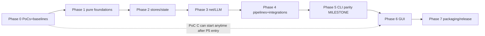

# 12 — Migration Roadmap

> Phased plan with entry/exit conditions and verification gates. Effort labels: XS/S/M/L/XL
> (relative, not time). Dependency graph is strict: a phase's entry condition is the previous
> phase's exit gate.

## Phase 0 — Foundations and proof points (before any engine work)

**Entry**: repo as-is; this blueprint accepted as the working plan.
**Work**:
- T-00 Reproduce the dev environment (Go toolchain; Python venv for differential runs).
- T-01 **PoC A: gotd/td** — login + bot-chat iteration + read-acknowledge over SOCKS on Windows
  (ADR-0004). Exit: working fetch of 100 messages, or the documented fallback decision.
- T-02 **PoC B: tls-client** — stdlib fetch gets 403 on a walled page; Chrome-profile fetch
  succeeds (ADR-0006). Exit: proof artifacts (statuses recorded), or utls fallback decision.
- T-03 **Differential harness skeleton** (`go-desktop/testdiff/`): case dirs, Python driver,
  comparator with normalization rules (doc 09 §3).
- T-04 **Performance baselines** captured (doc 07 §B.4 procedure; numbers recorded here — do not
  invent).
**Exit gate**: PoC verdicts recorded as ADR updates; harness runs one trivial case end-to-end
(e.g. `--version` output parity); baseline table filled.

## Phase 1 — Pure-foundation packages (byte-parity layer)

**Work**: port + golden-test `constants`, `links`, `storage`, `dryrun`, `prompts`,
`taxonomy`, `notebuilder` (sanitizers + note formats), config load/merge/save + user memory.
**Key risks**: semantics items 1–13 of `05-python-to-go-mapping.md` §3.
**Exit gate**: the corresponding characterization tests (ported from `test_core`,
`test_userconfig`, taxonomy tests) green; differential case "import-file grammar" matches; config
round-trip against a real `config.json` copy is byte-stable.

## Phase 2 — Stores and state engines

**Work**: `store` (SQLite plumbing) + `notestate`, `notereads`, `websitepipeline/state`,
`cache_db` (CacheDB), `link_tracker`, `vault_index`.
**Exit gate**: opening a real Python-created `cache.db` fixture passes read/write probes; the
moves-as-corrections suite (ported `test_phase1`-era cases) green; one-open law tests green
(`test_notereads` port).

## Phase 3 — Network and LLM layer

**Work**: `llmclient` (3 providers + detection + extract_json), `webfetch` ladder + rate limiter +
DoH + wayback, `webextract`, `netguard`/`connectioncheck`, `workerclient` (HMAC + UA law).
**Exit gate**: fake-server contract tests green (Ollama/OpenAI/Anthropic payload goldens; HMAC
loopback rig ported from `test_synclive`); redirect-chain parity tests; UA table asserted.

## Phase 4 — Pipelines and integrations (the engine room)

**Work**: `websitepipeline` (full state machine), `githubpipeline` + `batch`, `handdelivery`,
`chrometabs`, `vaultscan` + `vaulthygiene` + `repobanish`, `vaultseal` + `goodrepos` + `reporadar`
(real git tests), `directorysync`, `mirror/linking/embeddings/recall`, `telegram` (gotd
integration behind the PoC verdict).
**Exit gate**: differential cases: the 30-link golden set, banishment flows, scan-apply subset,
seal ladder on temp repos — all matching (normalized) Python outputs; the offline-golden-runner
equivalent passes in Go.

## Phase 5 — CLI parity milestone (first user-visible release)

**Work**: `internal/cli` full flag surface, terminal paint (ANSI/UTF-8 Windows hardening), the
`--sync` door, dry-run reports, `cmd/gitcurator-cli` packaging; `.bat` launcher equivalents.
**Exit gate**: the owner can run the Go CLI alongside the Python app on real data (dry-run
first); differential harness green on the full case list; **CLI parity release `0.92.0-go.1`**
tagged with the zip artifact.

## Phase 6 — GUI (Wails shell)

**Entry**: Phase 5 exit + **PoC C: Wails** (ADR-0001 gate: themed window + log desk + one job;
startup ≤ 1.5 s; log flood smooth).
**Work**: `internal/app` commands/event bus completion; frontend pages in dependency order:
main window chrome + log desk → settings pages (Vault, Credentials, LLM, Proxy, Input) → Bot
queue + Dashboard → Sync view (flow cards + matrix + differences modal) → Scan flow (picker →
plan → scorecard) → Backup page → sounds/theme toggle/dialogs polish.
**Exit gate**: GUI workflow tests green for the golden paths (sync → batch → seals; scan →
confirm → apply; sync-view refresh); performance criteria met (doc 07 §B.4); side-by-side lock
verified against the Python app.

## Phase 7 — Packaging, release, cutover

**Work**: deterministic zip builder, `1-INSTALL` equivalent, clean-machine checklist (doc 10 §7),
release workflow, docs (README-go, QUICKSTART update).
**Exit gate**: acceptance criteria (doc 15) demonstrated on a clean Windows VM; release
`GitCurator-v0.9x.0-windows.zip` (Go) attached to a GitHub release; owner sign-off.

## Phase 8 (post-parity, out of blueprint scope) — future work register

- Visual redesign (separate spec; doc 07 §D boundary).
- Linux/macOS builds; localization beyond what exists; the dormant cloud quartet revival;
  Worker-side improvements; UI polish backlog collected during porting.

## Amendment 1 — Owner Q&A re-scope (2026-10)

- **Phase 5 re-scoped** from "CLI parity milestone (first user-visible release)" to **"engine
  parity milestone (internal)"**: the CLI surface is still built and gated by the differential
  harness (it is the engine's proving ground, test driver, and emergency fallback), but
  owner-facing CLI polish (terminal-paint hardening, `.bat` launcher parity) is CUT and **no
  tagged CLI release** is produced (ADR-0007 Am.1).
- **Phase 6 (GUI) becomes the first owner-visible release milestone**; the tag + artifact ritual
  moves here — now dual artifact (setup.exe + portable zip) per ADR-0010 Am.1.
- **Phase 0 PoC C gains a bootstrapper dimension** (T-70): WebView2 is now *assumed absent* on
  the owner machine (updates stopped + Edge deleted — ADR-0001 Am.1), so the PoC must verify
  the silent Evergreen-bootstrapper path end-to-end on a WebView2-less Windows VM.
- Phase 1–4, 7, 8 and M1–M4 are unchanged. M5 becomes an internal gate (no owner-facing
  release); M6 absorbs the release-ritual duties.

## Amendment 2 — Owner Option-B stamp (2026-10-15, ADR-0004 Am.3)

- **Phase 4 loses the `telegram` (gotd integration) work item** — T-51 moves to the
  **Phase-8 future-work register** below. The desktop's bot queue rides the Worker HTTP API
  only (`/api/pending` — already in Phase 3's T-34 `workerclient` scope; zero Worker changes
  for the core flow). Read-acknowledge is dropped; a Worker read-ack endpoint joins the
  Phase-8 register as an optional revival. The Telegram single-slot lock and the Telegram
  leg of Test Connection fall away (ADR-0004 Am.3 lists the full consequences).
- **Phase-8 register gains**: *gotd/td Telegram leg revival* (capability proven by the T-01
  PoC on the owner's account — ADR-0004 Am.2; `poc/telegram` + the gotd v0.110.0 pin stay
  in the repo as the dormant proof; would restore read-ack badge-clearing,
  Saved-Messages/keyword/single-id modes, and chat re-read recovery).
- **Rider task R-0** (XS) is attached to Phase 1's session (SESSION-003): reconcile the
  remaining behavioral spec ripple (spec-core-connection, spec-cli `--sync` door,
  spec-gui-pages-b queue data source, spec-worker-contract note) per ADR-0004 Am.3 —
  docs-only, before T-10.
- Supersession note: the one-time re-login accepted in the owner Q&A (doc 14 §6 Round 1
  Q2) is void — no MTProto user login ever happens.

## Dependencies between phases (mermaid)

## Milestone summary

| Milestone | Definition of done | Evidence |
|---|---|---|
| M0 | PoC verdicts + baselines + harness skeleton | Phase-0 report |
| M1 | Foundations byte-parity | golden tests + differential case |
| M2 | Stores open real data | fixture DB tests |
| M3 | Contracts proven | fake-server + loopback rig |
| M4 | Engine parity | full differential corpus |
| **M5** | **CLI parity release (tag + zip)** | owner runs Go CLI on real data |
| M6 | GUI parity | workflow + perf gates |
| M7 | Go release | clean-machine checklist + acceptance doc |
