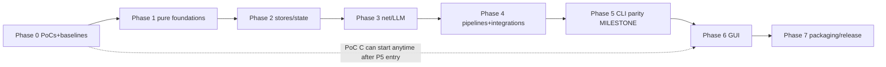

# 12 — Migration Roadmap

> Phased plan with entry/exit conditions and verification gates. Effort labels: XS/S/M/L/XL
> (relative, not time). Dependency graph is strict: a phase's entry condition is the previous
> phase's exit gate.

## Phase 0 — Foundations and proof points (before any engine work)

**Entry**: repo as-is; this blueprint accepted as the working plan.
**Work**:
- T-00 Reproduce the dev environment (Go toolchain; Python venv for differential runs).
- T-01 **PoC A: gotd/td** — login + bot-chat iteration + read-acknowledge over SOCKS on Windows
  (ADR-0004). Exit: working fetch of 100 messages, or the documented fallback decision.
- T-02 **PoC B: tls-client** — stdlib fetch gets 403 on a walled page; Chrome-profile fetch
  succeeds (ADR-0006). Exit: proof artifacts (statuses recorded), or utls fallback decision.
- T-03 **Differential harness skeleton** (`go-desktop/testdiff/`): case dirs, Python driver,
  comparator with normalization rules (doc 09 §3).
- T-04 **Performance baselines** captured (doc 07 §B.4 procedure; numbers recorded here — do not
  invent).
**Exit gate**: PoC verdicts recorded as ADR updates; harness runs one trivial case end-to-end
(e.g. `--version` output parity); baseline table filled.

## Phase 1 — Pure-foundation packages (byte-parity layer)

**Work**: port + golden-test `constants`, `links`, `storage`, `dryrun`, `prompts`,
`taxonomy`, `notebuilder` (sanitizers + note formats), config load/merge/save + user memory.
**Key risks**: semantics items 1–13 of `05-python-to-go-mapping.md` §3.
**Exit gate**: the corresponding characterization tests (ported from `test_core`,
`test_userconfig`, taxonomy tests) green; differential case "import-file grammar" matches; config
round-trip against a real `config.json` copy is byte-stable.

## Phase 2 — Stores and state engines

**Work**: `store` (SQLite plumbing) + `notestate`, `notereads`, `websitepipeline/state`,
`cache_db` (CacheDB), `link_tracker`, `vault_index`.
**Exit gate**: opening a real Python-created `cache.db` fixture passes read/write probes; the
moves-as-corrections suite (ported `test_phase1`-era cases) green; one-open law tests green
(`test_notereads` port).

## Phase 3 — Network and LLM layer

**Work**: `llmclient` (3 providers + detection + extract_json), `webfetch` ladder + rate limiter +
DoH + wayback, `webextract`, `netguard`/`connectioncheck`, `workerclient` (HMAC + UA law).
**Exit gate**: fake-server contract tests green (Ollama/OpenAI/Anthropic payload goldens; HMAC
loopback rig ported from `test_synclive`); redirect-chain parity tests; UA table asserted.

## Phase 4 — Pipelines and integrations (the engine room)

**Work**: `websitepipeline` (full state machine), `githubpipeline` + `batch`, `handdelivery`,
`chrometabs`, `vaultscan` + `vaulthygiene` + `repobanish`, `vaultseal` + `goodrepos` + `reporadar`
(real git tests), `directorysync`, `mirror/linking/embeddings/recall`, `telegram` (gotd
integration behind the PoC verdict).
**Exit gate**: differential cases: the 30-link golden set, banishment flows, scan-apply subset,
seal ladder on temp repos — all matching (normalized) Python outputs; the offline-golden-runner
equivalent passes in Go.
**GATE CLOSED (SESSION-026, 2026-10-18)**: the task list T-40..T-50 all landed (T-51 removed by
the Option-B stamp); SESSION-025's close-out evaluation — the stone-by-stone evidence table in
`docs/sessions/SESSION-025.md` — recorded 8 of the 10 named differential stones green with ONE
artifact outstanding (the table's last two rows are the SAME artifact: the 30-link golden set
and the offline-golden-runner equivalent). The closer landed as
`testdiff/goldens/dump_goldenwebsites.py` +
`internal/websitepipeline/goldenrunner_test.go`: the generator drives the UNMODIFIED reference's
own `tools/run_golden_websites.py --offline` (CI's mode) over its own
`tests/golden/websites.json` corpus — the fake LLM answering from the golden file, canned pages
feeding the fetch, a throwaway vault, clocks frozen at 2026-10-17 12:00:00, temp roots + the
reference app dir folded by REPLACE — into
`internal/websitepipeline/testdata/goldenwebsites.golden.json` (94,979 bytes, the generator
runs the payload twice and refuses to write unless byte-identical); the Go replay runs the
ported pipeline over the SAME corpus with the same seams and byte-compares the canned pages,
the 90-call LLM choreography (classify/classify/analyze per link — the analysis prompt carries
no `Website: ` line, so its answer is the default analysis: the quirk every golden note is
named "Golden test site" by), the first three prompts, the per-link results, the 30 produced
notes, the report, the console output, and the exit-code law — all green first run, the
mutation test (one byte in the golden) fails precisely, 1828/1828 tests race-clean over 30
packages. **Phase 4 CLOSED; Phase 5 (engine parity milestone per Amendment 1) OPENS.**

## Phase 5 — CLI parity milestone (first user-visible release)

**Work**: `internal/cli` full flag surface, terminal paint (ANSI/UTF-8 Windows hardening), the
`--sync` door, dry-run reports, `cmd/gitcurator-cli` packaging; `.bat` launcher equivalents.
**Progress (SESSION-027)**: T-60's first slice LANDED — THE CLI SHELL (the paint box, the
settings halves, the sync door's pure halves + beat 1a, the honest Option-B flag surface with
refusal cards for the Telethon accepted losses, the FULL --status card, --list-dead/
--reset-dead; the differential golden dump_cli.py → goldencli.golden.json → the Go replay
green, mutation bites; 1852 tests race-clean over 31 packages).
**Progress (SESSION-028)**: T-60's remainder LANDED — THE COMMAND WIRINGS (the --init
wizard with the repo radar over the RadarAll seam + the honest Option-B closing card,
--test-connection over the ported battery with the _section/_check_line renderers and
every Option-B divergence asserted, --detect-llm with the model menu + cli_settings's
model-menu half, --hand-delivery complete, --chrome-retry's listing + full dry-run
rehearsal with the reality-wins dry-run-switch fix; the golden grew to 9 more sections
incl. the wizards' saved-config bytes + the enqueue's writes — 48,698 bytes two-run
byte-identical, the mutation teeth grew; 1866 tests race-clean over 31 packages). Only
T-61's remaining paint legs ride with T-62's engines.
**Progress (SESSION-029)**: T-62 slice 1 LANDED — THE RUN ENGINE'S DOORS (the preflights
with the model-picker bridge, run_config_card, the dry-run report writer, and THE
PHASE-5 CLEAR RE-SPEC — ADR-0004 Am.3's bounded open item — resolved on the evidence
chain and implemented: the all-clear verdict + the batch-complete mirror push as the
ack; the golden grew to 10 more sections incl. two saved configs — 69,028 bytes
two-run byte-identical; 1877 tests race-clean over 31 packages).
**Progress (SESSION-030)**: T-62 slice 2 LANDED — THE ENGINE + THE
DRIVERS — **T-62 COMPLETE**: run_batch_visual's synchronous shell over
the ported engines (the setup family, the warmup family, the websites
phase per website_phase.py's wiring, the Finish chain + the seals in
the reference's exact order, the Phase-5 CLEAR, the dry-run path, the
SIGINT drain + the 100 ms heartbeat ticker, the exit-code law) + the
Worker-queue fetch + the _bot_queue_job classification half + the
batch drivers (cmd_auto's wrong-vault guard + the >10 confirm,
cmd_sync's live beats, cmd_retry_failed, the import mode, the
chrome-retry live leg) + internal/platformintake. The golden drove the
reference's own engine over a fake Qt event loop — 86,570 bytes,
two-run byte-identical, eight reality-wins finds fixed in-commit;
1911 tests race-clean over 32 packages. Only T-61's remaining paint
legs ride ahead of T-63 (launchers).
**Progress (SESSION-031)**: **T-61 COMPLETE** (the close-out audit:
the paint box + NO_COLOR/TTY law + the spinner under the heartbeat +
the 65001 hardening all landed with tests — the runtime Windows-console
legs recorded as Phase 7's clean-VM items; ADR-0007 Am.2 records the
re-instatement of the CLI-facing legs) + **T-63 COMPLETE** — THE
LAUNCHERS: cmd/gitcurator-cli (the --cli strip law ported from main.py,
the --version stamp door, the exit pass-through), VERSION (0.92.0-go.1),
the launcher set in cmd/gitcurator-cli/ (the four .bats + gitcurator-cli.sh
+ the 1-INSTALL equivalent: ASCII+CRLF at byte level, the walk-up with
landmark VERSION, the exe run DIRECT with the reference's own --cli
defaults, EXITCODE echo + pause, the git-only install check — no
registry writes, no PATH mutations), and THE DISPATCH FLIP — the
session's reality-wins find: the T-62 drivers had landed but Run's
dispatch still answered not-yet cards for --auto/--sync/--retry-failed/
--import-file; the flip routes them to the real drivers. The
differential stone grew the launchers section (the reference's own
bytes recorded raw; shared grammar byte-compared; divergences asserted
both ways; mutation teeth on three surfaces) — 101,777 bytes two-run
byte-identical; 1922 tests race-clean over 33 packages. Only T-64 (the
corpus full run) and T-65 (the tag + zip) remain on Phase 5's books.
**Progress (SESSION-032)**: **T-64 COMPLETE** — THE DIFFERENTIAL CORPUS
FULL RUN: all 31 golden generators driven twice end-to-end against the
unmodified reference by the new corpus driver (testdiff/run_corpus.py);
every generator exit-0 both passes with the pinned-rev line; the
two-run byte-identical proof held (empty full-tree diff beyond the four
atomic pairs' documented timestamp churn); committed == regenerated
(the tree clean after pass 2). The fix loop's five finds were ALL
generator-side determinism bugs (three generators recorded raw mkdtemp
roots — folded to <TMP> now; dump_mirror's duplicate fixture had two
stems — the os.walk-order quirk, one stem now; the pair-stability
digest learned the notereads mtime_ns/epoch/scratch masks + the
websitestate dismissed-ledger tie order, unspecified on both sides) —
ZERO Go-port divergences; 1922 tests race-clean over 33 packages; the
harness case PASS; the report archived at
docs/poc-artifacts/t-64-corpus-full-run-report.md. Only T-65 (the
v0.92.0-go.1 tag + zip) remains on Phase 5's books.
**Progress (SESSION-032, part 2)**: **T-65 COMPLETE — THE CLI PARITY
RELEASE**: the zip-composition question resolved per the specs (the
minimal deterministic mkzip slice landed now — build/mkzip with doc 10
§2's laws + 5 law tests incl. byte-identity; T-80/Phase 7 keeps the
full builder per F4); the GUI-side launcher pair at the repo root
(GitCurator.bat with the honest GUI-milestone card,
GitCurator-DRY-RUN.bat running the CLI exe's safe first run; the
golden's launchers section grown to the reference's own app-root pair,
105,092 payload bytes two-run byte-identical, a fourth mutation
surface); config.example.json (the reference's own bytes) + the Go
WINDOWS-QUICKSTART.md; the exe built twice byte-identical (760942e4…)
and the zip built twice byte-identical — GitCurator-v0.92.0-go.1-
windows.zip, 12 files, 15,988,399 bytes, sha256 d2679a1d…; the tag
v0.92.0-go.1 at a39cb3d pushed; GitHub release 416838956 published
with the zip asset (the round-trip download verified byte-identical);
1927 tests race-clean over 34 packages. **PHASE 5's BOOKS ARE EMPTY
— the exit gate is GREEN**: the CLI parity release 0.92.0-go.1 is
tagged with the zip artifact, the differential corpus is green, and
the owner can run the Go CLI alongside the Python app on real data
(dry-run first).
**Exit gate**: the owner can run the Go CLI alongside the Python app on real data (dry-run
first); differential harness green on the full case list; **CLI parity release `0.92.0-go.1`**
tagged with the zip artifact.

## Phase 6 — GUI (Wails shell)

**Entry**: Phase 5 exit + **PoC C: Wails** (ADR-0001 gate: themed window + log desk + one job;
startup ≤ 1.5 s; log flood smooth).

> **SESSION-033 (2026-10-19): the Phase-6 entry gate is GREEN — T-70
> COMPLETE.** The gate re-run with ONE REAL JOB wired through (the
> note-state baseline over a 800-note fixture vault, via the guibridge/
> seam): first frame 266/679 ms over two runs (gate ≤ 1.5 s), the 10k
> flood 458,695/454,133 lines/s with 0 drops and 23–25 ms max handler
> time per batch, the real job 800 notes in 94–101 ms, the Windows exe
> CGO-free at 14.95 MB. Verdict: ADR-0001 Am.3; evidence:
> docs/poc-artifacts/t-70-gate.md. The Wails toolchain record (the pinned
> CLI v2.16.0, the nested webui/ module, the vanilla frontend step, the
> CGO story) surfaced BEFORE the first wails invocation: ADR-0002 Am.3
> (+ Am.4's boundary correction). Phase 6's work (T-71…) may proceed.
>
> **SESSION-034 (2026-10-19): T-71 COMPLETE — `internal/app` is real.**
> The composition layer landed in four slices (events/commands+lifecycle
> seams/DI root, commits 5453214 → 00f4cdb → eb74171 → this row's
> slice): the typed bus + the three ask-gates (the reference's
> identical 300/300/600 s windows, the headless + no-reader
> fail-fasts), the command surface over injected seams with the
> crash-safety wrapper and the one-batch law, the single-instance
> app.lock with PID healing, the watchdog, the startup passes at the
> reference's delays, the shutdown graces, and the production engines
> (the queue classification, the scan job with both confirm doors, the
> backup zip, the batch composition). 67 internal/app tests
> race-clean; the acceptance (the command contract tests + the
> lock/watchdog tests) GREEN. T-72 (the frontend foundation) is the
> next session's primary task.
>
> **SESSION-035 (2026-10-19): T-72 COMPLETE — the frontend foundation.**
> The thirtieth full wipe absorbed before work (everything rebuilt from
> the committed recipes; the webkit tree rebuilt + proven at both
> levels). The suite re-verification caught a REAL production race
> (deskbus's post-Stop push coin flip) — fixed deterministically, plus
> hygiene (52 mode flips, the orphan wails binary). T-72 in two slices:
> (a) the theme-token CSS golden + the icon-pack golden — three twins
> (Go tables, the CSS var dump, the JS pack) locked against two
> reference-generated goldens (dump_theme.py + dump_icons.py, CORPUS
> 33); (b) the production shell binding internal/app DIRECTLY
> (guibridge/ retired with its tests; the T-70 gate legs retired), the
> typed Bus → the deskbus → the cache-mirror desk, the startup passes'
> real lines, the single-instance lock before the window
> (AppLock.Refused added), the sync_card CTA band. The dissolution
> probe (Am.4's law, run FIRST): wails into the MAIN module forces
> x/net v0.56.0 + the 1.25.0 directive — BLOCKED by the authorized-pins
> law; the boundary stays nested, the owner's call in ADR-0002 Am.5.
> The acceptance GREEN: the token golden (6 uitheme tests) + the log
> perf test (headless transport: ≥1.07M lines/s through the REAL Bus,
> 0 drops; the gate leg end-to-end: first frame 283 ms, the 10k flood
> 434,782 lines/s producer-side, 22 ms max handler, 0 drops). 1994
> main-battery tests over 35 packages race-clean + 21 webui tests over
> 4 packages. T-73 (Settings pages A) is the next session's task; the
> vanilla-vs-vite call + the dissolution question remain the owner's.
**Work**: `internal/app` commands/event bus completion; frontend pages in dependency order:
main window chrome + log desk → settings pages (Vault, Credentials, LLM, Proxy, Input) → Bot
queue + Dashboard → Sync view (flow cards + matrix + differences modal) → Scan flow (picker →
plan → scorecard) → Backup page → sounds/theme toggle/dialogs polish.
**Exit gate**: GUI workflow tests green for the golden paths (sync → batch → seals; scan →
confirm → apply; sync-view refresh); performance criteria met (doc 07 §B.4); side-by-side lock
verified against the Python app.

## Phase 7 — Packaging, release, cutover

**Work**: deterministic zip builder, `1-INSTALL` equivalent, clean-machine checklist (doc 10 §7),
release workflow, docs (README-go, QUICKSTART update).
**Exit gate**: acceptance criteria (doc 15) demonstrated on a clean Windows VM; release
`GitCurator-v0.9x.0-windows.zip` (Go) attached to a GitHub release; owner sign-off.

## Phase 8 (post-parity, out of blueprint scope) — future work register

- Visual redesign (separate spec; doc 07 §D boundary).
- Linux/macOS builds; localization beyond what exists; the dormant cloud quartet revival;
  Worker-side improvements; UI polish backlog collected during porting.

## Amendment 1 — Owner Q&A re-scope (2026-10)

- **Phase 5 re-scoped** from "CLI parity milestone (first user-visible release)" to **"engine
  parity milestone (internal)"**: the CLI surface is still built and gated by the differential
  harness (it is the engine's proving ground, test driver, and emergency fallback), but
  owner-facing CLI polish (terminal-paint hardening, `.bat` launcher parity) is CUT and **no
  tagged CLI release** is produced (ADR-0007 Am.1).
- **Phase 6 (GUI) becomes the first owner-visible release milestone**; the tag + artifact ritual
  moves here — now dual artifact (setup.exe + portable zip) per ADR-0010 Am.1.
- **Phase 0 PoC C gains a bootstrapper dimension** (T-70): WebView2 is now *assumed absent* on
  the owner machine (updates stopped + Edge deleted — ADR-0001 Am.1), so the PoC must verify
  the silent Evergreen-bootstrapper path end-to-end on a WebView2-less Windows VM.
- Phase 1–4, 7, 8 and M1–M4 are unchanged. M5 becomes an internal gate (no owner-facing
  release); M6 absorbs the release-ritual duties.

## Amendment 2 — Owner Option-B stamp (2026-10-15, ADR-0004 Am.3)

- **Phase 4 loses the `telegram` (gotd integration) work item** — T-51 moves to the
  **Phase-8 future-work register** below. The desktop's bot queue rides the Worker HTTP API
  only (`/api/pending` — already in Phase 3's T-34 `workerclient` scope; zero Worker changes
  for the core flow). Read-acknowledge is dropped; a Worker read-ack endpoint joins the
  Phase-8 register as an optional revival. The Telegram single-slot lock and the Telegram
  leg of Test Connection fall away (ADR-0004 Am.3 lists the full consequences).
- **Phase-8 register gains**: *gotd/td Telegram leg revival* (capability proven by the T-01
  PoC on the owner's account — ADR-0004 Am.2; `poc/telegram` + the gotd v0.110.0 pin stay
  in the repo as the dormant proof; would restore read-ack badge-clearing,
  Saved-Messages/keyword/single-id modes, and chat re-read recovery).
- **Rider task R-0** (XS) is attached to Phase 1's session (SESSION-003): reconcile the
  remaining behavioral spec ripple (spec-core-connection, spec-cli `--sync` door,
  spec-gui-pages-b queue data source, spec-worker-contract note) per ADR-0004 Am.3 —
  docs-only, before T-10.
- Supersession note: the one-time re-login accepted in the owner Q&A (doc 14 §6 Round 1
  Q2) is void — no MTProto user login ever happens.

## Dependencies between phases (mermaid)

## Milestone summary

| Milestone | Definition of done | Evidence |
|---|---|---|
| M0 | PoC verdicts + baselines + harness skeleton | Phase-0 report |
| M1 | Foundations byte-parity | golden tests + differential case |
| M2 | Stores open real data | fixture DB tests |
| M3 | Contracts proven | fake-server + loopback rig |
| M4 | Engine parity | full differential corpus |
| **M5** | **CLI parity release (tag + zip)** | owner runs Go CLI on real data |
| M6 | GUI parity | workflow + perf gates |
| M7 | Go release | clean-machine checklist + acceptance doc |
